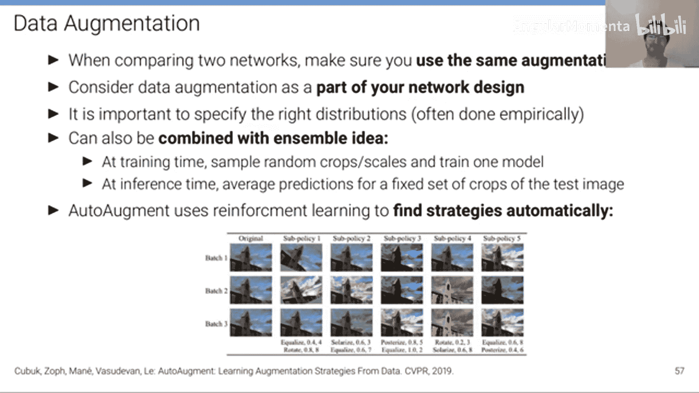

# 029：数据增强 🎨


在本节课中，我们将要学习一种重要的正则化技术——数据增强。数据增强通过对训练数据进行一系列简单的变换，来生成新的、多样化的训练样本，从而帮助模型学习到更鲁棒的特征，提高其泛化能力。


## 概述

假设我们要构建一个海獭检测器。从网络上收集的海獭图片中，我们可以看到海獭的姿态、颜色、光照和个体外观都存在巨大差异。我们的深度神经网络需要对这些输入变化具有不变性，才能正确识别所有海獭。

实现这种泛化能力的最佳方式是使用更多数据进行训练。然而在实践中，数据通常是有限的，因为数据的采集和标注成本都很高。数据增强的目标就是：在现有数据集的基础上，通过应用简单的变换，在训练过程中动态地生成新的“伪数据”，从而有效地扩充训练集。

重要的是，这些变换必须保持图像原有的语义。例如，我们不能把海獭变换成看起来像猫的图像。令人惊讶的是，即使是非常简单的操作，如轻微的平移或添加少量像素噪声，通常也能显著提升模型的泛化性能。

## 几何变换

以下是几种常见的几何变换方法，它们通过改变图像的空间结构来生成新数据。

### 随机裁剪
一种简单的数据增强方法是随机裁剪图像。将裁剪后的区域重新缩放到原始图像大小，以确保所有图像尺寸一致。需要注意的是，裁剪区域不宜过小，否则会丢失语义信息，导致无法识别物体。

```python
# 示例：使用库进行随机裁剪
transform = RandomCrop(size=(224, 224))
augmented_image = transform(original_image)
```

### 裁剪与填充
这种方法与随机裁剪类似，但在裁剪后，会对图像的边界进行填充。填充可以使用恒定颜色、复制图像边缘颜色或其他策略。

### 水平翻转
水平翻转图像是另一种常用方法。通常以一定的概率（例如0.5）决定是否对图像进行翻转。但这种方法是否适用取决于具体任务。例如，在涉及交通规则（如靠右行驶）的场景语义分割任务中，水平翻转可能会产生不符合现实的数据。

### 仿射变换
仿射变换是一种线性变换，可以对图像进行旋转、缩放、剪切等操作。对于变换后出现的空白区域，可以采用恒定颜色填充或从图像边界复制颜色等策略。


### 分段仿射变换与透视变换
分段仿射变换在图像局部网格上应用不同的仿射变换，实现更局部的扭曲效果。透视变换则自由度更高，能模拟图像平面上的透视效果，使某些区域被挤压而其他区域被放大。


## 局部滤波与噪声

除了几何变换，我们还可以对图像应用局部滤波或添加噪声，以模拟不同的拍摄条件。

### 高斯模糊
对图像应用高斯模糊可以模拟不同对焦或运动模糊的情况。这有助于模型学会在不同清晰度下识别物体。

```python
# 示例：随机强度的高斯模糊
transform = GaussianBlur(kernel_size=(5, 5), sigma=(0.1, 2.0))
augmented_image = transform(original_image)
```

### 锐化与边缘增强
与模糊相反，我们也可以锐化图像或将其与边缘检测版本结合。但需注意，过度增强可能会使图像偏离合理的语义范围。

### 添加噪声
向输入图像添加像素噪声是一种非常通用且流行的数据增强技术。深度神经网络对噪声相当敏感，在训练中加入噪声有助于提升模型鲁棒性。

噪声类型包括：
*   **高斯噪声**：向每个像素独立添加高斯噪声。
*   **椒盐噪声**：以一定概率将像素设置为纯黑或纯白。
*   **随机遮挡噪声**：随机将图像中的某些区域置为黑色（如Cutout方法）。

此外，噪声不仅可以添加到网络输入，也可以添加到网络中间层（类似于Dropout的思想），从而在更高层次的表征上引入鲁棒性。

## 颜色变换

颜色变换对于许多数据集的成功至关重要，因为相机传感器、白平衡和光照条件都会导致颜色差异。

### 对比度与亮度调整
可以随机改变图像的整体对比度和亮度。也可以分通道调整，制造出色彩偏移的效果。

### 局部亮度调整与色调/饱和度变换
基于频率噪声局部调整亮度，或改变图像的色调和饱和度。这些变换可以模拟不同光照和色彩环境。

### 颜色反转与灰度化
将颜色反转或转换为灰度图像。虽然反转后的图像与现实世界差异较大，但仍可能对模型学习有益。

### 添加特效
可以添加一些简单的视觉特效来模拟不同天气条件，例如雪、云、雾等。这些效果通常可以高效计算，无需预先生成。

## 组合变换与注意事项

在实际应用中，我们通常会将多种变换随机组合，并应用于整个数据集的每一张图像，且最好在训练过程中动态生成。

### 随机组合变换
从定义好的变换集合中随机选择并组合多种效果，应用于每一个训练样本。

### 输出空间的变换
对于分类任务，通常不需要变换标签。但必须小心避免那些会改变语义的变换（例如，水平翻转手写字母“D”会得到“B”，旋转数字“6”会得到“9”）。

对于具有结构化输出的任务（如语义分割、关键点检测、边界框预测），如果对输入进行了几何变换，则必须相应地变换真实标签（Ground Truth）。对于深度预测等任务，变换则更为复杂。

## 实践要点与总结

*   **公平比较**：在比较不同模型时，必须使用完全相同的数据增强策略，否则性能提升可能归因于增强策略而非模型本身。
*   **网络设计的一部分**：将数据增强视为模型设计的一部分，选择计算高效的变换以便在GPU上动态进行。
*   **分布选择**：为变换参数（如裁剪范围、噪声强度）指定合适的随机分布范围，这通常需要通过实验和经验来确定。
*   **与集成学习结合**：数据增强可以与集成学习思想结合。例如，在测试时对同一张图片的不同裁剪区域进行预测并平均结果，可以提升性能。
*   **自动化搜索**：已有研究尝试使用强化学习等方法，自动地为特定数据集寻找最优的数据增强策略组合。



本节课中，我们一起学习了数据增强这一强大的正则化技术。我们介绍了包括几何变换、滤波噪声、颜色变换在内的多种增强方法，并讨论了在实际应用中组合使用这些方法以及需要注意的要点。正确使用数据增强能显著提升深度学习模型的泛化能力和鲁棒性。