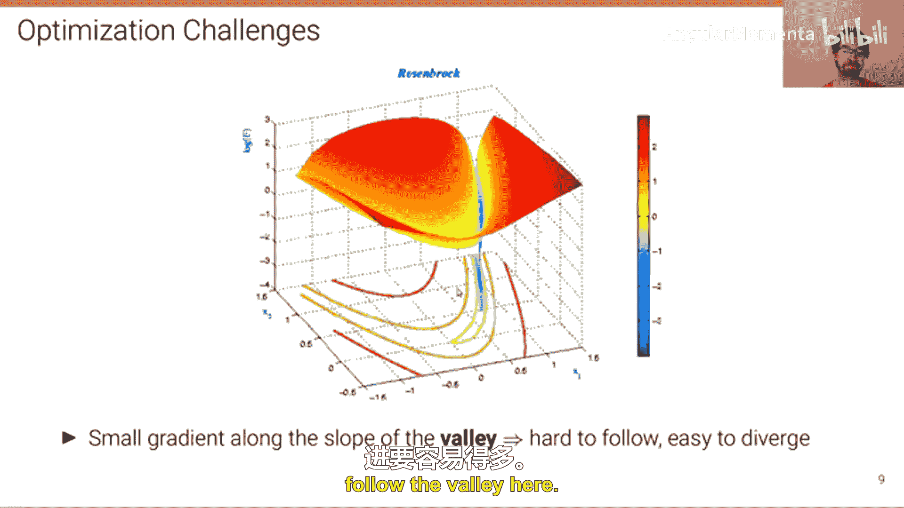

# 030：优化挑战 🎯

在本节课中，我们将要学习深度神经网络优化过程中面临的主要挑战。我们已经了解了梯度下降和随机梯度下降这两种最基本的优化方法。本节将深入探讨在优化深度模型时可能遇到的各种困难，例如局部最小值、学习率选择、悬崖、鞍点和高原等问题。

## 优化基础回顾

上一节我们介绍了梯度下降的基本概念，本节中我们来看看它在实际应用中可能遇到的问题。梯度下降的标准公式如下：

**公式：** `W_{t+1} = W_t - η * ∇L(W_t)`

其中：
*   `W_t` 是第 `t` 次迭代时的参数。
*   `η` 是学习率（步长）。
*   `∇L(W_t)` 是在 `W_t` 处计算的损失函数梯度。

我们从某个初始参数 `W_init` 开始，然后根据上述公式迭代更新参数。参数通常不会初始化为零，例如，基于零均值高斯分布的初始化是更好的选择。但在讨论简单低维优化问题时，初始化不那么关键。

## 主要优化挑战

以下是深度学习中常见的几种优化挑战。

### 1. 非凸性与局部最小值

深度神经网络的损失函数几乎总是非凸的。这意味着存在多个局部最小值，而不仅仅是单一的全局最小值。

**图示说明：** 在一个一维非凸函数中，根据梯度下降的起始点不同，优化器可能收敛到不同的局部最小值，而非全局最优解。

在神经网络中，一个有趣的事实是：许多局部最小值实际上是同等优秀的。例如，在一个多层感知机中，随机置换某一隐藏层中的神经元及其连接，会得到一个参数化不同但性能完全相同的网络。因此，尽管梯度下降可能无法找到全局最小值，但它找到的许多局部最小值在实践中仍然非常有用。

### 2. 学习率选择

学习率 `η` 的选择至关重要，它直接影响优化的速度和稳定性。

*   **学习率过低：** 优化过程会变得非常缓慢。越接近最小值，梯度越小，步长也越小，导致收敛速度极慢。
*   **学习率过高：** 可能导致**发散**。在凸函数（如抛物线）中，过高的学习率会使参数更新“越过”最小值，落到损失值更高的点。后续迭代中，梯度可能变得更大，导致参数在最优解两侧来回震荡，最终远离最优解。

### 3. 悬崖

损失函数景观中可能存在非常陡峭的区域，即“悬崖”。这些区域具有极高的梯度值。

**问题：** 当优化器进入悬崖区域时，巨大的梯度会将参数“弹射”到很远的地方，严重破坏优化进程，其效果类似于学习率过高导致的发散。

**应对策略：** 一个常用的启发式方法是**梯度裁剪**。它将梯度向量的每个元素限制在一个预先设定的范围内，防止过大的梯度对优化产生不利影响。

### 4. 鞍点

鞍点是梯度为零的点，但它既不是局部最小值也不是局部最大值。在某个方向上函数值上升，在另一个方向上函数值下降。

**图示说明：** 在一个三维曲面中，鞍点在一个方向上是谷底，在垂直方向上是峰顶。

在深度学习中，鞍点的数量相对于局部最小值呈指数级增长。这是因为在超高维参数空间中，所有维度同时朝同一方向（都向上）的概率极低，而部分向上、部分向下的组合则多得多。

**影响：** 鞍点本身只有在参数精确位于该点时才会导致优化停滞。但实践中，由于随机性，精确命中鞍点的概率很低。只要稍微偏离，梯度就会引导参数继续下降。

### 5. 高原

高原是指梯度接近于零的平坦区域。

**问题：** 在高原上，优化进展非常缓慢，甚至完全停止。这会导致训练时间大幅延长。

**常见原因：** 激活函数饱和（如Sigmoid函数在两端梯度接近零）或“死亡”的ReLU神经元（输出恒为零，梯度为零）。

### 6. 病态曲率

某些函数（如经典的Rosenbrock函数）具有狭窄而弯曲的峡谷状景观。

**挑战：** 沿着峡谷底部前进的方向梯度很小，但峡谷两侧的墙壁非常陡峭。优化器很容易在更新时“ overshoot”（越过）到峡谷壁上，从而被巨大的梯度弹射出峡谷，难以稳定地沿着最优路径前进。

## 总结

本节课中我们一起学习了深度神经网络优化面临的主要挑战。我们回顾了非凸损失函数中的局部最小值问题，探讨了学习率设置不当（过低或过高）的影响，并认识了悬崖、鞍点、高原和病态曲率等复杂地形给优化带来的困难。理解这些挑战是选择和设计更高级优化算法的基础。在下一节，我们将介绍能够更好应对这些挑战的优化算法变体。