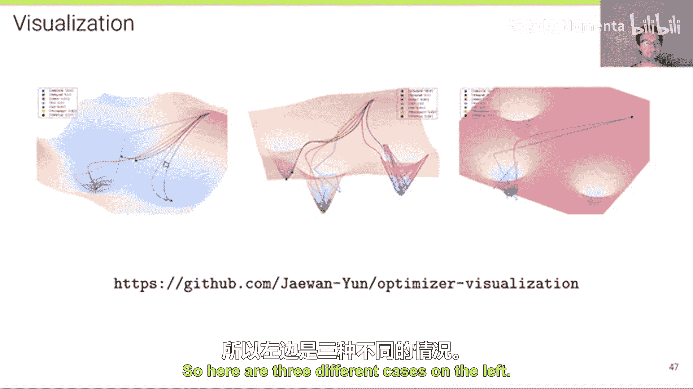
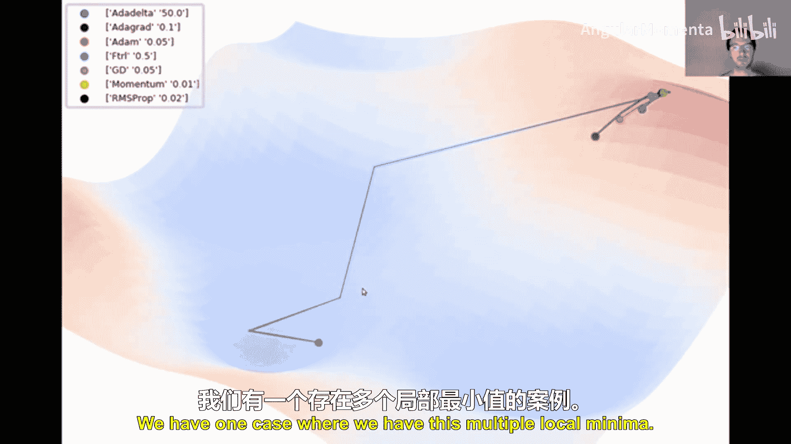
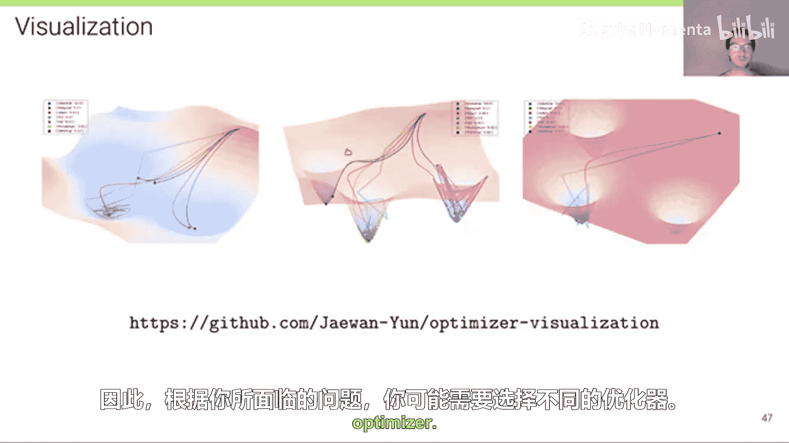
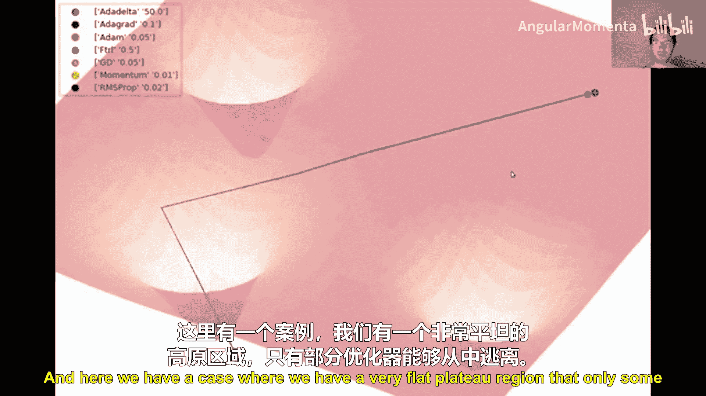
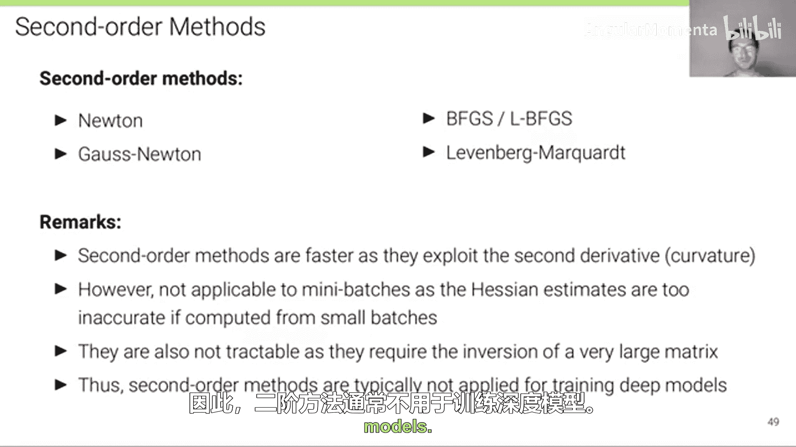

# 031：优化算法 🚀

在本节课中，我们将要学习深度学习中的核心优化算法。我们将从最基础的梯度下降法开始，逐步探讨其变体，如随机梯度下降、带动量的随机梯度下降、RMSProp以及目前最流行的Adam优化器。理解这些算法如何工作，以及它们各自的优缺点，对于高效训练神经网络至关重要。

## 回顾：标准梯度下降法 📉

上一节我们介绍了优化的基本概念，本节中我们来看看最基础的优化算法——标准（或“朴素”）梯度下降法。

该算法的步骤如下：

1.  初始化权重参数 `W0`（`0` 代表时间步或迭代次数）。
2.  选择一个标量学习率 `η`。
3.  对于数据集中的每一个数据点，执行以下操作：
    *   前向传播输入，计算预测值。
    *   从损失节点开始反向传播，计算损失函数相对于模型参数 `W` 的梯度。这是单个数据点的梯度。
4.  将所有数据点的平均梯度取负方向，移动一小步来更新参数。
5.  如果验证误差下降，则回到步骤2重复；否则停止。

然而，在深度学习中，我们通常要处理数百万个参数和大量的训练数据点，这使得上述更新步骤的计算成本非常高。同时，深度学习通常需要很多次更新，因此这种方法会变得非常慢，甚至无法放入GPU内存。

## 随机梯度下降法 🔄

为了解决标准梯度下降法效率低下的问题，在实践中我们使用随机梯度下降法。

其核心洞察是：在整个训练集上的总损失可以表示为一个期望值。这个期望值可以用数据的一个较小子集（即小批量）来近似。因此，真实的梯度也可以用基于这个小批量的梯度来近似。

以下是关于SGD的一些要点：
*   这个较小的数据集被称为**小批量**。在本课程中，我们通常用大写 `B` 表示批量大小。
*   应选择GPU内存允许的最大批量大小 `B`。通常 `B` 远小于数据集大小，例如 8, 16, 32, 64。
*   较小的批量大小会导致梯度方差更大，更新更“嘈杂”，但随着我们进行许多步更新，这种效应会随时间被平均掉。
*   批量可以随机选择，也可以在优化前对数据集进行分区。需要注意，在分区时应先打乱数据集，因为原始数据通常是顺序记录的，元素间可能存在相关性。

我们还需要明确两个术语：
*   **一次迭代**：基于单个小批量进行一次梯度更新。
*   **一个周期**：完整遍历一次训练集。如果小批量大小为 `B`，数据集大小为 `N`，那么一个周期包含 `N/B` 次迭代。

以下是SGD算法步骤：
1.  初始化权重 `W`，选择学习率 `η` 和小批量大小 `B`。
2.  随机抽取小批量数据。
3.  对于小批量中的每个元素：
    *   前向传播输入。
    *   反向传播梯度。
4.  沿小批量平均梯度的负方向移动一小步来更新参数向量。
5.  如果验证误差下降，则继续；否则停止。

这种方法允许在有限内存（如GPU内存）下进行训练，但同时也引入了随机性，因为批量梯度只是真实梯度的近似。

## 优化算法可视化示例 📊

为了直观地比较不同优化器，我们将使用一个简单的二维二次函数作为损失函数示例：
`L(W1, W2) = 0.1 * W1^2 + W2^2`
该函数在 `W1` 方向变化较缓，在 `W2` 方向变化较陡。其梯度为：
`∇L = [0.2 * W1, 2 * W2]`
为了模拟小批量带来的随机性，我们会在梯度上添加少量噪声。

现在，让我们将SGD更新规则 `W_{t+1} = W_t - η * ∇L_t` 应用于此问题。

*   **学习率过小**（如 `η=0.1`）：初期梯度较大时，步长尚可；但当接近谷底梯度变小时，步长也随之变小，收敛缓慢。
*   **学习率过大**（如 `η=1.01`）：模型剧烈振荡，甚至可能发散。
*   **“良好”学习率**（如 `η=0.99`）：振荡着接近最小值，但效率仍然不高，且由于固定学习率和梯度噪声，永远无法真正收敛到最优点并保持稳定。

## 学习率选择与SGD收敛性 ⚖️

如何选择合适的学习率？一种方法是**线搜索**，即计算当前小批量梯度后，通过求解一个优化问题来找到沿该方向最优的步长。然而，对于深度学习，每一步都需要解决大规模系统问题，计算成本高昂，且找到的步长仅对当前小批量最优，因此实践中并不常用。

关于SGD的收敛性，即使从最优解开始，由于梯度噪声，SGD也会步离最优点，始终在其周围振荡。这意味着**使用固定学习率 `η`，SGD实际上无法收敛**。

数学上，序列的收敛意味着存在一个极限，使得序列项最终能无限接近该极限。SGD的参数更新序列 `W_0, W_1, W_2, ...` 也类似。Robbins-Monro定理指出，如果学习率序列 `{η_t}` 满足：
*   `∑ η_t = ∞` （学习率衰减不能太快）
*   `∑ η_t^2 < ∞` （学习率衰减必须足够快）
并且梯度估计是无偏的，那么SGD更新序列将收敛到损失函数的一个局部最小值。
例如，满足条件的序列可以是 `η_t = η / t`。因此，**通过衰减学习率，可以保证SGD收敛**。

但SGD仍存在问题：所有维度的梯度被同等缩放，这要求我们选择非常保守（小）的学习率来避免发散，但这又会导致更新步长过小，进展缓慢。找到合适的学习率很困难。

## 带动量的随机梯度下降法 🏃♂️

为了解决SGD的振荡和缓慢问题，我们引入**带动量的SGD**。

观察SGD在示例中的表现：沿 `W2` 方向（陡峭维度）振荡剧烈，沿 `W1` 方向（平缓维度）进展缓慢。动量法的思想是：更新权重时，不仅考虑当前梯度，还引入过去梯度的指数移动平均，起到“阻尼”振荡和“加速”平缓方向的作用。

传统动量更新公式为：
`v_{t+1} = β * v_t - η * ∇L_t`
`W_{t+1} = W_t + v_{t+1}`
其中 `v` 是速度（动量），`β` 是动量系数（通常取0.9）。若 `β=0`，则退化为SGD。

更清晰的参数化（解耦学习率与动量）为：
`v_{t+1} = β * v_t + ∇L_t`
`W_{t+1} = W_t - η * v_{t+1}`

这实质上是在计算梯度的指数移动平均 `v_t`。`β` 越大，对过去梯度的记忆越长，平滑效果越强。动量法使SGD更高效，并允许使用稍大的学习率。

## Nesterov 加速梯度法 🚄

Nesterov 动量是动量法的一个改进变体。其核心区别在于：计算小批量梯度时，不是在当前位置 `W_t`，而是在一个“前瞻”位置 `W_t + β * v_t` 处计算。

更新公式为（解耦形式）：
`v_{t+1} = β * v_t + ∇L(W_t + η * β * v_t)`
`W_{t+1} = W_t - η * v_{t+1}`

这相当于先根据当前动量“跳一步”到预测的未来位置，然后在该位置计算梯度并进行修正。这种“前瞻性”更新使优化器响应更快，能更有效地减少振荡。它在训练循环神经网络等复杂模型时表现尤其出色。

## RMSProp 优化法 📈

RMSProp 的动机与动量法类似，但策略不同。它观察到梯度分布通常不均匀（如示例中 `W2` 方向梯度大，`W1` 方向梯度小），这迫使SGD使用保守的学习率。

RMSProp 的想法是：**根据每个参数维度上梯度平方的移动平均，来单独调整该维度的学习率**。对于梯度大的维度，除以较大的数来减小步长；对于梯度小的维度，除以较小的数来增大步长。

更新公式为：
`s_{t+1} = β_2 * s_t + (1 - β_2) * (∇L_t ⊙ ∇L_t)` // ⊙ 表示逐元素乘法
`W_{t+1} = W_t - η * ∇L_t / (√(s_{t+1}) + ε)`
其中 `s` 是梯度平方的指数移动平均（估计未中心化的方差），`β_2` 通常取 0.99，`ε`（如1e-8）是为防止除零的小常数。

RMSProp 能更快收敛。但一个问题是在初始迭代时，移动平均 `s` 偏向于初始值（通常为0），导致初期更新步长异常大（因为除以一个很小的数），产生“跳跃”行为。Adam 优化器将解决这个问题。

## Adam 优化法 🤖

Adam 是当前最常用、默认的优化器，因为它结合了动量法和RMSProp的思想，并具有鲁棒性和通用性。它同时保持梯度的一阶矩（均值，类似动量）和二阶原始矩（未中心化的方差，类似RMSProp）的指数移动平均，并进行偏差校正。

完整Adam更新公式如下：
1.  计算有偏一阶矩估计：`m_t = β_1 * m_{t-1} + (1 - β_1) * g_t`
2.  计算有偏二阶矩估计：`v_t = β_2 * v_{t-1} + (1 - β_2) * g_t^2`
3.  计算偏差校正后的一阶矩估计：`m̂_t = m_t / (1 - β_1^t)`
4.  计算偏差校正后的二阶矩估计：`v̂_t = v_t / (1 - β_2^t)`
5.  更新参数：`W_t = W_{t-1} - η * m̂_t / (√(v̂_t) + ε)`

偏差校正步骤 `3` 和 `4` 至关重要，它消除了初始迭代时 `m` 和 `v` 偏向于零的影响。数学上，可以证明未经校正的 `m_t` 的期望是 `E[g_t] * (1 - β_1^t)`，除以 `(1 - β_1^t)` 后即可得到无偏估计。Adam 通常能快速、稳定地收敛。

也存在结合 Nesterov 动量的 Adam 变体（Nadam），但在大规模问题上相比 Adam 优势不明显，因此使用不广泛。

## 优化器对比与总结 🏁

不同优化器在不同地形上的表现各异：
*   **多局部极小值问题**：不同优化器可能收敛到不同的局部极小点，且速度和振荡频率不同。
*   **陡峭地形**：梯度下降法可能振荡剧烈。
*   **平坦高原区域**：只有部分优化器（如Adam、RMSProp）能够有效逃离。

在实践中，深度学习框架实现了众多优化器（SGD, Momentum, RMSProp, Adam, Adagrad, Adadelta, Adamax 等）。**Adam 由于其鲁棒性和通用性，通常是首选的默认优化器。**

需要指出，在经典优化中常使用二阶方法（如牛顿法、拟牛顿法L-BFGS），它们计算或近似海森矩阵（二阶导数）。然而，这些方法不适用于深度学习中的小批量场景（估计不准确），且需要计算和求逆参数数量平方级别的矩阵，计算量巨大，因此通常不用于训练深度神经网络。

---

本节课中我们一起学习了深度学习的核心优化算法。我们从计算成本高昂的标准梯度下降法出发，引入了基于小批量的随机梯度下降法以提高效率。为了改善SGD的振荡和收敛慢的问题，我们学习了带动量的SGD及其改进版Nesterov动量。接着，我们探讨了通过自适应调整每个参数学习率的RMSProp方法。最后，我们详细介绍了结合动量和自适应学习率，并包含偏差校正的Adam优化器，它因其卓越的鲁棒性成为当前实践中的主流选择。理解这些算法的原理和适用场景，将帮助你为不同的深度学习任务选择合适的优化工具。