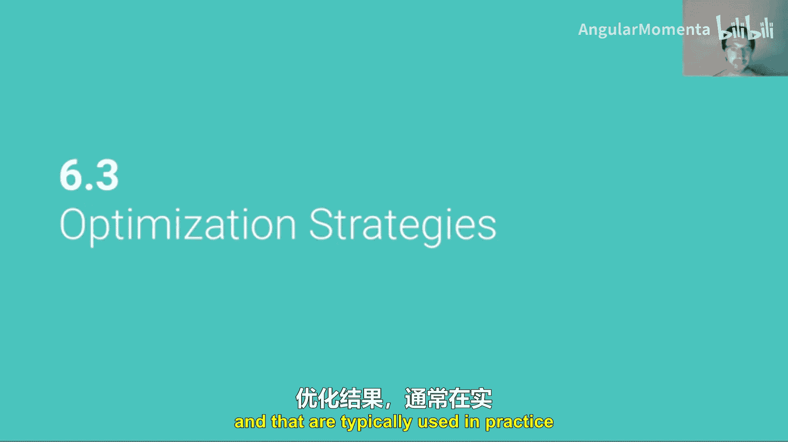
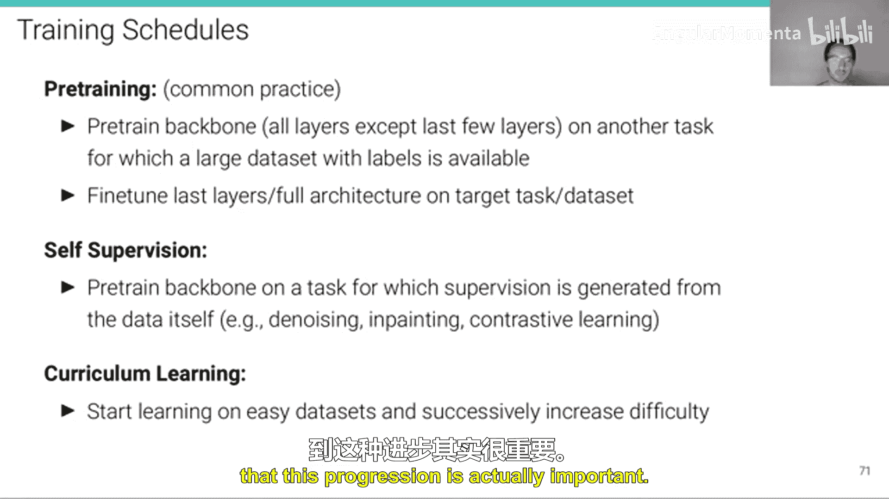

# 032：优化策略 🚀

在本节课中，我们将学习一系列实用的优化策略。这些策略能帮助我们在使用优化器的基础上，进一步提升深度神经网络的训练效果和稳定性。

上一节我们介绍了几种常见的优化器。本节中，我们来看看如何通过调整学习率、监控训练过程、选择超参数等策略来优化整个训练流程。

## 选择合适的学习率计划 📉

选择正确的学习率计划非常重要。我们已经知道，学习率应该逐渐降低。否则，模型会在最优值附近持续振荡。然而，学习率也不应下降过快，否则模型可能会被困在远离优质解的区域。

以下是几种常见的学习率调整方法：

*   **固定学习率**：这不是一个好方法。它无法收敛，并且在训练初期下降太慢，在后期又下降太快。
*   **反比例衰减**：这是一种流行的学习率计划，其动机源于罗宾斯-门罗定理。公式为：`η_t = η / (1 + βt)`。然而，这种衰减速度非常快，通常过快。此外，衰减系数 `β` 仍需手动选择和调整。
*   **指数衰减**：公式为 `η_t = η * α^t`，其中 `α` 是一个超参数。这同样需要手动设置初始学习率 `η` 和衰减率 `α`。
*   **阶梯衰减**：这是实践中最常见的方法。我们让模型在特定学习率下收敛，一旦发现其变化不大，就降低学习率。例如，将学习率减半。阶梯的位置（即何时降低学习率）通常基于实验来确定。

## 主动监控训练过程 📊

在训练过程中主动监控非常重要。这有助于我们直观理解训练进程和模型行为，从而判断哪些超参数需要调整、模型或数据是否存在普遍问题，或者是否应选择不同的优化器。

以下是观察学习曲线的一些示例：

*   **欠拟合**：如果训练损失和验证损失从一开始就无法显著下降，只有微小的线性减少，而没有初期急剧下降然后收敛的典型曲线，则可能表明模型容量不足，处于欠拟合状态。
*   **训练不足**：如果观察到损失在下降，但模型可能尚未收敛，那么通常只需要延长训练时间。某些模型可能需要训练数天甚至数周。
*   **过拟合**：如果训练损失持续下降，但验证损失开始再次上升，这就是我们之前见过的典型过拟合情况。此时可能需要使用正则化（如早停）或调整模型容量。
*   **验证集噪声过大**：如果训练损失收敛且曲线平滑，但验证曲线非常嘈杂且振荡，这可能意味着验证集选择得过小。验证集太小会导致评估结果噪声过大，失去意义。
*   **验证集比训练集更简单**：在某些情况下，验证集可能实际上比训练集更容易，这也会导致曲线异常。

为了有效监控，强烈建议使用社区提供的工具。一个几乎人人都在使用的优秀工具是 **TensorBoard**。它最初来自 TensorFlow 社区，但也有许多适配 PyTorch 的版本。它允许你在训练过程中轻松监控学习和验证曲线，以及其他指标如准确率。你还可以查看单个小批次、使用各种可视化方法查看样本、显示神经网络图以及激活的分布直方图。这对于调试神经网络至关重要。

## 选择超参数 ⚙️

超参数是所有不由梯度下降优化算法本身优化的参数。例如，神经网络的权重是参数，而不是超参数。但网络架构本身（不由梯度下降优化）、迭代次数、批次大小、学习率计划或不同正则化项的权重，这些都是超参数。

我们的模型中超参数的数量远少于参数数量，这很好，但仍有相当数量的超参数需要高效搜索。

高效搜索超参数空间是一个难题。目前最常见的情况仍然是基于直觉手动搜索：建立直觉、查看当前参数附近的局部区域、查阅文献（论文通常有专门章节说明如何选择这些参数）。从一个好的模型或相关模型开始，并据此选择超参数，是一个好策略。

当然，如果你有足够的计算资源，可以进行**网格搜索**或**随机搜索**。你定义一些范围，系统地尝试这些值，直到获得较低的验证误差。但这需要大量昂贵的训练运行。随机搜索与网格搜索类似，只是搜索点不是规则的网格，而是更随机。你还可以进行多尺度搜索：从粗糙的网格开始，然后逐步缩小范围。

结合人类建立的直觉仍然是个好主意，因为参数搜索空间仍然太大，难以高效地进行纯自动化搜索。值得一提的是，有一个完整的研究领域致力于自动化这个过程，即**神经架构搜索**。但许多此类算法需要大量计算资源和大型 GPU 集群，因此通常只有愿意投入这些资源的大公司才能使用。也有一些 NAS 算法尝试基于梯度的方法，但这要困难得多，而且这些算法通常只能操纵架构的较小组件，无法探索整个超参数搜索空间。

## 如何开始：从小处着手 🛠️

当你实现模型并想要训练和测试时，如何开始？一个糟糕的策略是构建整个模型，然后直接在完整数据集上运行。这几乎总是行不通，或者即使行得通，也可能给你一种它工作正常的错觉，但实际上并非如此。

一个好策略是**从小处着手**。甚至可以从单个训练样本开始，使用一个非常小的网络（可能只有你最终想开发模型的五分之一层数）。首先验证模型的输出是否正确。然后通过**过拟合**这一个训练样本，你可以看到训练过程是否有效，因为准确率应该达到 100%。你的模型在几乎所有情况下都应该足够灵活，可以精确拟合这个样本。如果这都做不到（你会惊讶于这种情况经常发生），那么肯定有问题，你需要先找到并解决它，否则所有后续结果都将毫无意义。

此外，当你在单个训练样本上用小网络过拟合时，调试周期非常快，这当然很重要。如果你训练模型三周后才发现错误，那就损失了三周时间；但如果能在几分钟内完成，你就能快速得到答案。

你需要选择一个好的学习率，应该选择实践中常用的值。一旦这步工作正常，你可以开始增加数据集规模，增加到 10 个训练样本（而非完整数据集），并再次验证输出是否正确。过拟合 10 个样本仍应产生接近 100% 的准确率。你还可以测量单次迭代的时间，以识别模型中的瓶颈（例如数据加载瓶颈）。一旦这些都正常工作且速度满足要求，你就可以将数据集规模从 100 增加到 1000、10000 个样本，同时开始增加网络规模。通过观察训练和验证曲线，你应该在某个时刻看到泛化效果。重要的是，一次只做一个更改，以便识别问题的潜在原因。

## 改善梯度流 🌊

梯度流非常重要。如果在反向传播期间没有良好的梯度流，某些参数就无法得到适当更新。因此，保持良好的梯度流至关重要，你应该可视化梯度流并确保它始终正常。

我们已经知道**初始化**非常重要。你应该使用适当的初始化方法，例如高斯初始化，使所有层的激活分布保持恒定（相同的均值和标准差）。

另一种在优化期间（不仅仅是初始化时）强制执行激活分布跨层恒定的技术叫做**批归一化**。批归一化的做法是，对于单个批次（`B` 是批次大小），分别计算每个通道激活的均值和方差（`C` 是通道或神经元）。然后减去均值并除以方差，得到在小批次上白化的信号。因为这不够灵活（任何之前添加的偏置都会被此操作消除），所以这里又添加了一个额外的可学习偏置。这样，你通过批次的均值和方差对每个通道进行归一化。这在训练时有效，因为我们可以对批次进行平均。在测试时，你只需取训练期间估计的均值和方差的运行平均值，并保持固定。这样，整个操作实际上就变成了一个线性操作，我们有了这个可学习的尺度和位移参数。我们可以在每个全连接层之后、激活函数之前添加这样一个批归一化层，这将有助于训练期间激活的分布。

批归一化有多种变体。除了默认的批归一化（在批次上归一化），还有层归一化（在层上归一化）、实例归一化，以及组归一化。这些主要适用于图像和卷积网络。

## 残差网络与深度模型 🧱

对于深度网络，一个特别棘手的问题是梯度传播非常缓慢。因为梯度是反向传播的，如果你需要反向传播很多层（可能数百或数千层），那么一旦到达早期层，梯度会变得非常小。有论文观察到，在 ImageNet 挑战赛中，随着网络越来越深，更深的网络性能往往比更浅的差。这与直觉相悖，因为如果你有一个浅层网络，并添加恒等变换作为层，那么深层模型在理论上至少应该和浅层模型一样好。

残差网络中提出的解决方案是，学习残差映射而不是经典的卷积或全连接层。这里有一个跳跃连接，这是残差网络中的一个块，网络中有许多这样的块。跳跃连接将输入添加到这两层的输出，使得这两层只需要学习 `X` 的增量，这要容易得多。因为现在实现恒等变换要容易得多：恒等变换就是让这两层基本上预测零，这样输入就直接作为输出传递。事实证明，这在模型中使用这些残差块来学习深度模型非常有帮助，如今这也已成为常见做法。

## 训练计划与课程学习 📚

如果你有一个小数据集，实践中通常通过**预训练**来提高性能。预训练意味着你预训练你的主干网络（即除最后几层特定于任务层之外的所有层）。例如，在 ImageNet 这样的大型带标签数据集上预训练主干网络。网络通过这个过程已经学习了很多关于图像如何形成的有用信息。然后，你可以在目标任务和数据集上微调最后几层或整个架构，这些数据集标注样本较少。事实证明，这能显著提高性能。因此，许多人从在某些任务上预训练网络开始，然后针对感兴趣的任务进行微调。这是一种迁移学习。

另一种策略是使用**自监督学习**，你在一个任务上预训练主干网络，该任务的监督信号来自数据本身（例如去噪或修复任务）。我们将在本课程后面更详细地讨论其中一些内容。

还有**课程学习**，对于某些任务（如光流估计）也极其重要。课程学习的理念是，从在一些简单的数据集上学习开始，然后逐步增加数据的难度。例如，在光流估计中，你从一些非常简单、复杂度不高的场景开始，为它们学习一个光流估计器。然后，你继续用越来越难的数据集进行训练，直到达到你感兴趣的真实数据集。事实证明，这对于某些任务获得良好性能非常有帮助。因此，让模型先学习简单的东西，然后再处理更难的问题，这很重要。这也与人类学习有关，实际上也观察到这种渐进过程很重要。

本节课中，我们一起学习了多种优化策略，包括学习率调整、训练监控、超参数选择、从小规模开始的调试方法、改善梯度流的技术（如批归一化）、用于训练深度网络的残差连接，以及预训练和课程学习等高级训练计划。掌握这些策略将帮助你更高效、更稳定地训练深度学习模型。