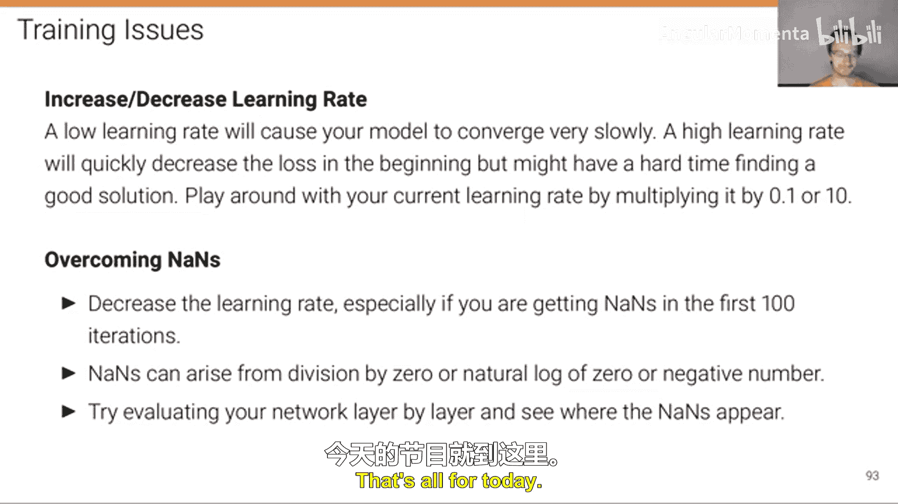

# 033：优化与调试策略 🐛


在本节课中，我们将学习如何识别和解决深度神经网络训练过程中常见的故障。我们将探讨一系列实用的调试策略，帮助你系统地定位问题根源，确保模型能够成功训练。

上一节我们介绍了优化算法的理论基础，本节中我们来看看如何将这些知识应用于实际问题排查。

## 数据集问题

检查输入数据是调试的第一步。确保馈送给网络的数据是正确且有意义的至关重要。

以下是常见的数据集相关问题及检查方法：

*   **检查输入数据**：打印并可视化几个批次的数据，确保图像尺寸、通道顺序、标签索引等正确无误。一个常见的错误是混淆了图像的宽和高。
*   **尝试随机输入**：用随机数代替真实数据进行前向传播。如果错误表现相同，则表明网络在某个环节将数据变成了无意义的垃圾。
*   **检查数据加载器**：数据在磁盘上可能完好，但加载到内存时可能因加载器错误而损坏。确保第一层之前的输入是正确的。
*   **确保输入与输出对应**：检查一些输入样本是否具有正确的标签。在打乱数据时，确保输入和标签以相同的方式被打乱。
*   **验证数据集噪声**：手动检查一批输入样本，查看标签是否错误。数据集中存在大量错误标签会阻碍网络学习。
*   **打乱数据**：创建小批量数据前打乱数据集，避免同一批次内的样本高度相关，影响学习效果。
*   **处理类别不平衡**：对于分类任务，如果某个类别的样本远多于其他类别，可能需要调整损失函数以平衡各类别的重要性。
*   **验证训练样本数量**：从头开始训练网络通常需要大量数据。对于图像分类，通常每个类别需要约1000张或更多图像。若数据不足，需加强数据增强或进行预训练与微调。
*   **确保批次随机性**：在分类任务中，确保每个小批量包含不同标签的混合样本，而非单一标签。
*   **从标准数据集开始**：测试新网络架构或代码时，首先使用MNIST、CIFAR-10或ImageNet等标准数据集。这些数据集有已知的参考结果，能帮助你确认模型基础能力。

## 数据标准化与增强问题

数据预处理不当也会导致模型无法收敛或性能不佳。

以下是相关的注意事项：

*   **标准化输入**：如果输入值范围差异很大，将其标准化（例如，零均值、单位方差）通常有助于训练。公式示例：`x_normalized = (x - mean) / std`
*   **避免过度数据增强**：数据增强具有正则化效果，但过度增强结合其他正则化方法可能导致网络严重欠拟合。
*   **检查预训练模型的预处理**：使用预训练模型时，确保在训练和测试阶段采用与原始模型完全相同的归一化和预处理策略（例如，图像像素值范围是[0,1]还是[0,255]）。
*   **统一预处理流程**：任何预处理统计量（如数据均值）应仅基于训练数据计算，然后应用于验证集和测试集。错误做法：在整个数据集上计算均值并减去，然后再划分训练、验证和测试集。

## 实现问题

代码实现中的细微错误常常难以察觉，需要系统性地检查。

以下是一些关键的实现检查点：

*   **先解决简化问题**：尝试解决一个更简单的任务版本，这有助于抽象理解问题，更快定位错误。例如，若目标输出是物体类别和坐标，先尝试仅预测类别。
*   **确保训练流程正确**：检查是否在训练和验证模式间正确切换；确保使用正确的输入；在反向传播前不要忘记将梯度置零。代码示例（PyTorch风格）：
    ```python
    optimizer.zero_grad() # 梯度清零
    output = model(input) # 前向传播
    loss = criterion(output, target) # 计算损失
    loss.backward() # 反向传播
    optimizer.step() # 更新参数
    ```
*   **检查损失函数**：如果实现了自定义损失函数，仔细检查其中是否有错误。可视化损失，并尽可能为其添加单元测试（例如，计算导数的数值差分进行验证）。
*   **验证损失函数输入**：使用框架提供的损失函数时，确保传入它期望的输入。例如在PyTorch中，负对数似然损失（`NLLLoss`）需要输入经过LogSoftmax的值，而交叉熵损失（`CrossEntropyLoss`）则直接输入原始逻辑值（logits）。
*   **调整损失权重**：如果总损失由多个子损失函数组成，确保它们之间的相对权重设置正确。通常应尽可能减少损失函数的数量以降低超参数复杂度。
*   **监控其他指标**：不要只看损失函数。使用准确率等其他指标来更全面地评估网络训练状况。
*   **测试自定义层**：如果网络中有自定义实现的层，务必反复检查，确保其按预期工作。
*   **检查输出格式**：确保网络输出格式与损失函数期望的输入格式匹配。
*   **检查冻结的层或变量**：确认是否无意中通过分离梯度等方式，禁用了某些本应可学习层的梯度更新。
*   **增加网络容量**：如果网络表现欠拟合，可能是其表达能力不足。尝试增加层数或隐藏单元数量。
*   **检查隐藏层维度错误**：使用张量时，很容易弄错维度。一个技巧是使用不同的质数作为输入维度，观察它们在网络中传播时，各中间层的维度是否正确。
*   **梯度检查**：如果手动实现了梯度下降或特定计算节点，并且没有使用自动微分，请使用数值微分等方法确保梯度计算正确。

## 训练问题

训练过程中的超参数设置和监控同样关键。

以下是训练阶段需要关注的重点：

*   **从小数据集开始**：这是非常重要的第一步。尝试在极小的数据子集（如一两个样本）上过拟合，以确保训练机制本身能够工作。这是一个必要条件。
*   **检查权重初始化**：如果不确定，使用Xavier或He初始化。糟糕的初始化可能导致陷入不良的局部最小值，尝试不同的初始化方式可能会有帮助。
*   **调整超参数**：可能当前使用的超参数组合不佳。尝试修改它们，如果可能，进行小范围的网格搜索。
*   **减少正则化**：过多的正则化（如Dropout、L2正则化）会导致网络欠拟合。尝试减少正则化强度。
*   **给予足够时间**：深度学习优化可能非常缓慢。如果损失在稳步下降，让模型训练更长时间，结果可能会持续改善。
*   **切换训练/测试模式**：确保在预测（测试）时，将模型切换到正确的模式。像Batch Normalization和Dropout这样的层在训练和测试时的行为是不同的。
*   **可视化训练过程**：监控每一层的激活值、权重和更新量。例如，参数更新的量级通常应在 `1e-3` 左右。可以使用TensorBoard等工具，或直接打印权重、偏置和激活值进行观察。
*   **留意激活值**：注意那些均值远大于0的层激活。在使用Batch Norm后，权重直方图应随时间呈现近似高斯分布。偏置的直方图通常从0开始，最终也趋于高斯分布。警惕那些变得异常大（发散）的参数。
*   **尝试不同的优化器**：优化器的选择通常不会阻止网络训练，除非超参数设置极差。但针对特定任务选择合适的优化器，有助于在最短时间内获得最佳训练效果。
*   **梯度爆炸/消失**：检查层更新值，过大的值可能表明梯度爆炸，此时梯度裁剪可能有帮助。同时检查激活值的标准差，理想范围通常在0.5到2之间。显著超出此范围可能表明梯度消失或爆炸。
*   **调整学习率**：过低的学习率会导致模型收敛极慢；过高的学习率初期损失下降快，但可能难以找到好的解甚至发散。尝试将当前学习率乘以0.1或10进行调节。
*   **处理NaN（非数值）**：NaN的出现通常源于除零、对零或负数取自然对数等操作。如果训练初期出现NaN，可能是模型发散了。尝试逐层评估网络，找出NaN首次出现的位置。



本节课中我们一起学习了深度神经网络训练中常见的故障类型和一套系统的调试策略。从检查数据、验证实现到监控训练过程，每一步都至关重要。记住核心原则：**简化问题、从小开始、逐步增加复杂性、并充分利用可视化工具**。通过耐心和系统性的排查，你将能更有效地解决训练难题，构建出性能优异的模型。