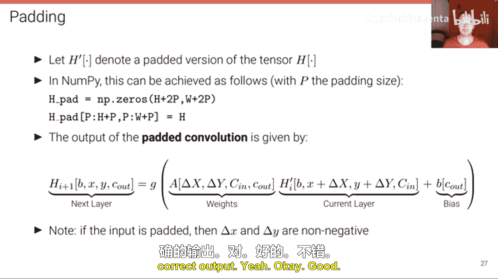

# 034：卷积 👁️

在本节课中，我们将要学习卷积神经网络的基础——卷积层。卷积神经网络是现代几乎所有处理图像输入的深度神经网络架构的骨干。我们将从卷积层的基本概念开始，理解其工作原理、数学表达以及它为何如此高效。

## 概述 📋

本节课是深度学习课程的第七讲，我们将聚焦于卷积神经网络。卷积层是CNN的核心组件，它通过局部连接和权值共享，极大地减少了参数数量，并引入了平移等变性这一重要的归纳偏置，使得网络能够高效地处理图像数据。

## 卷积层的基本概念 🧠

上一节我们介绍了卷积神经网络在图像分类任务中的成功应用。本节中，我们来看看构成这些网络的基础模块——卷积层。

在图像分类任务中，目标是构建一个模型，输入一张图像，输出其所属的类别（例如“公交车”）。传统方法依赖于手工设计的特征（如梯度、直方图），然后输入到分类器（如支持向量机）中。然而，这种方法在2008-2009年左右性能达到瓶颈。

直到2012年，随着现代卷积深度神经网络的出现，性能才得以大幅提升。深度神经网络无需手工特征，而是通过反向传播自动学习所有中间表示。对于图像输入，标准的多层感知机并非理想选择，而卷积层则为此量身定制。

一个典型的卷积神经网络（如VGG）包含三种层：
*   **卷积层**（白色）：提取特征。
*   **池化层**（红色）：降低特征图的空间维度。
*   **全连接层**（蓝色）：最终进行分类。

与MLP不同，卷积网络在操作中会保持特征图的空间维度，并逐步通过池化层缩小尺寸，同时增加特征通道数（即每个空间位置的神经元数量），最终通过全连接层输出类别概率。

## 卷积层的数学描述与实现 🔢

上一节我们了解了卷积层的直观作用。本节中，我们来看看如何用数学语言精确地描述它。

首先，我们引入贯穿本讲的符号约定：
*   **B**：批量大小。
*   **W, H**：特征图的宽度和高度。
*   **C**：特征通道数（每像素的神经元数）。
*   **C_in, C_out**：特定层的输入和输出通道数。
*   **K**：卷积核（滤波器）的大小（假设为K×K像素）。

与MLP的二维张量（B, C）不同，卷积层处理的是四维张量（B, C, H, W），它保留了空间维度。

### 全连接层 vs. 卷积层

以下是全连接层与卷积层的核心区别：

*   **全连接层**：输出层的每个神经元与输入层的**所有**神经元相连。参数数量为 `(W*H*C_in + 1) * (W*H*C_out)`，对于高分辨率图像，参数量巨大。
*   **卷积层**：输出层的每个神经元只与输入层中一个**局部区域**（如3×3）的神经元相连，并且**相同的滤波器权重**被应用于输入的所有空间位置（权值共享）。参数数量为 `(K*K*C_in + 1) * C_out`，参数量显著减少。

权值共享的直觉是：在图像中，无论物体出现在哪里，检测边缘或纹理等特征的滤波器应该是相同的。这大大提升了网络的数据效率。

### 爱因斯坦记号

为了简洁地描述卷积运算，我们使用**爱因斯坦记号**。在这种记号中：
*   小写索引（如 `i`, `j`）表示张量的单个元素。
*   大写索引（如 `I`, `J`）表示张量的整个维度（切片）。
*   乘积中重复的大写索引意味着沿该维度求和。

例如，矩阵乘法 **y = Ax** 可以写为 **y_I = A_I^J x_J**，其中对 `J` 的求和是隐含的。

### 卷积运算公式

使用爱因斯坦记号，卷积层的前向传播可以形式化地表示为：

**H_{b, x, y, c_out}^{(l+1)} = g( A_{c_out}^{c_in, \Delta x, \Delta y} H_{b, x+\Delta x, y+\Delta y, c_in}^{(l)} + b_{c_out} )**

其中：
*   **H^{(l)}** 和 **H^{(l+1)}** 是第 `l` 层的输入和输出张量。
*   **g(·)** 是激活函数（如ReLU）。
*   **A** 是卷积核权重，维度为 `(C_out, C_in, K, K)`。
*   **b** 是偏置项，维度为 `(C_out,)`。
*   求和是隐含的，对索引 `c_in`、`Δx`、`Δy` 进行。

这个公式清晰地表明：为了计算输出位置 `(x, y)` 处通道 `c_out` 的值，我们取输入中以 `(x, y)` 为中心的 `K×K` 局部区域，与对应的滤波器权重相乘并求和，加上偏置，最后通过激活函数。

**技术备注**：实践中，深度学习库实现的是**互相关**，而非严格的数学卷积（即滤波器不需要翻转）。这对网络的表达能力没有影响。

### 卷积核示例

虽然CNN的滤波器是学习得到的，但它们常常会学到类似传统图像处理中的滤波器。例如：
*   **高斯模糊核**：使图像变得平滑。
*   **Sobel边缘检测核**：突出图像中的边缘。

## 卷积的性质：平移等变性 ⚖️

上一节我们形式化地定义了卷积运算。本节中，我们探讨它的一个关键性质——平移等变性，这是CNN成功的重要归纳偏置。

首先区分两个概念：
*   **不变性**：对输入进行某种变换（如平移）后，函数的输出**保持不变**。
*   **等变性**：对输入进行某种变换后，函数的输出**以相同的方式被变换**。

卷积运算具有**平移等变性**。这意味着：如果我们将输入图像平移 `t` 个单位，那么输出的特征图也会被平移 `t` 个单位。用公式表达，对于平移操作 `T`，有：

** (A ⋆ T(H)) (x) = T(A ⋆ H) (x) **

**直观理解**：因为相同的滤波器被滑动应用于图像的每个位置，所以输入图像的移动会直接导致输出特征图的相应移动。

**重要性**：这种等变性是一种强大的归纳偏置。它告诉网络：“在图像中某个位置有用的特征，在其他位置也同样有用。”这极大地减少了需要学习的参数数量，提高了数据效率，是卷积网络在处理图像任务上取得成功的关键原因之一。

## 实现细节：计算图与填充 🛠️

上一节我们讨论了卷积的理论性质。本节中，我们来看看它在实现中的两个重要细节：如何在计算图框架中处理权值共享，以及如何处理边界问题。

### 权值共享与反向传播

在卷积层的计算图中，由于权值共享，**同一个滤波器参数**会被用于计算输出特征图的**每一个位置**。这意味着在反向传播时，损失函数相对于该参数的梯度，来自于所有应用了该滤波器的位置。

根据全导数法则，我们需要将所有流入该参数节点的梯度**累加起来**。这与普通全连接层中一个参数只接收一个梯度的情形不同。正是这种来自图像中大量位置的梯度汇聚，使得每个滤波器参数的更新信息非常丰富，从而实现了更高的数据效率。

### 填充

卷积运算在边界处会遇到问题：当滤波器中心位于输入图像的边缘时，滤波器的一部分会落在图像外部，导致无法计算。

直接忽略边界会导致特征图尺寸随着网络加深而不断缩小，这通常是不希望的。为了解决这个问题，我们引入了**填充**。

**填充** 是在输入特征图的边界周围添加额外像素（通常是0）的过程。假设使用 `K×K` 的滤波器，为了保持输入输出尺寸一致，通常需要在每边填充 `P = floor(K/2)` 个像素。

例如，对于一个 `3×3` 的滤波器（`K=3`），我们设置填充 `P=1`。这样，输入尺寸为 `(H, W)`，填充后变为 `(H+2, W+2)`，卷积后输出尺寸恢复为 `(H, W)`。

实现时，我们可以先创建一个更大的零张量 `H‘`，其尺寸为 `(H+2P, W+2P)`，然后将原始输入 `H` 复制到 `H‘` 的中心区域，最后对 `H‘` 应用标准的卷积公式。

## 总结 🎯

本节课中，我们一起学习了卷积神经网络的核心——卷积层。
1.  我们了解了卷积层通过**局部连接**和**权值共享**，以远少于全连接层的参数量来处理图像数据。
2.  我们使用**爱因斯坦记号**形式化地定义了卷积运算。
3.  我们探讨了卷积的**平移等变性**，这是CNN强大的归纳偏置，使其对图像中物体的位置变化具有鲁棒性。
4.  我们讨论了实现细节，包括权值共享在**反向传播**中的梯度累积，以及使用**填充**来处理卷积的边界问题，以保持特征图的空间尺寸。

卷积层是构建现代深度视觉模型的基石。在接下来的章节中，我们将以此为基础，探讨如何通过池化等操作构建更完整的网络架构。