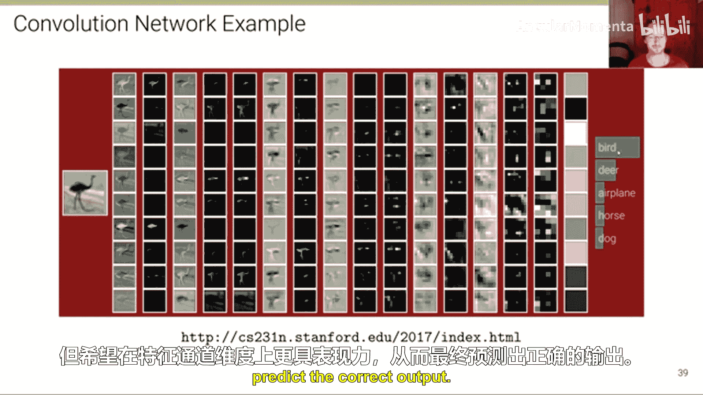

# 035：下采样

在本节中，我们将学习卷积神经网络中的下采样操作。我们将了解下采样的目的、常见的实现方式（如池化），以及如何计算卷积层输出尺寸。最后，我们会看到如何将卷积层的输出转换为全连接层所需的向量形式。

## 下采样的目的 🎯

上一节我们介绍了卷积操作，它保持了输入的空间分辨率。然而，下采样操作，例如最大池化，会降低空间分辨率。在下图中，空间分辨率从224x224降低到了112x112。

下采样在卷积网络中非常有用，主要有两个目的：
1.  逐步降低空间分辨率，最终得到描述整张图像的单一输出（例如一个分类标签）。
2.  通过观察图像中越来越大的区域，逐步聚合更多关于图像的全局信息。

图中的红色操作标记了池化操作，它逐步降低了空间分辨率。同时，它也增大了**感受野**，即影响特定神经元的输入区域范围。最终，网络末端的神经元会受到图像中每个像素的影响；而在网络开始的卷积层，只有非常局部的邻域会影响单个激活值。

## 池化操作 🧊

最简单且最常见的下采样操作之一是**池化**。池化有多种变体，例如最大池化、最小池化和平均池化。

池化操作没有参数。它对每个通道单独操作，在图像中取一个由池化核定义的特定区域（本例中为3x3），计算该区域的池化值（例如最大池化就是取最大值），并将该值放在输出对应的位置。然后，它以一定的**步长**移动，而不是查看输入的直接相邻像素。通常步长大于1，例如本例中步长为2，意味着它会跳过一些输入像素。

以下是池化操作的数学表达式。对于输出张量在位置 (x, y) 的值，我们计算输入张量在对应区域的最大值：

**公式：**
`输出[b, x, y, c] = max_{Δx, Δy} ( 输入[b, s*x + Δx, s*y + Δy, c] )`

其中，`s` 是步长，`(Δx, Δy)` 在池化核范围内遍历。可以看到，这个操作没有参数，只是一个最大值运算，并且对每个输入通道独立进行，因此输出通道数与输入通道数相同。

以下是一个具体示例，我们使用了步长为2、核大小为2x2的最大池化操作，它将空间维度缩小了2倍。

你可以看到，红色输出单元格对应红色输入单元格区域，其值6是红色输入区域中的最大值；绿色输出单元格对应绿色输入区域，其值4是绿色输入区域中的最大值，依此类推。

需要说明的是，最大池化对输入的小幅平移具有一定的不变性，这常被用作解释其有效性的理由。但在实践中，如今人们常用**步长卷积**来替代最大池化。

## 步长卷积 🚶‍♂️

步长卷积是一种标准的卷积算子，但其步长大于1。与没有参数的池化操作不同，步长卷积像普通卷积层一样拥有可学习的参数。它可以在不额外添加池化层的情况下降低空间分辨率。

其公式与标准卷积几乎相同，唯一的区别在于对输入位置的索引方式：

**公式：**
`输出[b, x, y, c_out] = σ( Σ_{Δx, Δy, c_in} ( 权重[Δx, Δy, c_in, c_out] * 输入[b, s*x + Δx, s*y + Δy, c_in] ) + 偏置[c_out] )`

其中 `s` 是步长。我们有效地将卷积滤波器在输入张量上移动 `s` 个像素，而不是1个像素。这是一种**可学习的下采样**方式，被用于许多现代网络架构（如ResNet）中。

## 感受野与尺寸计算 📐

**感受野**被定义为所有能影响特定神经元的输入像素的集合。例如，在一个两层网络中，如果我们想知道第二层某个神经元受哪些输入像素影响，我们可以从该神经元反向追溯。如果两层都使用3x3卷积，那么第一层中只有对应3x3区域的神经元会影响它。再进一步追溯，输入层中影响这些第一层神经元的区域，就是最终的影响区域（本例中为5x5）。这个区域的并集就是该神经元的感受野。

添加更多层或使用池化操作（其步长能更快扩大覆盖范围）会使感受野增长得更快。如果仅使用卷积层来缩小224x224图像的空间分辨率，速度会很慢（线性增长）；而使用池化下采样，速度则快得多。

在实现卷积神经网络时，正确计算每个张量的通道数和空间维度非常重要。空间维度取决于输入张量大小、滤波器大小、填充和步长。以下是计算输出空间维度的公式：

**公式：**
`输出宽度 = floor( (输入宽度 + 2*填充 - 核宽度) / 步长 ) + 1`
`输出高度 = floor( (输入高度 + 2*填充 - 核高度) / 步长 ) + 1`

其中 `floor` 是向下取整运算。我们给输入宽度加上两倍的填充（因为两边都填充），减去核宽度（因为卷积核会消耗一些空间），然后除以步长。如果结果是分数，则向下取整，因为无法处理缺失的输入，最后再加1。

例如，一个5x5的输入，填充为1，步长为4，核大小为3x3。计算过程：`(5 + 2*1 - 3) / 4 = 1.0`，取整后为1，再加1得到2。因此输出是2x2的张量。

## 全连接层 🔗

全连接层也是某些卷积网络架构的一部分。实际上，它们是卷积网络架构中**内存消耗最大**的部分，因为它们是全连接的（例如，一层4096个神经元连接到另一层4096个神经元），相比之下，卷积核的内存占用要轻量得多。

为了应用全连接层，我们需要将空间维度压缩（例如从7x7压缩到1x1）。具体做法与我们之前在MLP练习中将MNIST数字图像压缩为向量的方式相同：**展平**输入。

假设我们有一个大小为3x3x3的特征图（3个通道，3x3空间尺寸）。我们通过一个简单的重塑操作，将四维张量转换为二维张量。具体来说，我们将每个空间位置的所有通道特征拼接成一个大向量。

**代码/操作示意：**
`展平后的向量 = 将输入张量 [批量大小, 高度, 宽度, 通道数] 重塑为 [批量大小, 高度 * 宽度 * 通道数]`

这样，X和Y维度就被重塑到了特征通道维度C中。然后，我们就可以对这个向量应用标准的全连接层了。

## 网络示例与总结 🏁

下图展示了一个用于图像分类的简单卷积网络示例。你可以看到，第一列是卷积层激活前的输出，第二列是激活后的输出。接着是最大池化操作，它降低了空间分辨率。之后是更多的卷积和池化层。最后，通过一个softmax层来预测输出类别的离散分布。

在整个过程中，特征在空间维度上变得越来越粗糙，但在特征通道维度上则希望变得越来越具有表现力，以最终预测出正确的输出。

**本节总结：**
本节课我们一起学习了卷积神经网络中的下采样。我们了解了池化（如最大池化）和步长卷积这两种降低空间分辨率的主要方法，并探讨了感受野的概念。我们还学习了如何计算卷积层输出张量的空间尺寸，以及如何将卷积层的输出展平以输入到全连接层。下采样是构建深层、高效卷积网络的关键步骤，它帮助网络逐步从局部特征中提取出全局信息。