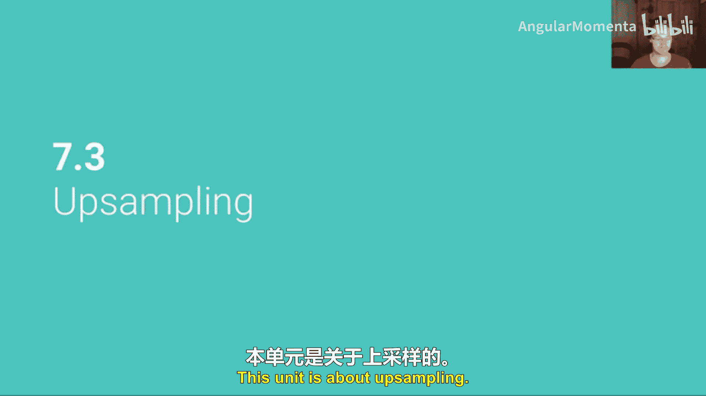
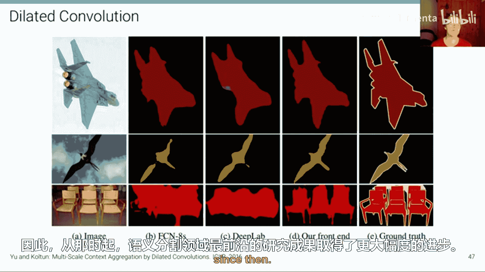
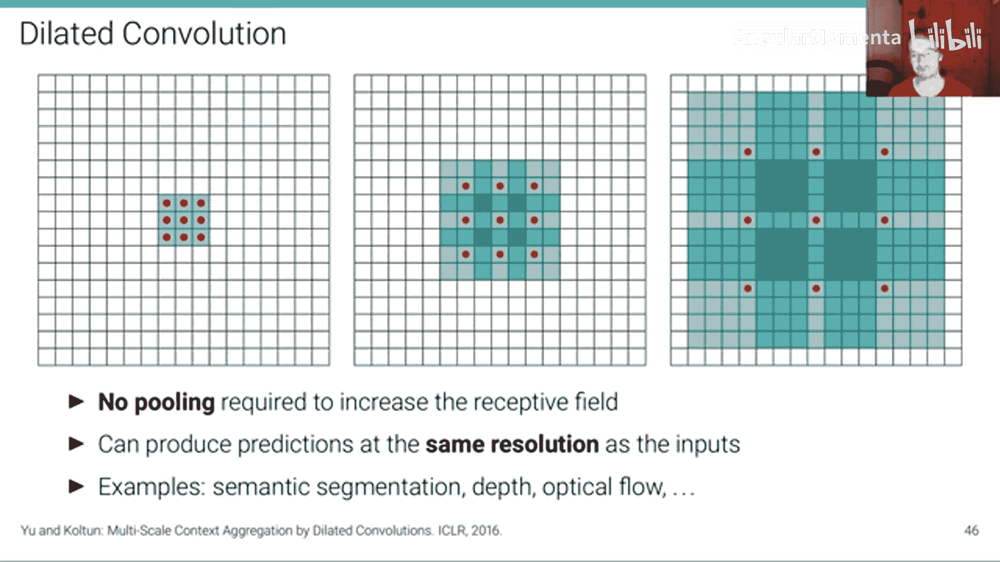
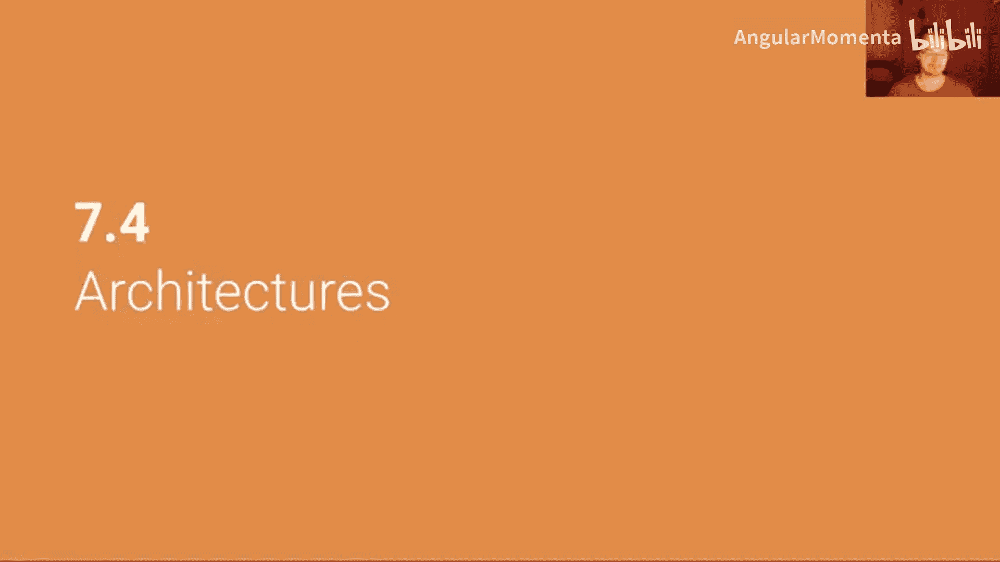

# 036：上采样

在本节中，我们将学习卷积神经网络中的**上采样**技术。上采样是许多像素级预测任务（如语义分割、深度估计）中的关键步骤，用于将低分辨率特征图恢复到输入图像的高分辨率。

在许多情况下，我们可能不满足于图像级别的预测，而是需要像素级别的预测。例如，我们可能希望预测每个像素位置的深度图、运动向量或语义标签图。就像这里的例子，对于输入图像的每一个像素，我们都需要确定其对应的语义类别标签，例如树木、水池、汽车、道路、人行道或建筑物。

如果目标是像素级预测，那么纯粹的下采样是不够的，我们还需要再次进行上采样。上图展示了一个典型的架构示例，它同时包含用于下采样的卷积和池化操作，以及用于从低分辨率恢复到高分辨率的上采样和卷积操作。

## 为何需要下采样与上采样？🤔

上一节我们介绍了下采样的必要性，本节中我们来看看为何需要上采样。首先，为什么需要下采样？如果不进行下采样，网络将无法快速聚合大范围图像区域的信息，也就无法获得具有**大感受野**的强特征。在网络参数数量有限的前提下，下采样是必要的。

上采样则能产生与输入图像相同分辨率的输出。为了保持高精度，特别是在物体边界处，通常会引入类似**跳跃连接**的结构，将来自网络浅层的信息直接传递到上采样层。这种编码器-解码器网络非常常见，因其形状常被称为**U-Net**架构。

## 上采样的实现方法 🛠️

有多种方法可以实现上采样。以下是几种常见的示例：

*   **最近邻上采样**：将输出中的每个元素简单地设置为输入特征张量中最近邻的值。
*   **双线性上采样**：基于输入像素的加权平均进行插值，通常会产生更平滑的结果。
*   **“钉床”上采样**：将输入值稀疏地插入到输出张量的对应位置，其余位置填充零，然后通过一个卷积层来填充这些缺失的部分。这种方法效果通常很好。

选择哪种上采样方法取决于具体应用，因为不同类型会产生不同的伪影。例如，双线性上采样结果可能过于平滑；“钉床”上采样中那些突出的非零值（“钉子”）有时在输出中仍然可见。每种技术都有其优缺点。

## 特殊的反池化：最大反池化 🔄

还有一种特殊的上采样方法叫**最大反池化**。在最大池化操作时，我们会记录下每个池化区域内最大值的位置。当在上采样阶段需要恢复某个特征图时，我们采用“钉床”表示法，但只在之前记录的最大值位置插入该值。

这种方法旨在保留一些高层次细节和结构，但它要求下采样层和上采样层必须成对对应，因此无法在任意的U-Net架构中随意实现。然而，这种方法曾被用于语义分割领域的奠基性网络之一——SegNet中。

## 上采样的替代方案：空洞卷积 🌐

除了先下采样再上采样，另一种替代方案是使用**空洞卷积**。使用空洞卷积，你无需进行下采样，因为它是一种在保持特征图空间分辨率不变的同时，增大感受野的技术。

在空洞卷积中，有一个乘数作用于输入张量的偏移量 `delta x`，这有效地分散了卷积核在输入上的采样位置。通过不同的空洞率 `d`，你可以获得一个非常大的有效感受野，而实际上并不需要更多的参数，因为它更稀疏地查询输入。

这种方法在一定程度上是有效的。但即使在原始论文中，为了使其真正有效，仍然需要一些标准的主干网络。其核心思想是，你可以在不增加参数或降低空间维度的情况下增大感受野。你可以在网络的末端，用极少的参数，在同一分辨率下细化你的输出，这通常效果很好。

下图展示了空洞卷积如何逐步增大感受野。

## 应用实例 📈

这种方法可以应用于语义分割、光流估计等任务。

上图是一个语义分割的例子。可以看到，标准的U-Net架构存在的问题，在一定程度上可以通过空洞卷积来缓解，因为它能更好地保留一些细节。需要说明的是，这张图来自2016年的论文，语义分割领域的最新技术成果自那时起已经取得了长足的进步。

## 总结 📝

本节课中，我们一起学习了卷积神经网络中的上采样技术。我们首先了解了为何在像素级预测任务中需要结合下采样与上采样，并介绍了经典的编码器-解码器（如U-Net）架构。接着，我们探讨了几种具体的上采样实现方法，包括最近邻、双线性、“钉床”上采样以及特殊的最大反池化。最后，我们学习了上采样的一种重要替代方案——空洞卷积，它能在不损失分辨率的情况下扩大感受野。理解这些技术是掌握语义分割等高级计算机视觉任务的基础。