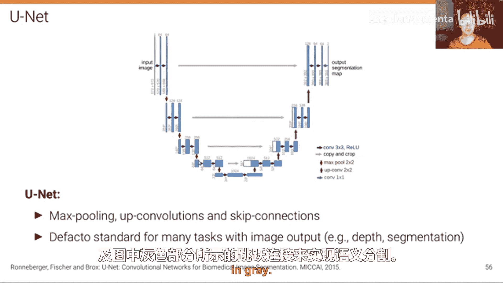

# 037：卷积神经网络架构 🏛️

在本节中，我们将学习一些经典的、更具历史意义的卷积网络架构，以及一些更近期的、最先进的卷积网络架构。我们将看到，在过去十年中，网络架构如何演变以实现更高的性能。

## 概述

我们将回顾从早期突破到现代设计的几种关键卷积神经网络架构。理解这些架构的演变，有助于我们把握设计高效、强大模型的核心思想。

---

## 经典架构的演变

上一节我们介绍了卷积神经网络的基本组件。本节中，我们来看看这些组件是如何被组合成具有影响力的网络架构的。

### LeNet-5：起点 🚀

卷积网络的起点可以追溯到LeNet-5。这是一个由Yann LeCun等人开发的、相对较浅的网络架构，它奠定了现代卷积网络的基础。

以下是LeNet-5的主要结构：
*   它仅包含两个卷积层、两个池化层和两个全连接层。
*   在ImageNet时代之前，它是在MNIST数据集上取得领先性能的架构。
*   其设计思路是使用卷积和下采样来降低空间维度，最后通过全连接层完成分类。

### AlexNet：深度学习的突破 💥

2012年，AlexNet的出现标志着深度学习的重大突破。它首次证明了结合多项技术（如ReLU、Dropout和数据增强）并利用GPU训练，可以将深度学习成功应用于像ImageNet这样的大规模数据集。

以下是AlexNet的关键特点：
*   它包含8层，由于当时GPU内存限制（仅3GB），其计算被分布在两个GPU上。
*   网络中出现了特征通道数随深度增加、空间分辨率随深度降低的趋势。
*   它结合了卷积层、最大池化层、ReLU激活函数，并使用了Dropout和数据增强来正则化训练。

### VGGNet：小卷积核的威力 🔍

2015年提出的VGG网络架构强调了使用小卷积核的重要性。它表明，使用堆叠的多个3x3小卷积核，可以替代单个大卷积核（如7x7），并获得相同甚至更大的感受野。

以下是VGG网络的核心思想：
*   使用更小的卷积核（3x3）可以减少参数数量，同时因为层数更多而引入了更多非线性。
*   它提出了两个主要变体：VGG-16和VGG-19。
*   其设计理念是构建更深但参数更少的网络，从而获得更好的泛化能力。公式上，两个3x3卷积层的感受野等同于一个5x5卷积层：`receptive_field = 2 * 3 - 1 = 5`。

### GoogLeNet (Inception)：并行与高效 🧩

同样在2015年，Google提出了GoogLeNet（或称InceptionNet）。这是一个22层的网络，比VGG更深，但参数却少了27倍，效率极高。

以下是GoogLeNet的创新之处：
*   它避免了使用庞大的全连接层，快速收敛到Softmax分类。
*   核心创新是**Inception模块**，该模块并行使用不同尺度的卷积（1x1, 3x3, 5x5）和池化操作，然后将结果拼接起来，类似于一个集成模型。
*   它使用了**辅助分类器**（侧枝输出）来帮助深度网络中的梯度传播。
*   广泛使用**1x1卷积**来灵活调整特征通道数，控制计算复杂度。1x1卷积的运算可以表示为对特征图在通道维度上的线性组合。

### ResNet：残差连接解决梯度问题 🌉

2016年的ResNet是另一个真正的突破，它使得训练极深的网络（如152层）成为可能，并成为当今大多数先进图像分类架构的基础。

ResNet成功的关键在于解决了深度网络训练中的梯度消失/爆炸问题。作者发现，简单地堆叠更多层数，即使模型有能力学习恒等映射，性能也会下降。

以下是ResNet的解决方案：
*   引入了**残差块**。在残差块中，层学习的是输入`x`与目标输出`H(x)`之间的残差`F(x)`，即 `F(x) = H(x) - x`。最终输出为 `H(x) = F(x) + x`。
*   这种设计让模型更容易学习恒等映射（当`F(x) = 0`时），极大地缓解了深度网络的优化困难。
*   残差连接已成为当今许多神经网络架构的标准组件。

### U-Net：用于图像分割的编码器-解码器结构 🎯

最后，我们看一下在生物医学图像分割领域流行起来的U-Net架构。它是一种编码器-解码器结构，专门用于产生像素级的输出（如图像分割）。

以下是U-Net的核心设计：
*   网络呈“U”形，左侧是下采样（编码）路径，用于捕获上下文信息；右侧是上采样（解码）路径，用于精确定位。
*   关键创新在于引入了**跳跃连接**，将编码器路径中高分辨率的特征图与解码器路径中相应层的特征图进行拼接。这帮助解码器在恢复空间细节时，同时利用高级语义信息和低级细节信息。

---

## 架构对比与总结

以下是不同网络架构在复杂度和性能上的对比概览：

*   **VGG-19**：参数多，模型大，计算慢，但性能扎实。
*   **GoogLeNet**：模型更小、更快，通过Inception模块和1x1卷积实现高效计算。
*   **ResNet及变体**：在模型大小、速度和准确率之间取得了更好的平衡，通过残差连接成功训练了极深的网络。

**总结**：本节课我们一起学习了卷积神经网络架构的演变历程。我们从简单的LeNet-5出发，见证了AlexNet带来的深度学习革命，理解了VGGNet中小卷积核的优势，领略了GoogLeNet的并行高效设计，掌握了ResNet通过残差连接解决深度训练难题的核心思想，最后了解了U-Net在图像分割任务中的编码器-解码器结构。这些架构的创新思想，如使用小卷积核、残差连接、跳跃连接等，至今仍是构建高效深度学习模型的基石。