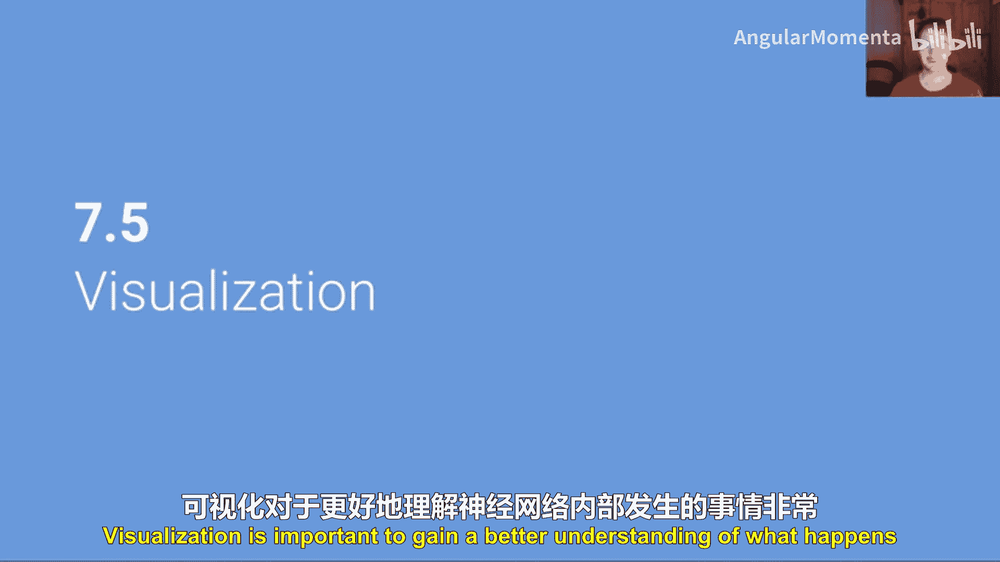
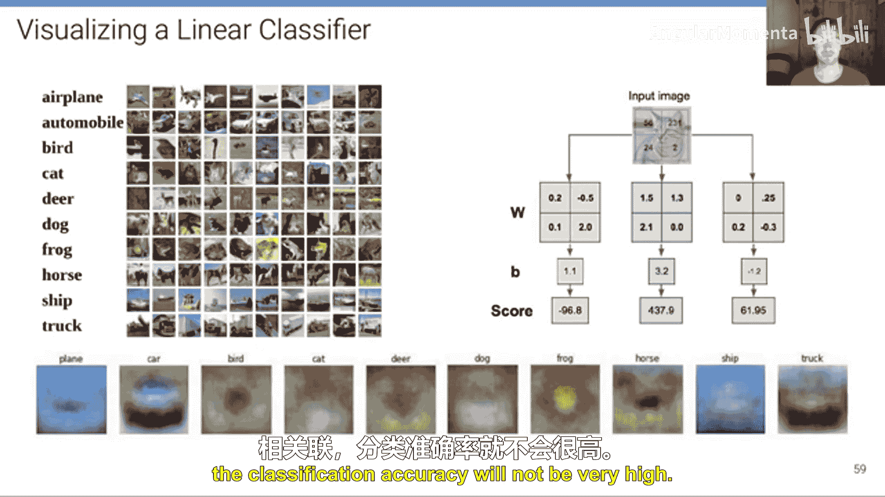
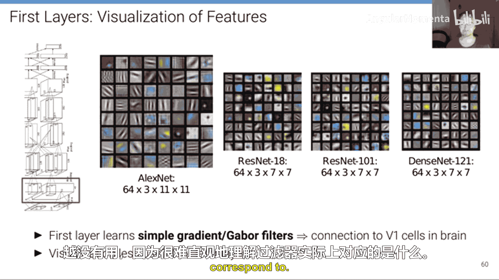
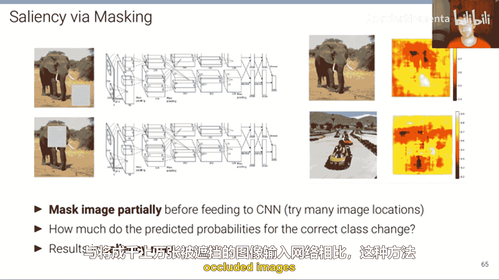
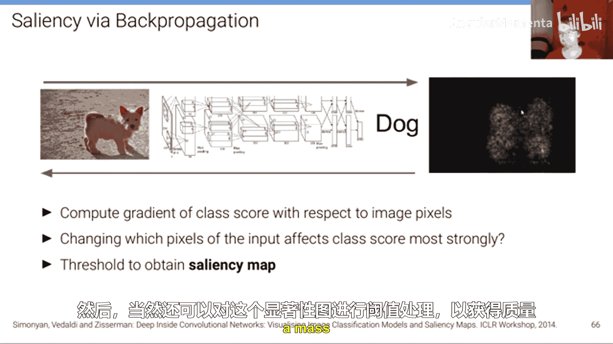
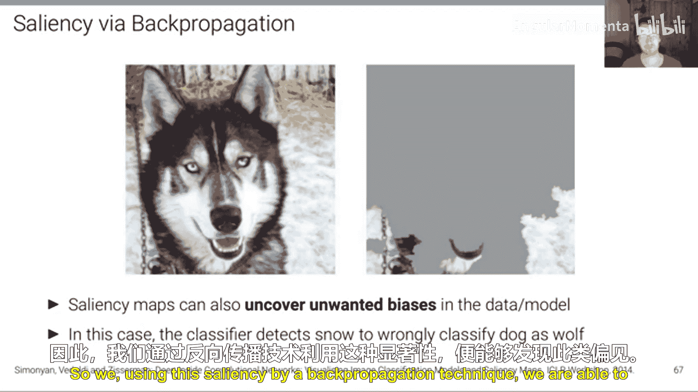

# 038：卷积神经网络可视化 🎨

在本节课中，我们将学习几种用于理解卷积神经网络内部工作机制的可视化技术。通过可视化，我们可以更好地洞察网络如何“看待”和处理输入数据，这不仅能帮助我们调试和改进模型，有时还能创造出有趣的艺术效果。

## 可视化的重要性

上一节我们讨论了卷积神经网络的结构与训练。本节中，我们来看看如何“打开”这个黑箱，理解其内部各层究竟在做什么。可视化对于理解网络学习到的特征至关重要。

## 浅层线性分类器的可视化

让我们从一个简单的模型开始，例如逻辑回归。这类模型的可视化相对容易，因为它本质上是一个单层网络。

以下是其工作原理：输入像素与一个权重矩阵 **W** 相乘，加上偏置 **b**，然后通过一个逻辑函数得到分数。公式可以表示为：

`score = σ(W * x + b)`

在这种情况下，我们可以直接查看权重矩阵 **W**。对于一个在特定数据集上训练好的分类器，如果我们将其权重矩阵可视化，会发现它看起来像是该类别物体的某种“平均图像”。这解释了为什么浅层模型分类效果有限：它仅仅是将输入图像与这个平均模板进行相关性匹配。

## 深层卷积网络的可视化

现在，让我们转向更复杂的模型，如AlexNet、ResNet或DenseNet。对于这些深层网络，最容易理解和可视化的是第一层。

以下是第一层卷积滤波器（filters）的可视化结果。可以看到，不同网络的第一层滤波器大小可能不同（例如AlexNet使用较大的核，ResNet-18使用较小的核），但它们都有一个共同点：第一层学习到的都是非常基础的图案，如边缘、颜色梯度或斑点检测器。这与人类大脑初级视觉皮层（V1区）提取基础特征的方式有相似之处。

然而，这种方法对于更深的网络层效果不佳，因为高层滤波器的功能不再直观。

## 理解高层特征空间

为了理解网络高层在做什么，我们可以分析其生成的特征表示。以AlexNet为例，我们可以取一张测试图像（如一朵花），让它通过网络，并提取倒数第二层（分类层之前）的4096维特征向量。

接下来，我们可以计算数据集中所有其他图像的特征向量，并在这个4096维的**特征空间**中，为测试图像寻找最邻近的图像（例如，使用L2距离）。结果显示，在特征空间中距离近的图像，在语义上也高度相似（例如，花对应花，大象对应大象）。相比之下，在原始**像素空间**中进行最近邻搜索，得到的结果在语义上则混乱得多（例如，船可能匹配到马）。

这表明网络成功地将图像映射到了一个语义丰富的特征空间。我们可以使用降维技术（如主成分分析PCA或t-SNE）将这个高维空间压缩到二维进行可视化。在MNIST数据集上的可视化结果显示，相似的数字在特征空间中确实聚集在一起。

这种语义丰富的特征表示也是**迁移学习**成功的原因：我们可以先在一个大型数据集（如ImageNet）上预训练网络，然后针对数据较少或任务不同的目标数据集，仅微调网络的最后几层，就能获得比从头训练好得多的结果。

## 最大化激活图像块

另一种技术是寻找“最大化激活图像块”。其思路是：针对网络中某个特定神经元（可以在任何中间层），我们让大量图像通过网络，并记录哪些图像或图像块能最大程度地激活该神经元。

以下是这种方法的结果示例。每一行代表网络中不同神经元的最大激活图像块。可以看到，不同神经元对不同类型的输入有响应，并且这种响应具有语义性。例如，某个神经元专门检测圆形物体（如眼睛、鼻子），另一个神经元对文字敏感，还有一个神经元专门识别人脸。这些功能是通过在分类任务上训练网络而自动涌现出来的。

## 通过遮挡理解输入重要性

我们还可以探究输入图像的哪些部分对网络的决策最重要。一种方法是**遮挡分析**。

具体操作如下：取一张图像，用一个小窗口依次遮挡图像的不同区域。对于每个被遮挡的图像，我们都将其输入网络并记录分类得分的变化（例如，图像被分类为“大象”的置信度下降了多少）。通过遍历所有位置，我们可以生成一张**显著图**，它显示了遮挡每个区域对分类结果的影响程度。

例如，对于一张大象图片，遮挡面部区域会导致分类性能下降最明显；对于一张汽车图片，遮挡最前面的汽车或背景中的轨道区域影响最大。这直观地展示了网络决策所依赖的图像区域。

## 通过反向传播生成显著图

另一种更高效的方法是**通过反向传播生成显著图**。与运行成千上万次遮挡实验相比，这种方法计算成本低得多。

其原理是：对于一张输入图像，我们计算网络输出（如某个类别的得分）相对于每个输入像素的梯度。梯度的大小表明了微调该像素会对分类得分产生多大影响。然后我们将梯度幅值可视化，得到显著图。图中明亮的区域（高梯度幅值）意味着改变这些像素会强烈影响分类结果。我们还可以对显著图进行阈值处理，得到一个二值化的掩码。

这种方法还能帮助我们发现模型或数据中不希望的**偏见**。例如，一个网络错误地将一只哈士奇（狗）分类为狼。通过显著图分析发现，网络做出判断的依据不是狗本身，而是背景——因为数据集中狼的照片多在雪地背景下拍摄，网络学会了通过“背景是否有雪”这个捷径来区分，而不是真正识别动物特征。可视化技术帮助我们揭示了这种有问题的学习模式。

## 反卷积与特征重建

2014年提出的一种流行技术是**反卷积**。其核心思想是从网络中的某个神经元出发，以相反的顺序重建网络，试图找出是输入图像的哪些区域最负责激活该神经元。对于池化层，该方法会记录前向传播时最大激活值的位置，以便在反向重建时能将信息传递回对应的图像区域。

以下是该技术在不同网络层的结果：
*   **第一层**：重建出简单的边缘和基础图案。
*   **第二层**：出现物体的局部结构。
*   **第三层**：出现更大的物体组合，如头部和躯干。
*   **第四、五层**：重建出完整的物体，如整张脸或动物面部。

## 深度学习与艺术生成

最后，这些可视化技术还可以用于创造艺术效果，即著名的 **DeepDream** 技术。其思想是：选择一张输入图像和一个网络层，然后通过梯度上升**放大**该层神经元对当前图像的激活。

具体做法是：将图像输入一个预训练好的网络（如ImageNet上训练的GoogLeNet），计算指定层的激活值，然后将该激活值本身设为梯度，通过反向传播来**修改输入图像的像素**，使得图像能更强地激活那些已经被激活的特征。通过迭代这个过程，可以在普通图像中“幻化”出网络学到的各种图案和物体，生成如梦似幻的艺术图像，例如在云彩中看到狗、蜗牛、骆驼鸟等奇幻生物。

## 总结

本节课中，我们一起学习了多种卷积神经网络的可视化技术。我们从简单的权重可视化开始，逐步深入到分析高维特征空间的语义、寻找最大化激活的神经元、通过遮挡和反向传播理解输入的重要性，最后探讨了利用反卷积进行特征重建以及生成艺术图像的DeepDream技术。这些工具不仅帮助我们揭开神经网络“黑箱”的神秘面纱，理解其决策依据，还能用于模型调试、发现数据偏见，甚至进行艺术创作。