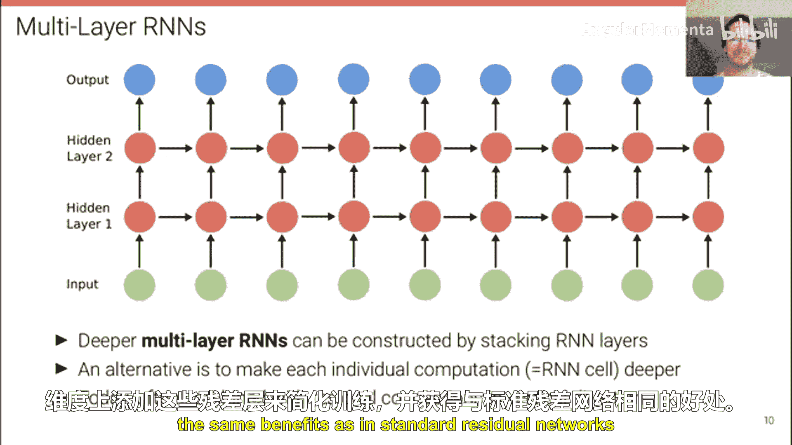

# 039：序列模型与循环神经网络

在本节课中，我们将要学习如何处理可变长度的序列数据。我们将介绍循环神经网络（RNN）这一核心模型，它能够处理输入、输出或两者长度均可变的序列，并广泛应用于机器翻译、图像描述等任务。

## 从固定输入到序列输入

在之前的课程中，我们讨论的模型，如多层感知机（MLP）或卷积神经网络（CNN），通常处理固定大小的输入，例如单张图像。这些模型首先将输入（如图像）转换为一个固定长度的向量，然后进行处理。

然而，在许多实际应用中，数据天然具有序列结构，例如文本句子、语音信号或视频帧。这些序列的长度是可变的。因此，我们需要能够处理可变长度序列的模型。循环神经网络正是为此类任务设计的强大模型。

## 课程结构概述

本节课的结构如下：
*   在第一单元，我们将介绍循环神经网络，这是深度学习中处理序列最著名的模型。
*   在第二单元，我们将探讨RNN的一些应用，以展示这类模型的灵活性。
*   在第三单元，我们将了解门控循环网络，它们能够克服普通RNN的一些问题。
*   在第四单元，我们将讨论自回归模型，这是一种纯前馈网络，但在许多序列任务上表现优异。

现在，让我们开始学习循环神经网络。

## 计算图回顾与RNN核心思想

首先，我们通过一个单隐藏层的多层感知机（MLP）来回顾前馈神经网络的计算图。该网络接收输入 `X`，经过隐藏层 `H` 处理，最终在输出层产生预测 `Y_hat`。网络中的每一层都有其对应的参数。

为了简化图示并专注于RNN的核心概念，后续我们将隐去参数节点，并引入新的颜色标识：绿色代表输入节点，红色代表隐藏计算层，蓝色代表输出层。

与前馈网络信息单向从输入流向输出不同，循环神经网络引入了**反馈连接**。其核心思想是存在一个**隐藏状态**，该状态会根据当前输入 `X_t` 和前一时刻的隐藏状态 `H_{t-1}`，通过一个参数共享的更新规则进行更新。

我们可以将这种带反馈的RNN在时间维度上“展开”。时间索引 `t` 可以代表任何序列顺序，在大多数应用中指时间步。展开后，我们得到一个看似前馈的网络结构，其中每个时间步的计算单元（称为RNN Cell）执行相同的操作，并共享同一套参数。

这种参数共享机制使得RNN能够处理任意长度的序列，因为模型参数数量不随序列长度增加而增加。理论上，RNN拥有“无限记忆”，因为隐藏状态 `H_t` 可以携带并传递从序列开始（`t=1`）到当前时刻的所有相关信息。不过，我们将在后续课程中看到，由于训练性问题，这种长程记忆能力在实践中可能受限。

## RNN单元详解

让我们更仔细地观察一个RNN单元。每个单元在时间步 `t` 接收两个输入：前一时刻的隐藏状态 `H_{t-1}` 和当前时刻的输入 `X_t`。单元的输出是当前时刻的隐藏状态 `H_t`。

其计算过程通常如下：
1.  将 `H_{t-1}` 和 `X_t` 拼接（Concatenate）成一个特征向量/张量。
2.  对该拼接后的向量应用一个变换函数 `F_H`，以生成新的隐藏状态 `H_t`。
3.  可选地，使用另一个变换函数 `F_Y` 基于 `H_t` 生成当前时刻的预测输出 `Y_t`。

关键点在于，函数 `F_H` 和 `F_Y` 的参数在所有时间步是共享的。

## 经典RNN：Vanilla Single Layer RNN

最基础的RNN实现之一是**Vanilla Single Layer RNN**。它使用仿射变换（线性变换加偏置）和Tanh非线性激活函数来定义隐藏状态更新，并使用另一个仿射变换来产生输出。

其数学公式如下：

**隐藏状态更新：**
`H_t = tanh(A_H * H_{t-1} + A_X * X_t + b)`

**输出预测：**
`Y_t = A_Y * H_t`

其中：
*   `A_H`, `A_X`, `A_Y` 是权重矩阵。
*   `b` 是偏置向量。
*   `tanh` 是激活函数。选择Tanh是因为其输出范围在[-1, 1]之间，且是零中心的，这对处理序列中多个时间步堆叠时的梯度问题有好处。

这些参数 `A_H`, `A_X`, `A_Y`, `b` 在所有时间步保持不变，这正是RNN能处理变长序列的原因。

我们也可以使用爱因斯坦求和约定来简洁地表示这些运算。此外，可以将权重矩阵 `A_H` 和 `A_X` 合并为一个更大的矩阵 `A`，同时将 `H_{t-1}` 和 `X_t` 拼接起来作为输入，这在计算上是等价的。

## RNN的映射类型

循环神经网络能够实现多种输入输出映射关系，非常灵活：

以下是常见的映射类型：
*   **一对一**：经典的前馈网络映射，非RNN典型应用。
*   **一对多**：单一输入，序列输出。例如，**图像描述**：输入一张图片，输出描述该图片的一句话（单词序列）。
*   **多对一**：序列输入，单一输出。例如，**动作识别**：输入一段视频（图像帧序列），输出一个动作类别（如“烹饪”、“跑步”）。
*   **多对多（异步）**：输入和输出均为序列，但长度可能不同，且元素间无严格对齐。例如，**机器翻译**：输入一种语言的句子，输出另一种语言的句子。
*   **多对多（同步）**：输入和输出均为序列，且每个输出元素与对应时刻的输入元素直接相关。例如，**视频目标跟踪**：输入视频帧序列，输出每一帧中目标物体的位置坐标。

对于需要生成变长序列的任务（如一对多、多对多），一个常见的方法是让模型学习预测一个特殊的**停止符号**（如`<EOS>`）。当模型输出该符号时，即表示序列生成结束。

## RNN的训练：随时间反向传播

训练RNN需要使用**随时间反向传播**算法。其思想很简单：对于序列中的每个输出预测，我们计算一个损失（与真实标签比较），然后将这些损失产生的梯度从序列末端开始，沿着时间步反向传播回网络的所有部分。

由于所有时间步的RNN单元共享参数，梯度会在时间维度上累积，类似于卷积网络中参数在空间位置共享时的梯度累积。

然而，BPTT在处理长序列时面临挑战：计算开销大、内存占用高，并且一次参数更新需要处理整个长序列，效率低下。这在处理长文章或视频时变得不切实际。

## 截断的随时间反向传播

为了解决长序列训练问题，实践中通常采用**截断的随时间反向传播**。其核心思想是：我们不通过整个长序列进行反向传播，而是将其分割成较短的片段（例如20-50个时间步），仅在每个片段内执行BPTT。

具体操作时，我们在一个片段内进行前向和反向传播，计算梯度并更新参数。然后，我们将该片段最后一个时间步的隐藏状态**前向传递**到下一个片段，作为其初始隐藏状态，并重复这个过程。这样，模型依然能保持一定的序列连续性，但训练变得可行。总的损失是各个片段损失的和。

## 构建更深的RNN

基础的Vanilla RNN通常比较浅。我们可以通过两种主要方式构建更深的RNN，以增加模型容量：

以下是构建更深RNN的方法：
*   **堆叠RNN**：将多个RNN层堆叠起来。第一层RNN接收输入序列，其输出（隐藏状态序列）作为第二层RNN的输入，依此类推。高层RNN可以学习到更抽象的时间特征。其公式可以扩展为包含层索引 `l`。
*   **深化RNN单元**：在每个RNN单元内部使用更深的神经网络（例如，多个全连接层加非线性）来代替简单的单层变换。

此外，像在CNN和MLP中一样，我们也可以将**残差连接**应用于堆叠的RNN层之间，以缓解深度网络中的梯度消失问题，从而训练更深的RNN模型。

## 总结

本节课中，我们一起学习了序列建模的核心——循环神经网络。我们了解了RNN通过参数共享和隐藏状态传递来处理可变长度序列的基本原理，探讨了其数学表达和多种输入输出映射类型。我们还介绍了训练RNN的BPTT算法及其在实际中常用的截断版本，并讨论了如何通过堆叠或深化单元来构建更强大的深度RNN模型。RNN为机器翻译、语音识别、文本生成等序列任务提供了强大的基础框架。