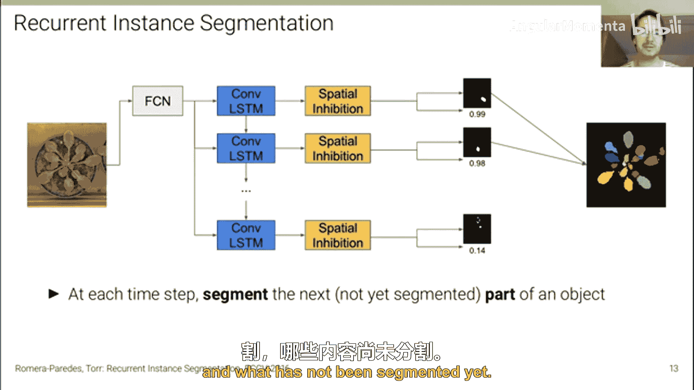
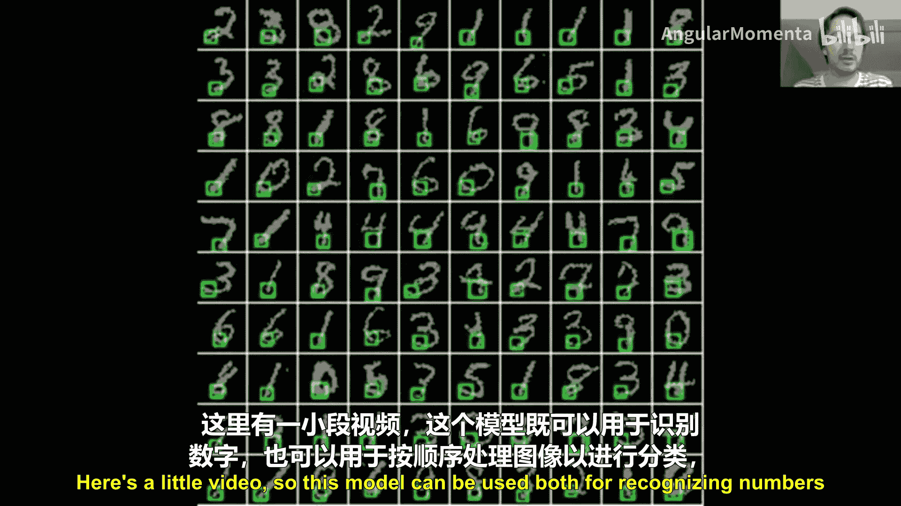
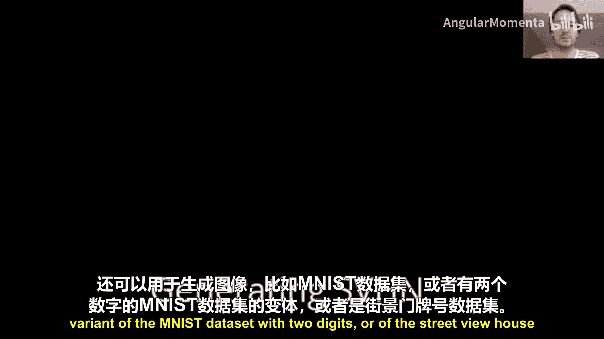
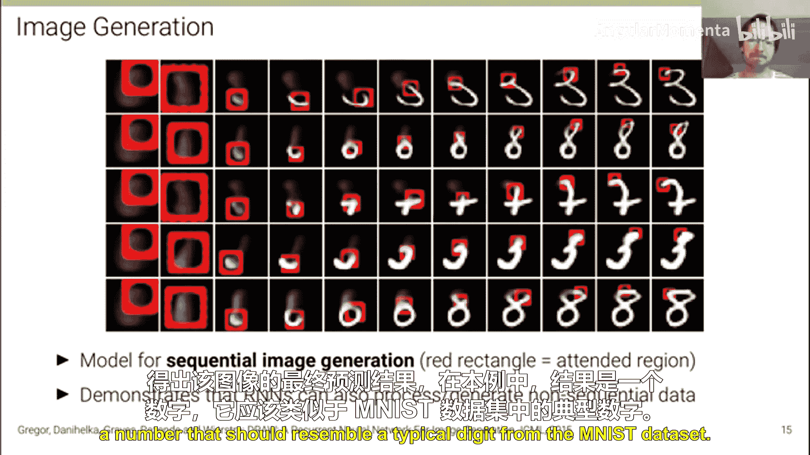
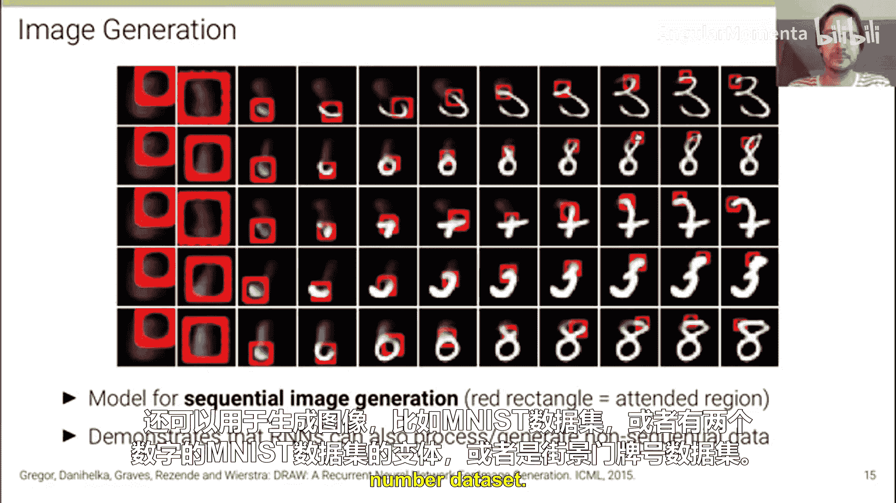
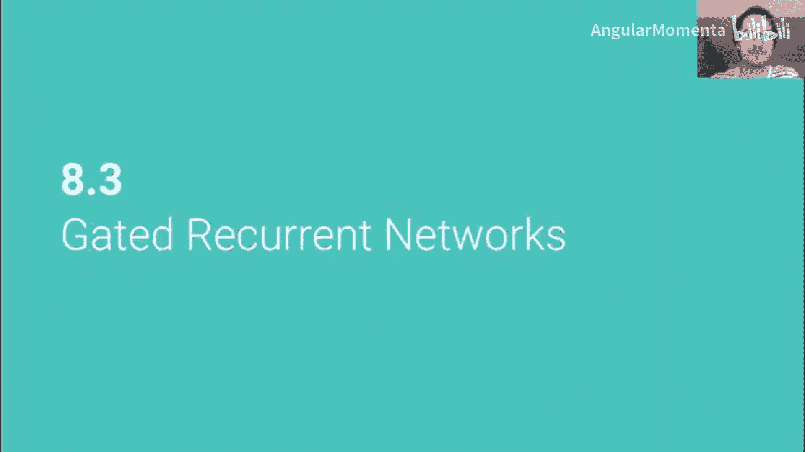

# 040：循环神经网络的应用 🧠

在本节课中，我们将学习循环神经网络（RNN）能够解决的一些具体应用。我们将看到，RNN不仅限于处理文本或时间序列数据，它们还能在计算机视觉、图像生成、机器翻译等多个领域发挥重要作用。

---

## 图像中的多对象识别 👁️

上一节我们介绍了RNN的基本原理，本节中我们来看看它在图像识别中的应用。一个典型的例子是识别图像中的多位数字（如门牌号）。

一种解决方法是部署一个RNN，让它像人类一样，迭代地关注图像的不同区域。模型在每个时间步会“瞥见”（glimpse）图像的一个小区域，然后预测下一个应该关注的位置（称为“扫视”，saccade）以及当前区域的类别标签（例如，一个数字）。

以下是该过程的核心步骤：
1.  **感知**：模型在时间步 `t` 关注位置 `L_t` 并提取该区域的特征。
2.  **预测**：模型基于当前信息，预测类别标签 `y_t` 和下一个关注位置 `L_{t+1}`。
3.  **迭代**：将预测的下一个位置 `L_{t+1}` 作为输入，重复上述过程，直到识别出所有数字。

这个过程可以用一个循环单元来描述：
`h_t = RNN(h_{t-1}, glimpse(I, L_t))`
其中，`h_t` 是隐藏状态，`I` 是输入图像，`glimpse` 函数从图像 `I` 中提取位置 `L_t` 周围的区域特征。

---

## 迭代实例分割 🎨

RNN也可以用于迭代地执行实例分割任务。在这种情况下，输入图像首先通过一个全卷积网络处理成特征图。

然后，一个卷积LSTM（ConvLSTM）RNN被用于该特征图。在每个时间步，模型预测并输出一个对象的分割掩码。如下图所示，不同颜色代表不同时间步输出的分割部分。

关键机制在于，模型会将之前所有时间步已生成的分割结果的并集，作为输入反馈到下一个时间步。这样，RNN就能知道哪些部分已经被分割，哪些还没有，从而避免重复分割并逐步完成整个图像的分割。

---

## 视频中的目标跟踪 🎬

在视频多目标跟踪任务中，RNN可以用来更新每个目标的内部状态表示。这个内部表示可以包含目标的位置、大小、外观、速度等信息。

通过在每个视频帧上运行RNN，模型能够维持并更新对每个被跟踪目标的记忆，从而在时间维度上实现稳定、连续的跟踪。

有趣的是，RNN也能应用于一些本质上并非严格序列的问题。

---

## 序列图像生成 ✍️

图像生成任务通常使用卷积神经网络（CNN）分层生成。然而，研究证明也可以按序列方式生成图像。

例如，在Gregor等人2015年的工作中，模型按顺序生成图像的各个区域。如下图所示，红色矩形框表示模型下一步将要绘制的区域。

模型首先生成物体的粗略轮廓，然后通过更精细的预测逐步细化，直到生成最终的完整图像（例如一个手写数字）。

这种序列生成模型具有多功能性。同一个模型架构既可以用于**识别**图像（如分类MNIST数据集中的数字），也可以用于**生成**图像（如生成新的手写数字或街景门牌号）。

---

## 图像补全与多模态输出 🌈

在Oord等人2016年的模型中，RNN被用于图像补全任务。给定一张被部分遮挡的图像（左），模型的目标是预测完整的图像（右）。

由于补全任务通常具有高度的模糊性和多模态性（即存在多种合理的补全方式），RNN的优势在于它能轻松输出像素强度的**概率分布**。

以下是生成多样化补全结果的过程：
1.  在每个时间步，RNN输出下一个像素值的概率分布（通过softmax函数）。
2.  从该分布中**采样**一个具体的像素值。
3.  将采样得到的像素值作为输入，馈送到下一个时间步。

通过这种随机采样机制，模型可以从同一个遮挡输入生成多种多样但都合理的补全结果，如上图所示。这是此类生成模型的一个优良特性。

---

## 交互式图像标注 🖱️

创建大型标注数据集（用于训练分割或检测模型）非常耗时。RNN可以帮助加速这一过程。

例如，Polygon RNN是一个交互式对象标注工具。给定一个物体的粗略边界框，模型通过RNN**顺序地预测多边形的一个个顶点**，从而勾勒出物体的轮廓。

标注者可以在此基础上进行修改，使其更贴合物体，这能显著减少标注一个物体轮廓所需的时间。

---

## 道路布局生成 🗺️

道路布局很难用固定长度的向量来表示，它们通常是包含节点和边的空间图。

RNN可以被训练来生成此类空间图。例如，一个在纽约道路数据上训练的模型，会生成纽约风格的道路模式；而在伦敦数据上训练的模型，则生成伦敦风格的道路模式。

这类模型还可以根据输入的鸟瞰图条件，生成对应的街道布局，这对于自动测绘新区域或更新因建设而变化的区域非常有用。

---

## 图像描述（看图说话） 🖼️➡️🗣️

图像描述（Image Captioning）的目标是为输入图像生成一句自然语言描述。

在“Show, Attend and Tell”模型中，流程如下：
1.  CNN首先将图像编码成一个低分辨率（如14x14）的特征图。
2.  一个LSTM网络在该特征图上运行，通过**注意力机制**（Attention）迭代地关注图像的不同区域。
3.  LSTM根据当前关注的区域和已生成的词语，逐个单词地生成描述句子。

例如，生成“bird”时，模型会关注图像中的鸟；生成“water”时，则关注背景水域。注意力图可以直观展示模型在生成每个词时所关注的位置，这有助于理解模型的决策过程并诊断错误。

---

## 视觉问答（VQA） ❓

视觉问答是一个较新的任务，输入是一张图像和一个自然语言问题，输出是一个答案句子或从多个选项中选择正确答案。

例如，对于问题“谁在击球手后面？”，模型需要结合图像信息推理出正确答案是“捕手”。这要求模型同时理解视觉内容和语言语义。

---

## 神经机器翻译 🌐

神经机器翻译是RNN的经典应用。谷歌在2016年利用基于RNN的序列到序列（Seq2Seq）模型，显著提升了翻译质量。

模型结构通常包含两部分：
*   **编码器（Encoder RNN）**：将源语言句子编码成一个固定长度的上下文向量。
*   **解码器（Decoder RNN）**：以上下文向量为初始状态，逐个单词地生成目标语言句子。

这是一种“多对多”的映射，输入和输出的单词之间没有直接的对应关系。

---

## 字符级语言模型 📖

最后，我们通过一个简单的例子来直观感受RNN的序列生成能力。Andrej Karpathy演示了如何使用极简单的字符级RNN来生成自然语言文本。

模型的基本单元如下：
*   **输入**：字符的独热编码（one-hot vector），例如 `H = [1,0,0,0]`, `E = [0,1,0,0]`。
*   **处理**：RNN单元根据当前输入和前一隐藏状态计算新的隐藏状态 `h_t`。
*   **输出**：通过一个全连接层和softmax函数，输出下一个字符的概率分布 `P(char | h_t)`。

生成文本时，我们从初始字符开始，将模型预测的分布中采样得到的字符作为下一个输入，如此循环，即可生成任意长度的文本。

以下是一些有趣的训练成果：
*   **莎士比亚风格文本**：模型学习了剧本的结构（如角色名、冒号、换行、逗号、句号），能生成看似合理的对话。
*   **LaTeX代码**：模型学习了LaTeX语法，能生成可以编译的、包含引理、证明和图的文档（尽管数学内容无意义）。
*   **Linux内核代码**：模型学习了代码结构（许可证声明、`#include`、宏定义、函数体、括号匹配），甚至能生成注释。
*   **婴儿名字**：模型学习了8000个名字的构词模式，能生成不在训练集中的、听起来合理的新名字。

通过分析RNN隐藏层神经元的激活情况，我们可以窥见模型学到的一些规律，例如：有神经元专门跟踪是否在引号内、是否在`if`语句中、或者当前处于行中的哪个位置，这些都对生成正确的语法结构至关重要。

---

## 总结 📝

本节课我们一起探索了循环神经网络（RNN）丰富多彩的应用场景。我们看到，RNN的能力远不止于处理文本，它还能：
*   通过迭代注意力机制识别图像中的多个对象。
*   以序列方式进行图像分割、生成和补全。
*   为图像生成描述性语言，或回答关于图像的提问。
*   实现语言间的机器翻译。
*   从字符层面学习并生成具有复杂结构的文本、代码等数据。

这些应用展示了RNN在处理**序列信息**和**依赖关系**方面的强大灵活性，是深度学习工具箱中不可或缺的组件。