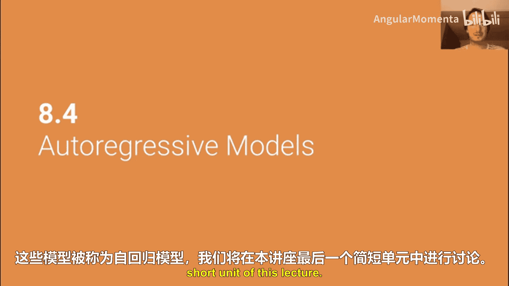
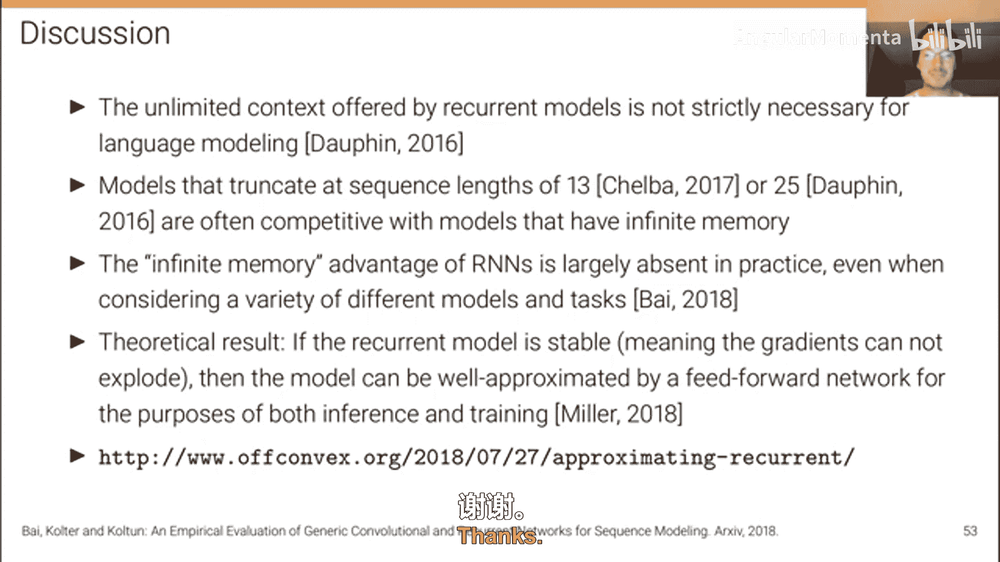

# 042：序列模型之自回归模型 🧠

在本节课中，我们将要学习一种强大的序列建模方法——自回归模型。我们将看到，这种前馈神经网络模型如何挑战了循环神经网络在序列处理领域的传统地位，并理解其工作原理、优势以及实际应用。

## 概述

我们之前已经了解到，循环神经网络是一个强大的模型家族，能够处理任意长度的序列。长期以来，人们认为循环模型是唯一能做到这一点的模型类型。但最近的研究表明，实际上存在一类前馈神经网络，其性能能够与循环神经网络相媲美，甚至在某些方面超越它们。这就是我们将在本单元讨论的所谓自回归模型。

## 什么是自回归模型？

自回归模型是一种前馈模型，它基于时间序列中前K个变量来预测下一个变量X_T。其中，T表示时间。

在数学上，一个K阶自回归模型可以表示为：
**X_t = f(X_{t-1}, X_{t-2}, ..., X_{t-K})**

下图是一个直观的示例。在这个图示中，x5直接依赖于x4和x3，因此这里的K值为2。

请注意，图中使用了虚线只是为了更清晰地指示不同的映射关系，虚线箭头和实线箭头的含义实际上是相同的。与循环神经网络类似，自回归模型的参数在时间上是共享的，这意味着我们在每个时间步T应用相同的函数，该函数不依赖于时间步索引T。

从图模型的角度来看，我们在此做了一个很强的条件独立性假设。例如，在给定x3和x4的条件下，x5与x2是条件独立的。这与循环神经网络不同，我们将在后续幻灯片中再次审视这一点。

## 扩展到序列建模

现在，我们可以将预测自身下一个值的自回归模型概念，扩展到我们一直在研究的序列建模场景中，即输入和输出不同的情况。

在这种情况下，输入（绿色）和预测输出（y）是不同的。我们有一个函数，使得在时间T的预测依赖于从时间T直到T-K的所有输入。

换句话说，Y_t依赖于所有满足 `i >= t-K` 且 `i <= t` 的X_i。而在本示例中，y5独立于x2或x1。这是自回归模型最基本的形式，它是一个纯粹的前馈模型，没有递归更新的隐藏状态。

## 与循环神经网络的对比

为了更清晰地理解，我们将自回归模型与展开的循环神经网络版本进行比较。

以下是两者的核心区别：

*   **信息处理方式**：循环模型通过其隐藏状态来总结先前的信息。而在自回归模型中，我们有从先前时间步到当前预测的直接连接，但仅限于前K步。
*   **记忆能力**：自回归模型有一个硬性约束，即完全忽略K步之前的信息。而理论上，循环神经网络可以记住很早以前的信息用于很晚的预测。换句话说，与没有无限记忆、做出强条件独立性假设的自回归模型不同，循环神经网络理论上具有无限记忆。当然，问题在于这种无限记忆的实际价值有多大，这正是我们将在本单元探讨的内容。
*   **训练难度**：与需要随时间反向传播（这带来了我们在上一单元看到的所有问题）的循环神经网络相比，自回归模型训练起来要容易得多，因为它不需要随时间反向传播。它是一个标准的前馈模型，我们面对的是标准的监督学习问题。例如，对于y5、y4和y3，我们甚至可以并行地应用学习过程，并行更新这些共享权重矩阵的权重。自回归网络比需要随时间反向传播的循环神经网络更容易训练，也更稳定。

## 深度自回归模型与因果卷积

像循环神经网络一样，自回归模型可以通过简单地堆叠具有自回归性质的层来扩展到具有多个层的深度版本。现在，我们有两个不同的函数（同样，参数在时间上共享，但在层方向上是不同的）。我们有一个函数从x映射到H，然后另一个函数从这个隐藏层映射到预测层Y。

我们还可以看到，这些自回归模型有效地执行了多个因果时间卷积。因为我们在时间上共享参数，所以每一层都可以被视为一个一维卷积层，我们在该层上滑动一个核滤波器矩阵以产生输出。在本例中，它们是因果的，因为我们在时间T进行预测时，只考虑时间T及之前时间步的信息，而不考虑未来时间步的信息。

根据具体情况，您可能希望考虑因果或非因果结构。如果您要处理整个批次或整个句子，而没有在线处理的要求，您可能也希望考虑来自未来的信息。类似地，在循环神经网络中，有所谓的双向循环神经网络，它同时从左到右和从右到左处理，因此也考虑了来自未来的信息。但在本讲座的范围内，我们将考虑标准设置下的循环神经网络，即因果设置，它只利用过去的信息进行预测。

当然，这类模型现在可以与我们（社区）在标准深度神经网络中开发的所有技巧相结合，例如跨层的残差连接以及扩张卷积，以便在保持参数不变的情况下更快地增加感受野大小。

## 突破性应用：WaveNet

第一个真正成功并展示突破的此类模型是Oord等人在2016年提出的WaveNet。

这是一个用于原始音频波形的生成模型，它能生成逼真的语音，人类观察者很难将其与真实语音区分开来。它结合了残差连接、跳跃连接和扩张卷积，如下图所示，这对于考虑来自任何先前时间步的上下文和输入信息至关重要。

音频处理在某种意义上很困难，因为每秒有大量样本，以至于序列处理社区通常避免使用原始音频波形。但这里已经证明，即使不使用循环神经网络，仅用前馈网络也有可能生成原始音频波形。通过使用扩张卷积的思想，我们可以用很少的参数非常快速地扩展感受野大小，再结合具有残差和跳跃连接的深度多层架构思想，这确实是在原始音频波形生成方面的一个突破。由于音频在多个尺度上存在结构（毫秒级的微观结构和秒级的重复模式），捕获这些多时间尺度的结构非常困难，而这类模型很好地做到了这一点。

在定量性能方面也得到证明，这些是衡量语音自然度的指标，WaveNet展示的性能远优于LSTM，可与人类自然语音相媲美。

## 进一步的发展与理论探讨

随后，这个想法在Atal 2018年的这篇论文中得到了进一步发展。他们证明了一个更简单的架构（使用相同的想法：具有残差层、扩张卷积和零填充的深度多层网络）在各种任务上都表现出非常好的性能。

以下是他们在多个不同任务上的测试结果，涵盖了图像处理、加法、复制、音乐处理、自然语言处理等。在一系列被认为是LSTM和循环神经网络传统优势领域的任务中，他们证明这些非常简单且易于训练的前馈网络实际上可以超越这些循环模型。

当然，问题是为什么会这样？这些循环网络是必需的吗？它们是否真正利用了其无限记忆的理论优势？这仍然是一个开放讨论的话题。

我想引导您关注这个网站，这是一篇围绕此主题的优秀博客文章。这里有一些来自最近研究该问题的论文的引述：

*   Daniluk等人在2016年发现，循环模型提供的无限上下文对于语言建模等任务并非绝对必要。例如，明确将输入序列长度截断为13或25的模型，通常与具有无限记忆的模型具有竞争力。这表明，也许在理论上，具有无限记忆的模型更好，但在实践中，它们并没有利用无限记忆，或者对于这些特定任务，无限记忆并非必要。
*   Bai等人在2018年也观察到了这一点。他们说，即使在考虑各种不同模型和任务时，循环神经网络的无限记忆优势在实践中也基本不存在。
*   Miller在2018年提供了一个理论结果。该结果表明，如果循环模型是稳定的（意味着梯度不会爆炸，这当然是我们训练循环模型时始终希望的特性），那么该模型可以很好地被一个前馈网络近似，无论是用于推理还是训练。

因此，似乎也有理论证据表明，循环神经网络无限记忆的理论优势实际上在实践中并不存在。我想以这个讨论作为结束，这是一个很好的起点，可以让我们更多地思考这个问题并进一步阅读相关资料。

## 总结

本节课中，我们一起学习了自回归模型。我们了解到，自回归模型作为一种前馈神经网络，通过直接利用过去有限时间步的信息进行预测，在序列建模任务中提供了循环神经网络之外的一种强大选择。它训练更简单、更稳定，并且通过结合深度架构、残差连接和扩张卷积等技术，能够在音频生成等多种任务上达到甚至超越传统循环模型的性能。理论分析和实践结果表明，循环神经网络理论上的“无限记忆”优势在实际应用中可能并非关键，这使得自回归模型及其相关的因果卷积网络成为许多序列处理场景中一个极具竞争力的替代方案。