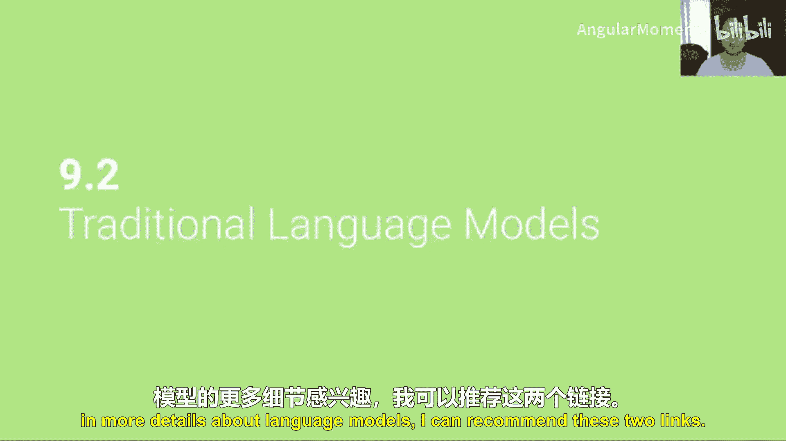

# 043：自然语言处理与语言模型 🧠

在本节课中，我们将要学习自然语言处理（NLP）中的一个核心概念——语言模型。我们将了解什么是语言模型，它如何工作，以及如何评估其性能。

在之前的课程中，我们讨论了卷积神经网络，它是图像处理的理想架构。上一讲我们探讨了用于序列处理的循环神经网络和前馈自回归模型。自然语言是这类模型的理想应用场景，因此，我们将更深入地研究这些模型，并专门用一讲来探讨这个主题。

本讲内容分为四个部分：
1.  介绍什么是语言模型并展示一些例子。
2.  讨论在20世纪70、80和90年代使用的传统语言模型。
3.  探讨这些模型的现代版本，即使用神经网络的神经语言模型。
4.  讨论语言模型的一个特别重要的应用：机器翻译。

现在，让我们从语言模型开始。

## 什么是语言模型？ 📖

一个语言模型对一系列离散标记（token）的概率分布进行建模。这些标记可以是单词或字符等。每个标记可以从一个词汇表 **V** 中取值，即 **x_t ∈ V**。

我们有一个长度为 **T** 的标记序列 **x**。假设这些是单词，我们有第一个词、第二个词，直到第 **T** 个词。我们对此离散标记序列的概率分布进行建模。

该序列的联合分布可以分解为 **T** 个条件分布的乘积：
**P(x_1, x_2, ..., x_T) = ∏_{t=1}^{T} P(x_t | x_1, ..., x_{t-1})**

这仅仅是概率乘积法则（也称为链式法则）的结果，此处没有做任何近似。我们只是以这种方式重写或分解任何联合分布。这是一种自回归模型，它根据序列中所有先前的标记来预测下一个标记。

根据语言模型的不同，标记可以是单词、字符或其他单位。在单词级别操作的难点在于词汇量非常大（通常为10,000到30,000），而在字符级别操作则更容易建模长期依赖关系，因为词汇量小得多（通常只有几十个字符）。

语言模型中通常会引入一个特殊的标记：句子结束标记（EOS），以指示句子的结束。

让我们看一个单词语言模型的例子。模型为句子 “The dark ran away.” 分配概率质量。根据乘积法则，这可以分解为条件分布：**P(The) * P(dark | The) * P(ran | The, dark) * ...**。一个好的模型能够以高概率预测可能出现的下一个单词。

## 语言模型的应用 💡

以下是语言模型的一些主要应用：

**1. 语言识别**
假设我们训练了两个语言模型 **P** 和 **P‘**，它们为句子分配概率，但它们是不同的模型。例如，**P** 在大量英语句子上训练，**P‘** 在大量法语句子上训练。我们可以根据以下规则对句子 **x** 的语言进行分类：
**语言(x) = 英语，如果 P(x) > P‘(x)；否则为法语。**

**2. 生成新序列**
从一个已训练好的单词语言模型 **P(x)** 中，我们可以高效地采样新句子。我们从采样第一个词 **x_1** 开始，然后根据第一个词采样第二个词 **x_2**，依此类推。这是一个线性时间的采样过程。

**3. 贝叶斯推理（如传统机器翻译）**
假设我们有一个在目标语言（如法语）上训练的语言模型 **P(x)**，可以将其视为可能句子的先验分布。再假设有一个基于规则的系统，为给定源语言句子（如英语）**y** 生成翻译 **x** 并分配似然 **P(y | x)**。那么，我们可以使用贝叶斯规则推断后验分布：
**P(x | y) ∝ P(y | x) * P(x)**
现代机器翻译系统通常直接建模 **P(x | y)**，我们将在后面单元看到这类模型的例子。

## 语言模型的训练 🏋️

我们使用 **P_model(x | θ)** 来表示具有参数 **θ** 的模型分布，以区别于真实的数据分布。

设训练集 **X** 由 **N** 个句子 **{x^(i)}** 组成，句子长度可能不同。我们通过最大似然估计来训练一个无条件语言模型：
**θ* = argmax_θ ∏_{i=1}^{N} P_model(x^(i) | θ)**
这等价于最小化模型分布与数据分布之间的交叉熵：
**θ* = argmin_θ H(P_data, P_model)**
其中交叉熵 **H(P_data, P_model) = E_{x~P_data}[-log P_model(x)]**。最小化交叉熵意味着使模型分布尽可能接近数据分布。

## 语言模型的评估 📊

字符级语言模型通常用**每字符比特数（bits per character）**来衡量。首先需要引入信息论中的一些基本量。

**香农信息（或惊奇度）**
对于一个长度为 **T**、概率为 **P(x)** 的字符序列 **x**，其归一化香农信息定义为：
**I(x) = - (1/T) * log₂ P(x)**
由于 **P(x)** 可以分解为条件概率的乘积，因此：
**I(x) = - (1/T) * Σ_{t=1}^{T} log₂ P(x_t | x_1, ..., x_{t-1})**
单位是比特（bits）。直观上，如果观察到的事件在模型下概率很低，则惊奇度（信息量）很高；反之则很低。

**期望惊奇度与交叉熵**
模型在数据分布下的期望惊奇度由归一化交叉熵给出：
**H(P_data, P_model) ≈ - (1/T) * E_{x~P_data}[log₂ P_model(x)]**
更好的模型具有更低的交叉熵，即更少的比特数。根据香农-麦克米伦-布里曼定理，当序列长度 **T** 趋于无穷时，此近似成立。在实践中，我们是在一个独立于训练集的**测试集或验证集**上计算此值。

**示例理解**
考虑一个只有两个符号 **{A, B}** 的词汇表，序列长度 **T=10**。
*   **情况1**：数据与模型分布一致，**P(A)=P(B)=0.5**。这是一个完全分解的单字（unigram）模型。计算得交叉熵为 **1 bit**。这是最优编码所需比特数，也是该词汇表大小下的上界。
*   **情况2**：**P(A)=1, P(B)=0**。计算得交叉熵为 **0 bits**。因为下一个字符总是确定的，无需传递信息。这是下界。
*   **情况3**：**P(A)=0.1, P(B)=0.9**。计算得交叉熵约为 **0.47 bits**。介于0和1之间。
*   **情况4**：模型分布为 **P_model(A)=0.1, P_model(B)=0.9**，但真实数据分布是 **P_data(A)=1, P_data(B)=0**（测试序列全是A）。计算得交叉熵约为 **3.32 bits**。这可以分解为：数据分布本身的熵（0.47 bits）加上模型与数据分布之间的KL散度（2.85 bits）。**交叉熵 = 数据熵 + KL散度 ≥ 数据熵**。因此，数据分布的熵是所能达到的交叉熵的下界。

**词级语言模型的评估：困惑度（Perplexity）**
词级语言模型传统上使用**困惑度**来衡量，它与交叉熵密切相关：
**Perplexity = 2^{H(P_data, P_model)}**
当 **T** 很大时，可以近似为：
**Perplexity ≈ P_model(x)^{-1/T}**
困惑度可以解释为测试集概率的几何平均的倒数。它直观地表示了模型在预测下一个词时的“平均分支因子”，即模型有多“困惑”。**更低的困惑度代表更好的性能**。

**困惑度示例**
考虑词汇表 **{A, B, C}**，序列长度 **T=10**。
*   **情况1**：均匀分布，**P(A)=P(B)=P(C)=1/3**。困惑度 = **3**。模型最大程度困惑，平均有3个等可能的选择。
*   **情况2**：确定分布，**P(A)=1**。困惑度 = **1**。模型完全确定下一个词，毫不困惑。
*   **情况3**：**P(A)=0.1, P(B)=0.9, P(C)=0**。困惑度 ≈ **1.38**。模型比较确定，困惑度较低。
*   **情况4**：模型分布为 **P_model(A)=0.1, P_model(B)=0.9, P_model(C)=0**，但测试序列全是A。困惑度 = **10**。由于模型与数据严重不匹配，困惑度甚至超过了词汇表大小。

## 总结与补充说明 📝

本节课中我们一起学习了语言模型的基础知识。我们了解了语言模型是对标记序列概率分布的自回归建模，探讨了它的应用、训练方法（最大似然/最小化交叉熵）以及评估指标（字符级的比特数、词级的困惑度）。

香农在1948年估计英文文本的熵大约在每字符0.6到1.3比特之间。现代字符级语言模型性能大约在每字符1比特。对于词级模型，直到2017年，困惑度在60左右是典型的。根据统计，英文平均每个单词约有4.79个字母（不含空格）。若按每字符1比特计算，对应的困惑度约为2^(4.79) ≈ 27.9，若考虑空格则更高，这与历史数据大致吻合。

但近年来最先进的模型（如GPT-2, GPT-3, Megatron-LM）报告的困惑度可达10-20。需要注意的是，**比较不同语言模型的困惑度时必须谨慎**，因为它们可能使用不同的词汇表（例如，只包含最常见的前1万个词）、不同的数据集或不同的预处理方式。必须在相同的词汇表和相同的数据集上进行对比才有意义。

最后，如果你对语言模型的更多细节感兴趣，可以查阅相关的在线资源进行深入学习。

---

本节课中，我们介绍了语言模型的核心概念，它是自然语言处理的基石。从定义、应用、训练到评估，我们建立了一个完整的理解框架。在接下来的章节中，我们将深入探讨传统语言模型和现代神经语言模型的具体实现。