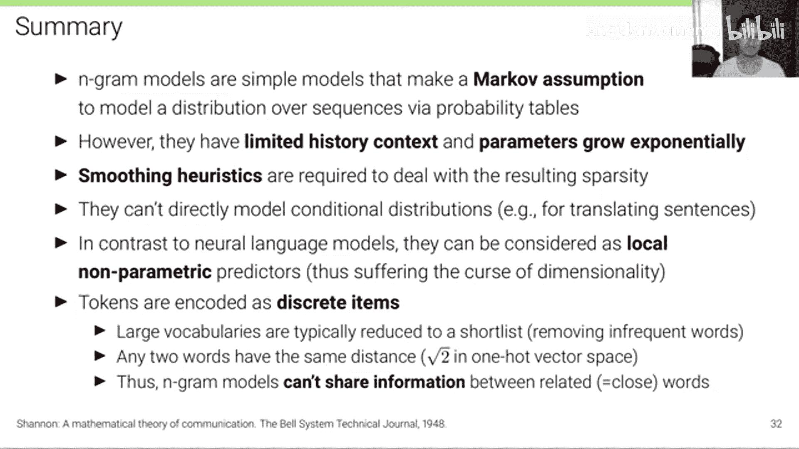

# 044：传统语言模型（N-gram）📚

在本节课中，我们将要学习传统语言模型，特别是 **N-gram 模型**。这种模型在过去几十年里一直是语言建模的默认选择。我们将了解它的基本原理、如何构建、其优势与局限性。

## 概述

语言模型旨在为一系列离散的符号（词元）序列建模一个概率分布。每个词元都从一个固定的词汇表 **V** 中取值。我们将这个联合概率分布分解为一系列条件概率分布的乘积。其中，用于预测当前词元的历史信息被称为**上下文**。

## 从概率表到 N-gram 模型

上一节我们介绍了语言模型的基本概念，本节中我们来看看最直观的实现方式及其面临的问题。

最简单的建模方式是为每个条件概率分布使用**概率表**。例如，给定 `x1` 预测 `x2` 的概率，我们可以存储一个二维矩阵（概率表）。随着序列长度增加，我们需要为 `P(xt | x1, ..., xt-1)` 存储一个维度为 `t` 的张量。

对于一个词汇量为 `|V|` 的模型，这个概率表的大小是 `|V|^t`。假设 `|V| = 30,000`，序列长度 `t = 10`，那么表的大小是 `30,000^10`，这是一个天文数字，无法存储，也需要海量的训练数据来估计每个条目的概率。

这就是 **N-gram 模型** 出现的原因。N-gram 模型通过做一个近似来简化问题：它缩短了上下文。

## N-gram 模型的核心思想

N-gram 模型做出了一个强马尔可夫假设：当前词 `xt` 的概率只依赖于它前面的 `n-1` 个词，而不是整个历史。

**公式表示如下：**
对于一个 N-gram 模型（n 表示考虑的连续词元数量），我们近似：
`P(xt | x1, ..., xt-1) ≈ P(xt | xt-n+1, ..., xt-1)`

这意味着模型是“记忆有限”的，`xt` 不依赖于 `xt-n+1` 之前的任何词。

为了写出整个序列的联合概率分布，我们使用链式法则并结合这个近似：

**公式：**
`P(x1, ..., xT) ≈ P(x1, ..., xn-1) * Π_{t=n}^{T} P(xt | xt-n+1, ..., xt-1)`

其中，`P(x1, ..., xn-1)` 是起始部分的边缘概率，通常也用小规模的 N-gram 表来建模。

通过限制上下文长度 `n`（例如 2, 3, 4），概率表的维度被限制为 `n`，这使得存储和计算变得可行。这与我们之前介绍的自回归模型思想类似，但关键区别在于：N-gram 模型中的每个条件分布是用一个**概率表**表示的，而不是用神经网络。

## N-gram 模型实例

以下是两种常见 N-gram 模型分解的具体例子：

**Bigram 模型 (n=2)：**
上下文长度为 1。
`P(“The”, “dog”, “ran”, “away”) = P(“The”) * P(“dog” | “The”) * P(“ran” | “dog”) * P(“away” | “ran”)`

**Trigram 模型 (n=3)：**
上下文长度为 2。
`P(x1, x2, x3, x4) = P(x1, x2) * P(x3 | x1, x2) * P(x4 | x2, x3)`

## 如何训练 N-gram 模型

训练 N-gram 模型的核心是估算条件概率 `P(xt | xt-n+1, ..., xt-1)`。根据条件概率的定义和训练语料库中的计数，我们可以直接计算。

**公式推导（以 Bigram 为例）：**
`P(xt | xt-1) = P(xt-1, xt) / P(xt-1) = count(xt-1, xt) / count(xt-1)`

以下是训练步骤：
1.  **计数**：在整个训练语料库中，统计所有 N-gram 和 (N-1)-gram 出现的次数。
2.  **计算概率**：对于每个条件概率，用相应的 N-gram 计数除以它的上下文（(N-1)-gram）的计数。

因此，N-gram 模型的训练过程非常简单，本质上就是**计数**，不需要梯度下降等复杂优化算法。

## 平滑技术

对于较大的 `n`（如三元组、四元组），许多可能的词序列组合在训练集中从未出现，导致其条件概率为 0。这在测试时是个问题，因为模型会给未见过的序列分配零概率，这被称为**数据稀疏性**。

为了解决这个问题，需要使用**平滑**技术。一个简单的启发式方法是**加一平滑**，即在所有 N-gram 计数上加 1，确保没有概率严格为 0。当然，还有更复杂的平滑方法（如 Good-Turing、Kneser-Ney 平滑）效果更好。

## 生成文本示例

由于 N-gram 模型是自回归的，我们可以通过迭代地从条件分布中采样来生成文本：给定前 `n-1` 个词，采样下一个词，重复此过程直到生成句子结束符。

从简·奥斯汀或莎士比亚文本训练出的不同阶数 N-gram 模型生成示例如下：
*   **Unigram (n=1)**：生成的单词序列几乎是随机的，如 “a a a a a”。
*   **Bigram (n=2)**：开始出现常见的双词搭配，但句子整体可能不连贯。
*   **Trigram (n=3)**：能生成更通顺的短语和短句，如 “King Henry what? I will go seek the traitor.”
*   **Four-gram (n=4)**：生成的文本在局部看起来更加合理和自然。

随着上下文长度 `n` 的增加，模型捕获的依赖关系更丰富，生成的文本质量也更高。

## 总结与局限性

本节课我们一起学习了传统的 N-gram 语言模型。我们来总结一下它的特点和主要缺点：

**总结：**
N-gram 模型是一种简单的、基于马尔可夫假设的序列概率模型，使用概率表进行参数化。它通过计数进行训练，易于理解和实现。

**局限性：**
1.  **有限的上下文**：由于马尔可夫假设，它无法建模长距离依赖关系。
2.  **参数增长**：参数数量仍随 `n` 呈指数级增长，限制了 `n` 的大小。
3.  **数据稀疏性**：需要平滑技术来处理未见过的 N-gram。
4.  **无法条件建模**：它是生成模型，无法直接建模基于输入的条件分布（如翻译、摘要）。
5.  **离散表示问题**：这是最关键的缺陷之一。在 N-gram 模型中，每个词被表示为离散的符号（如 One-hot 向量）。这导致两个问题：
    *   **词汇表限制**：必须将词汇表限制在一个较小的大小（如 30,000），忽略低频词。
    *   **无法共享语义**：任何两个不同的词在 One-hot 表示中的距离都是相同的（例如，欧氏距离为 √2）。这意味着模型无法利用词语之间的**语义相似性**。例如，“狗”和“犬”在语义上很接近，但对 N-gram 模型来说，它们是两个完全无关的符号，从“可爱的狗”学到的知识无法迁移到“可爱的犬”。

正是这最后一个缺点——**缺乏对词语语义关系的建模能力**——成为了推动语言模型向前发展的核心动力，并引出了我们下一单元将要学习的内容：**基于神经网络的分布式词表示**。