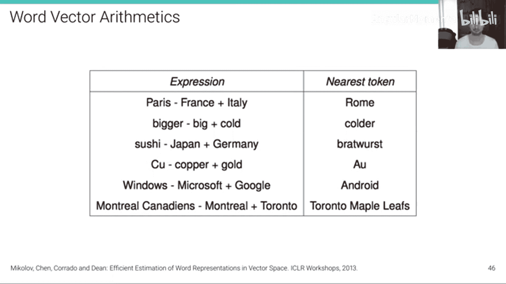

# 045：神经语言模型 🧠

在本节课中，我们将学习神经语言模型。这是一种利用神经网络来预测下一个词的语言模型。

## 概述

上一节我们介绍了传统的N元语法模型。本节中，我们将探讨如何利用神经网络，特别是分布式词表示（词嵌入），来构建更强大、更高效的语言模型。这种方法解决了传统模型面临的核心难题。

## 从离散到连续的表示

N元语法模型本质上是条件概率表，它们深受**维度灾难**的困扰。例如，对于一个大小为V的词汇表，对连续N个词的联合分布进行建模，需要处理 **V^N** 个参数。即使将上下文限制为10个词，参数量也可能达到 **10^40** 级别，这是难以处理的。

然而，对连续变量的建模通常比对离散变量的建模更容易实现泛化，因为需要学习的函数在局部是平滑的。这个想法催生了神经语言模型。下面引用的论文是这一领域的开创性工作：
> Bengio, Y., et al. (2003). A neural probabilistic language model.

## 核心问题：离散表示的局限性

问题的核心在于，在离散的词表示（如独热编码）中，我们假设任意两个词之间的距离是相同的。

假设 **W** 表示一个词的独热编码向量（一个维度为词汇表大小V的向量，其中只有一个元素为1，其余为0）。考虑两个不同的词，它们的独热向量相减后计算L2范数（距离），结果总是 **√2**（除非是同一个词，距离为0）。

这意味着在这种简单表示中，所有词彼此间的距离都相等。但在现实中，有些词比其他词更相似。请看以下句子：
*   The cat is walking in the bedroom.
*   The dog was running in the room.

在词级别（独热编码级别），这两个句子非常不同。但在语义上，它们高度相关。“猫”和“狗”、“走”和“跑”具有相似的语义角色。然而，纯粹的离散模型（如N元语法）无法捕捉这种相似性。

## 解决方案：分布式词表示（词嵌入）

因此，前述论文提出的思想是使用一种不同的表示方法——**分布式表示**。它将高维的独热向量（例如维度为10,000）映射到低维的**词嵌入**向量（例如维度为30或100），即 **R^M**。

在独热编码中，所有信息都集中在一个维度上。而在分布式表示中，词义被分布在整个嵌入向量的所有维度上。这样做的优势在于，我们现在能够建模词与词之间的**相似性**。

另一种理解方式是，这些表示将概率质量分布在重要的方向上，而不是像在独热编码中那样，所有训练点周围的所有方向都是均匀的（因为所有距离都相同）。这使得模型能够捕捉更有信息量的关系，从而实现跨句子的泛化。

## 词嵌入的实现

这种从独热向量到 **R^M** 的映射通常通过一个简单的线性变换（矩阵乘法）实现。本质上，这是一个**矩阵查找**操作，嵌入就存储在这个矩阵中。然后，这些嵌入成为词的表示，并可以被进一步处理，例如通过前馈神经网络、循环神经网络或将在最后一单元学习的Transformer模型。

以下是其工作原理的图示说明：

需要强调的是，我们并不会给词手动附加语义标签。词嵌入是纯粹通过数据学习得到的实值向量。

## 一个具体例子

假设训练集包含以下三个句子：
1.  The cat is walking.
2.  The dog is walking.
3.  The cat is sitting.

一个分布式表示可以学习将“cat”和“dog”的嵌入放置在嵌入空间中彼此靠近的位置，因为它们在语义上相似。现在，由于“The cat is sitting”在训练集中出现概率高，而“cat”和“dog”相关，因此未在训练集中出现的“The dog is sitting”的概率也会变高。这是关键：通过这种相似性建模，我们可以使未出现在训练集中的句子也获得较高的概率，而这是N元语法模型由于其表示方式所无法实现的。

## 表示空间的可视化

下图展示了局部表示（独热编码）与分布式表示空间可能的样子：

在左侧的局部表示中，三个词“walking”、“cat”、“dog”位于坐标轴上，彼此间的L2距离都是√2。右侧的分布式表示目标是将它们转换到低维空间（这里是从3维到2维）。现在，“cat”和“dog”彼此之间的距离比它们到“walking”的距离更近。

学习到词嵌入后，我们可以将其可视化。例如，在二维t-SNE可视化中，我们可能看到“国家”聚集在一个区域，“年份”聚集在另一个区域，这表明模型从文本中学习到了语义关联。

但我们必须谨慎对待高维空间的可视化。正如Geoffrey Hinton的一个著名比喻所言：在一个30维的杂货店里，泡菜可能挨着鱼，也可能挨着披萨配料。在高维空间中，任何事物都可能彼此相邻，而我们的可视化仅限于2D，想象力是有限的。

## 神经概率语言模型架构

前面引用的论文是第一个在语言模型中成功使用分布式表示的工作，这给NLP领域带来了突破性影响。该模型的关键思想是：
1.  为词汇表中的每个词关联一个分布式词特征向量（即词嵌入）。
2.  用序列中这些词的特征向量来表达词序列的联合概率函数。
3.  **同时学习**词特征向量和概率函数的参数。

这是一个**端到端**的训练过程，首次同时学习了词嵌入和语言模型参数。

以下是该模型的示意图（摘自原论文）：

模型描述如下：
*   **输入**：前 `n-1` 个词的索引（可视为独热向量）。
*   **嵌入层**：通过一个共享的矩阵 **C**（维度为 `M x V`）将每个独热向量转换为M维词嵌入。
*   **拼接**：将所有词嵌入拼接成一个大向量。
*   **隐藏层**：输入到一个带tanh激活函数的全连接隐藏层。
*   **输出层**：可选地，可以有从嵌入层到输出层的直接连接。最终通过一个softmax层输出下一个词 `w_t` 的概率分布。

模型的输出是给定之前所有词的情况下，下一个词的概率：
`P(w_t | w_{t-1}, w_{t-2}, ..., w_{t-n+1})`

该模型的参数数量与词汇表大小 **V** 和上下文长度 **n** 呈**线性**关系，即 `O(V * M + n * M * H)`，其中H是隐藏层大小。这与N元语法模型的指数级复杂度 `O(V^n)` 形成了鲜明对比。这种效率提升源于将条件信息（历史词）作为神经网络的输入，而非显式地为所有可能的组合建模概率。

## 模型效果与改进

论文中的主要结果表明：
*   与最好的N元语法模型相比，神经网络模型能获得显著更好的结果（在Brown语料库上困惑度降低约24%，在AP新闻语料库上降低约8%）。
*   神经网络能够利用更长的上下文（增加n带来提升），而N元语法模型则不能。
*   将神经网络的输出概率与插值三元语法模型结合，可以进一步降低困惑度（集成模型）。

## 高效词嵌入训练：Word2Vec

一个遗留的问题是，在大词汇表上计算softmax（覆盖数万个可能的下一个词）在内存和计算上都非常昂贵。Word2Vec论文提出了一种高效的替代方案。

它提出了**Skip-gram**模型，其目标不是预测下一个词的完整分布，而是预测一个词是否出现在另一个词的上下文环境中。这将其转化为一个**二元分类**问题（逻辑回归）：给定一对词，模型判断它们是否在训练语料中相邻出现。这种方法可以利用大量数据进行高效训练，并产生高质量的词嵌入。

利用这些词嵌入，我们可以进行一些有趣的“词向量算术”：
*   `vec(“Paris”) - vec(“France”) + vec(“Italy”)` 的结果最接近 `vec(“Rome”)`。
*   `vec(“sushi”) - vec(“Japan”) + vec(“Germany”)` 的结果最接近 `vec(“bratwurst”)`。

这不仅有趣，也表明词嵌入学习到的语义关系是非常有意义的。

## 总结

本节课我们一起学习了神经语言模型的核心思想。我们从传统N元语法模型的局限性出发，引入了**分布式词表示（词嵌入）**的概念，它通过将词映射到连续的低维空间来捕捉语义相似性。我们详细分析了首个神经概率语言模型的**端到端架构**，它同时学习词嵌入和语言模型参数，并将复杂度从指数级降低到线性级。最后，我们了解了**Word2Vec**这类高效训练词嵌入的方法及其有趣的应用。这些技术为现代自然语言处理奠定了坚实的基础。