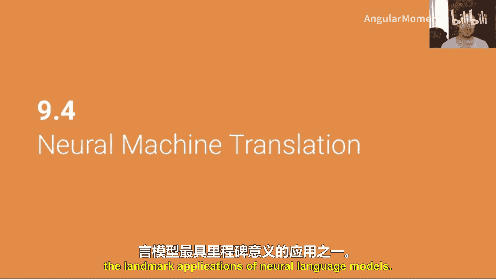
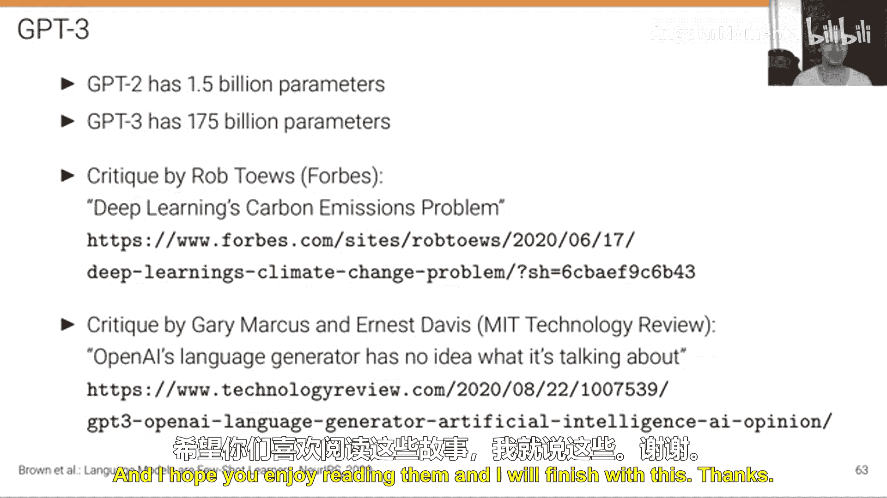

# 046：神经机器翻译 🧠➡️🗣️

在本节课中，我们将学习神经机器翻译，这是深度学习领域的一个里程碑式应用。我们将从经典的序列到序列模型开始，逐步深入到完全基于注意力机制的Transformer架构，并了解其如何彻底改变了自然语言处理领域。

## 概述

神经机器翻译旨在构建一个端到端的可训练模型，将一种语言的句子自动翻译成另一种语言。本节将介绍该领域的关键发展，从最初的突破性模型到当前最先进的Transformer架构。

## 序列到序列学习

上一节我们讨论了循环神经网络。本节中，我们来看看如何将其应用于翻译任务。2014年，一篇名为《使用神经网络进行序列到序列学习》的论文提出了一个简单但强大的端到端机器翻译模型。

该模型的核心是一个编码器-解码器架构。编码器将源语言句子（如英语）编码成一个固定维度的向量，称为“思想向量”。解码器则根据这个思想向量生成目标语言句子（如法语）。

以下是该模型的关键特点：
*   编码器和解码器均使用四层LSTM。
*   编码器处理输入句子时采用**逆序**。这有助于建立短期依赖关系，因为句子的第一个词在编码结束时被处理，而解码器正是从目标语言的第一个词开始生成。
*   思想向量是输入句子的全局语义表示，用于连接长度和词序可能完全不同的两种语言。

这个简单的模型，结合海量数据和计算资源，首次在效果上超越了所有基于手工规则的传统机器翻译系统。

## 解码策略：贪婪搜索与束搜索

上一节我们介绍了如何通过编码得到思想向量。本节中我们来看看解码器如何生成翻译结果。

解码的目标是找到最可能的输出句子序列 `W_1, W_2, ..., W_T`，使其在给定思想向量 `V` 下的概率 `P(W_1, W_2, ..., W_T | V)` 最大。

然而，穷举所有可能的序列计算量巨大。一种简单的近似方法是**贪婪解码**：在生成每个词时，只选择当前概率最高的那个词。

**公式**：在生成第 `t` 个词时，选择 `argmax P(W_t | V, W_1, ..., W_{t-1})`。

但贪婪解码可能陷入局部最优。例如，生成句子开头时，“那些”可能比“苹果”有更高的初始概率，但完整句子“苹果很好吃”的整体概率可能高于“那些苹果很好吃”。

因此，实践中常使用**束搜索**。束搜索是贪婪搜索和穷举搜索之间的一个折中方案。

以下是束搜索（Beam Search）的基本步骤：
1.  设定一个束宽 `K`（例如 `K=2`）。
2.  在每一步，保留当前概率最高的 `K` 个候选序列。
3.  基于这 `K` 个候选序列，继续扩展下一个词，并再次从所有扩展结果中选出新的 top-`K` 个序列。
4.  重复此过程，直到所有候选序列都生成结束符。

通过始终维护一个“束”的候选解，束搜索通常能找到比贪婪解码质量更高的翻译结果。

## Transformer：基于注意力的革命

序列到序列模型取得了成功，但其核心的RNN结构存在顺序计算的限制。2017年，Transformer模型的提出彻底改变了这一局面。

Transformer是一个完全基于**自注意力**机制的模型，它摒弃了循环和卷积结构。其最大优势在于**并行化**：句子中的所有词可以同时被处理，极大地提升了训练速度，并能更直接地捕获长距离依赖关系。

Transformer已成为当前所有顶尖自然语言处理模型的标准架构。

## Transformer的核心：自注意力机制

现在，让我们深入理解Transformer的核心——多头自注意力层。

在Transformer中，每一层的输入和输出都是一个形如 `L[T][J]` 的张量，其中 `T` 是序列位置（词），`J` 是该位置的神经元（特征维度）。这可以看作是一个序列的向量表示。

自注意力层的目标是让序列中的每个词都能关注到序列中的其他所有词。为此，它为每个词计算三个向量：
*   **查询向量**
*   **键向量**
*   **值向量**

这些向量通过将输入词嵌入与不同的可学习权重矩阵相乘得到。

**公式**：对于每个注意力头 `k` 和位置 `t`：
*   查询：`Q_t^k = L_t * W_Q^k`
*   键：`K_t^k = L_t * W_K^k`
*   值：`V_t^k = L_t * W_V^k`

注意力权重 `A_{t1, t2}^k` 通过计算查询向量和键向量的相似度（点积）并应用Softmax得到，表示词 `t1` 对词 `t2` 的关注程度。

**公式**：`A_{t1, t2}^k = softmax( (Q_{t1}^k · K_{t2}^k) / sqrt(d_k) )`，其中 `d_k` 是键向量的维度。

最终，该注意力头的输出是注意力权重与值向量的加权和。

**公式**：`H_{t1}^k = Σ_{t2} ( A_{t1, t2}^k * V_{t2}^k )`

Transformer使用多个这样的注意力头（原文为8个），每个头学习不同的关注模式。所有头的输出被拼接起来，再经过一个线性变换层，形成该自注意力层的最终输出。

## Transformer在机器翻译中的应用

在机器翻译任务中，Transformer同样采用编码器-解码器架构。
*   **编码器**：由多层Transformer块堆叠而成，处理源语言句子，输出其上下文表示。
*   **解码器**：也是多层Transformer块。它接收编码器输出的**键**和**值**，以及已生成目标句子的**查询**，以自回归的方式逐个预测下一个词。解码器使用**掩码自注意力**确保在预测当前位置时，不会“看到”未来的词。

这种架构在翻译质量上取得了飞跃，并催生了如GPT系列等强大的预训练语言模型。

## 大语言模型的成就与挑战

基于Transformer架构，通过在海量文本上进行无监督预训练，然后针对特定任务进行微调，产生了如GPT-2、GPT-3等大语言模型。它们展示了令人震惊的文本生成能力，例如根据提示续写文章、故事甚至代码。

然而，这些模型也面临挑战：
1.  **规模巨大**：GPT-3拥有1750亿参数，训练需要巨大的工业级计算资源，难以复现。
2.  **理解局限**：模型可能生成流畅但毫无意义或事实错误的内容，表明其缺乏真正的“理解”。
3.  **资源消耗**：训练此类模型会产生巨大的碳足迹，引发对环境影响的担忧。

## 总结

本节课中我们一起学习了神经机器翻译的发展历程。我们从基于LSTM的序列到序列模型开始，了解了其编码器-解码器结构和束搜索解码策略。接着，我们深入探讨了革命性的Transformer模型，其核心的多头自注意力机制实现了完全并行化计算，并成为当前NLP的基石。最后，我们看到了基于Transformer的大语言模型所展现的强大能力及其带来的规模、理解和环境方面的挑战。神经机器翻译是深度学习改变现实世界应用的典范。