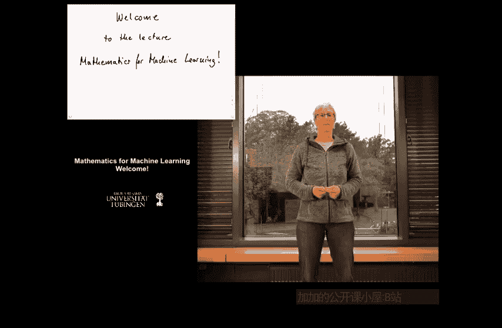
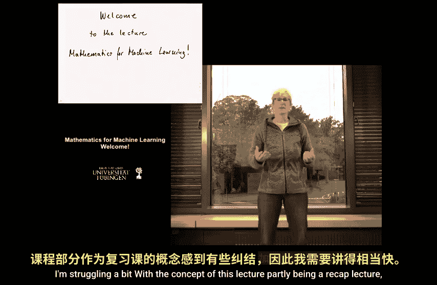

**机器学习数学：P1：欢迎与课程介绍** 🎓

在本节课中，我们将了解“机器学习数学”这门课程的基本信息、授课形式以及涵盖的核心内容。

早上好，欢迎来到“机器学习数学”课程。

我是里克基·卢斯博，是图宾根大学的机器学习教授，本学期将由我讲授这门课程。新冠疫情仍在持续，因此课程不得不以在线形式进行。对此我感到遗憾，因为我教学时通常喜欢与大家互动，观察你们的表情，看到你们理解时的微笑或困惑时的皱眉。至少以这种方式，这些互动将无法实现。然而，我们将提供翻转课堂以及小班在线辅导，希望仍能创造一些互动机会，让大家可以提问、发表意见，并就课程进展给我们反馈。

课程内容正如其名，是机器学习数学。本质上，这是一门复习性质的课程，大部分内容对你们中的多数人来说应该是已知的。我们将讨论线性代数、多元分析、概率论、统计学、数值方法、优化等各个方面。如果你想真正深入机器学习，并最终能够设计自己的机器学习算法、解决自己的机器学习问题，这些知识都是必需的。

我对这门课程的设计理念有些纠结。

一方面，它是一门复习课，因此进度应该相当快。我无法在每个主题上花费我希望的那么多时间。另一方面，我无法看到你们的即时反馈，因此很难把握合适的授课节奏、合适的示例数量，或者应该展示多少证明过程。如果你认为课程应以不同方式设计，请务必给我反馈。

上学期，我是在户外的花园里录制课程的。不幸的是，现在是冬季学期，这已不可能。因此，我也在努力搭建一个室内录制环境。尽管如此，我尽力让这个在线视频录制环境看起来不错。你会注意到我已经录制了一些视频，其中最初的一些视频效果并不理想：声音太低、光线不对、背景太亮而我太暗等等。随着我继续录制，情况会有所改善。

本节课中，我们一起了解了“机器学习数学”课程的概况、在线授课形式以及涵盖的数学核心领域。课程旨在为深入机器学习领域打下坚实的数学基础。