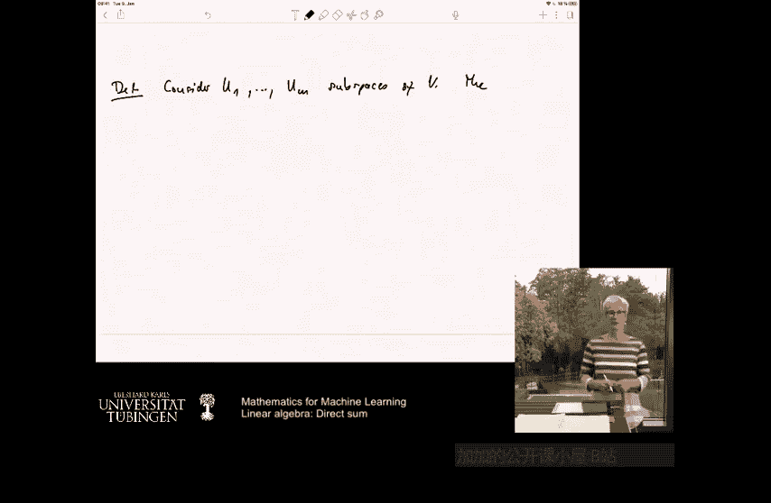
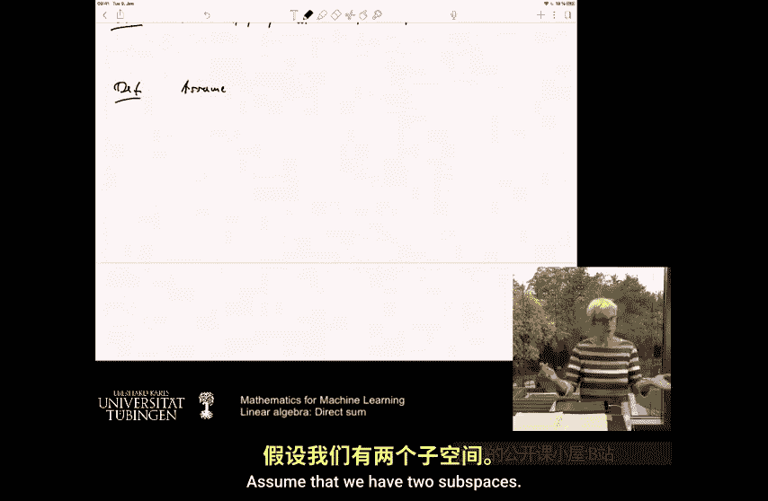
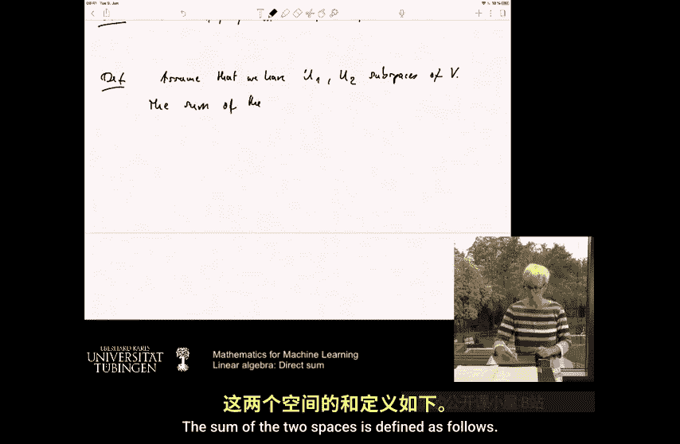
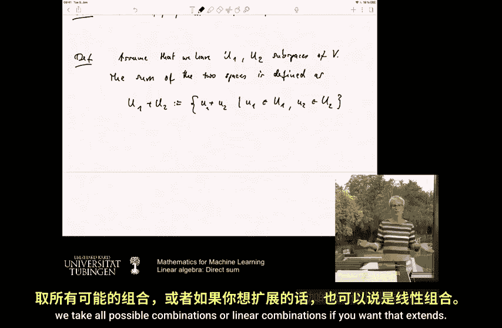

# 004：子空间的和与直和

在本节课中，我们将要学习线性代数中两个重要的概念：子空间的**和**与**直和**。我们将了解它们的定义、区别以及如何判断一个和是否为直和。

我们已经了解了**基**和**子空间**的概念。现在，有一个概念将这两者联系起来，那就是子空间的**和**与**直和**。

## 子空间的和

首先，我们来定义子空间的**和**。

假设我们有两个子空间 **U₁** 和 **U₂**，它们都是向量空间 **V** 的子空间。那么，这两个子空间的**和**定义如下：

**U₁ + U₂ = { u₁ + u₂ | u₁ ∈ U₁, u₂ ∈ U₂ }**

这个定义的意思是：我们取第一个子空间 **U₁** 中的任意一个向量 **u₁**，再取第二个子空间 **U₂** 中的任意一个向量 **u₂**，将它们相加，得到的所有可能的向量 **u₁ + u₂** 构成的集合，就是 **U₁** 和 **U₂** 的和。

这个新的集合 **U₁ + U₂** 本身也是一个**子空间**。如果你不能立刻看出这一点，可以尝试自己证明，过程非常简单。

## 子空间的直和

在上面的定义中，我们并没有排除 **U₁** 和 **U₂** 有重叠部分（即交集不为零）的情况。但在很多情况下，我们更关心那些**不重叠**的子空间。为了描述这种情况，我们需要引入**直和**的概念。

一个和 **U₁ + U₂** 被称为**直和**，当且仅当和空间中的**每一个**元素，其表示方式都是**唯一**的。

换句话说，对于直和 **U₁ ⊕ U₂** 中的任意向量 **v**，只存在**唯一**的一对向量 **u₁ ∈ U₁** 和 **u₂ ∈ U₂**，使得 **v = u₁ + u₂**。

以下是判断一个和是否为直和的几个等价条件：

*   **唯一分解性**：如上所述，每个向量有唯一的分解方式。
*   **平凡交集**：两个子空间的交集只包含零向量，即 **U₁ ∩ U₂ = {0}**。
*   **基的并集**：如果 **B₁** 是 **U₁** 的一组基，**B₂** 是 **U₂** 的一组基，那么 **B₁ ∪ B₂** 是 **U₁ ⊕ U₂** 的一组基，并且 **B₁** 和 **B₂** 不相交。

## 总结

本节课中我们一起学习了子空间的**和**与**直和**。

*   **和** (**U₁ + U₂**) 是通过将两个子空间的所有向量相加得到的**新子空间**。
*   **直和** (**U₁ ⊕ U₂**) 是一种特殊的和，要求两个子空间**除了零向量外没有其他公共部分**（即交集为 {0}），这保证了和空间中每个向量的分解方式是**唯一**的。

理解直和对于后续学习向量的分解、投影以及更高级的线性代数概念至关重要。