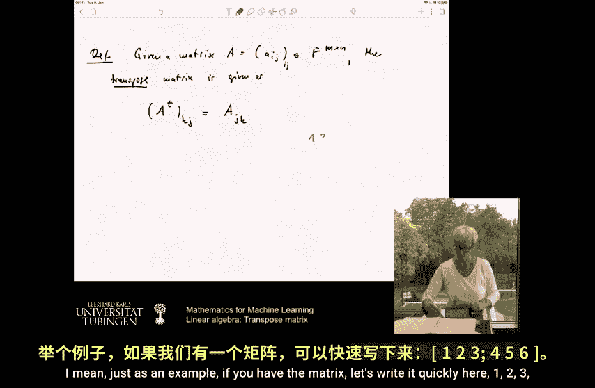

# 008：矩阵的转置与逆

在本节课中，我们将要学习线性代数中的两个核心概念：矩阵的转置与矩阵的逆。我们将首先定义矩阵的转置，然后探讨矩阵的逆是什么，以及它与线性映射的逆有何关系，最后分析这两个概念之间的联系。

---

## 矩阵转置的定义


上一节我们介绍了矩阵的基本表示。本节中，我们来看看矩阵的转置。转置本质上是一个定义。


给定一个矩阵 **A**，其元素索引为 **A<sub>ij</sub>**，其中 **i** 从 1 到 **m**，**j** 从 1 到 **n**。这里我们引入一个简写符号：矩阵属于空间 **F<sup>m×n</sup>**，这表示所有定义在域 **F** 上、大小为 **m×n** 的矩阵的集合。


矩阵 **A** 的转置矩阵，记作 **A<sup>T</sup>**，是通过交换原矩阵的行和列得到的。其元素定义为：
**A<sup>T</sup><sub>kj</sub> = A<sub>jk</sub>**

以下是转置操作的一个具体例子：


假设有一个矩阵：
```
A = [1, 2, 3]
    [4, 5, 6]
```
那么它的转置矩阵 **A<sup>T</sup>** 为：
```
A^T = [1, 4]
      [2, 5]
      [3, 6]
```
可以看到，我们沿着主对角线“翻转”了矩阵。关于转置矩阵的记法有多种，需要注意区分。


---

## 矩阵的逆与线性映射的逆


理解了转置之后，我们进入更重要的部分：矩阵的逆。我们需要探讨矩阵的逆是什么，以及它如何与线性映射的逆相关联。

一个 **n×n** 的方阵 **A** 的逆矩阵，记作 **A<sup>-1</sup>**，是一个满足以下条件的矩阵：
**A * A<sup>-1</sup> = A<sup>-1</sup> * A = I**
其中 **I** 是 **n×n** 的单位矩阵。


并非所有矩阵都有逆矩阵。只有行列式不为零（即矩阵是非奇异的）的方阵才可逆。

对于一个从向量空间 **V** 到 **W** 的线性映射 **Φ**，如果存在一个线性映射 **Ψ: W → V**，使得 **Ψ ∘ Φ = id<sub>V</sub>** 且 **Φ ∘ Ψ = id<sub>W</sub>**，那么 **Φ** 是可逆的，且 **Ψ** 就是 **Φ** 的逆映射。


当我们在基底下用矩阵 **A** 表示线性映射 **Φ** 时，矩阵 **A** 的逆 **A<sup>-1</sup>** 恰好就代表了逆映射 **Ψ** 在同一组基下的矩阵。这就是矩阵的逆与线性映射的逆之间的核心联系。

---



## 转置与逆的关系

最后，我们来看看转置运算和求逆运算之间的关系。这两个操作可以交换顺序，具体关系由以下公式描述：
**(A<sup>T</sup>)<sup>-1</sup> = (A<sup>-1</sup>)<sup>T</sup>**

这意味着，一个矩阵转置后再求逆，等于先求逆再转置。这个性质在推导许多线性代数公式时非常有用。

---

## 总结

本节课中我们一起学习了矩阵的两个基本操作：转置与求逆。
*   我们首先定义了矩阵的转置，即交换矩阵的行和列。
*   然后我们探讨了矩阵逆的定义及其与线性映射逆的关系，理解了可逆矩阵的条件。
*   最后，我们了解了一个重要的性质：转置运算与求逆运算是可交换的。

掌握这些概念是理解更高级线性代数主题和机器学习算法的基础。