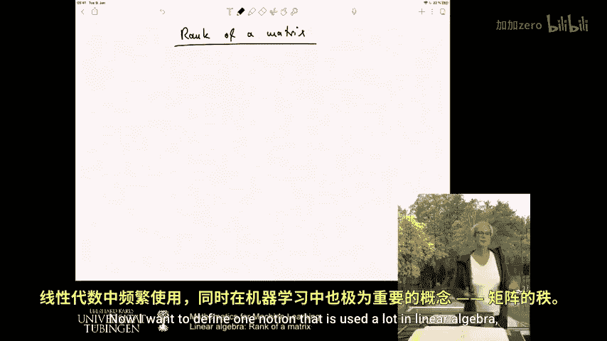
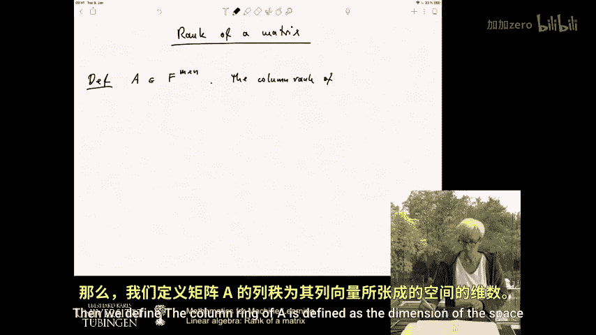
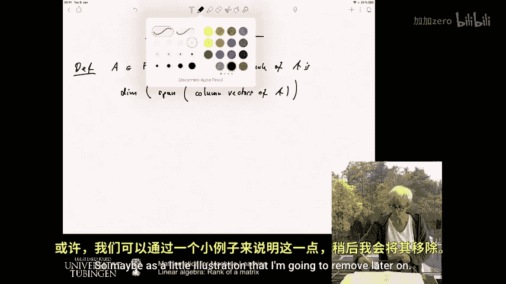
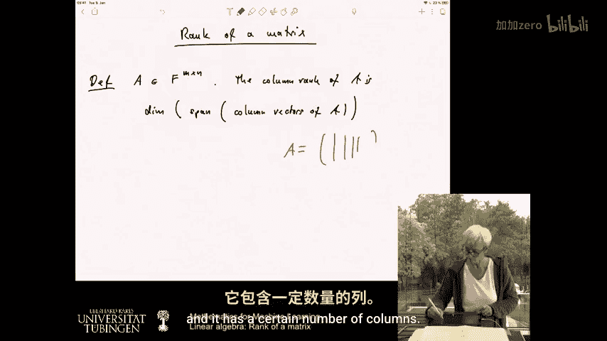

**机器学习数学：1.9：矩阵的秩** 🧮

在本节课中，我们将学习线性代数中一个核心且重要的概念——矩阵的秩。这个概念在机器学习中应用广泛，尤其是在低秩矩阵方法中。

---

### **矩阵秩的定义**

上一节我们讨论了向量空间和维度，本节中我们来看看如何将这些概念应用到矩阵上。矩阵的秩衡量的是其列向量（或行向量）所张成空间的“信息量”或“自由度”。

考虑一个矩阵 **A** ∈ F^{m×n}（注意，它不一定是方阵）。我们定义矩阵 **A** 的**列秩**为：

**列秩(A) = dim(span{**a₁, a₂, ..., aₙ**})**

其中，**a₁, a₂, ..., aₙ** 是矩阵 **A** 的列向量。简单来说，列秩就是这些列向量所张成的向量空间的维度。

为了直观理解，假设我们有一个矩阵 **A**，它包含若干列。每一列都是一个向量，所有这些列向量共同张成一个空间。这个空间的维度就是矩阵的列秩。

---

### **行秩**

与列秩相对应，我们可以类似地定义矩阵的**行秩**。

**行秩(A) = dim(span{**r₁, r₂, ..., rₘ**})**

其中，**r₁, r₂, ..., rₘ** 是矩阵 **A** 的行向量。行秩是这些行向量所张成空间的维度。

---

### **秩在机器学习中的意义**

在后续的机器学习课程中，你会遇到许多所谓的“低秩矩阵方法”。

这些方法通常试图用一个矩阵来描述数据，并拟合一个线性模型。但关键在于，这个矩阵被假定为具有**低秩**。

低秩确保了矩阵的“表达能力”不会过强。从参数的角度看，一个低秩矩阵包含的有效参数数量较少，这有助于防止模型过拟合，并提升其泛化能力。这是机器学习中采用低秩近似的核心动机之一。

---

### **总结**

本节课中我们一起学习了矩阵秩的概念。我们定义了**列秩**（列向量空间的维度）和**行秩**（行向量空间的维度），并了解到秩是衡量矩阵线性独立列（或行）数量的关键指标。最后，我们探讨了低秩矩阵在机器学习中的重要意义，即通过限制模型的复杂度来防止过拟合。理解秩是掌握后续线性代数与机器学习模型的基础。