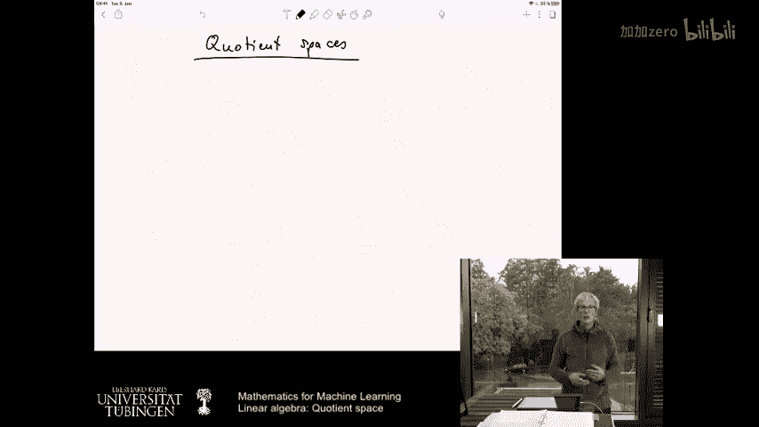

# 011：商空间与等价关系

在本节课中，我们将学习线性代数中一个重要的构造——**商空间**。为了理解商空间，我们需要先了解一个更基础的数学概念：**等价关系**。虽然商空间本身与矩阵没有直接关系，但当我们希望“剔除”或“忽略”向量空间中的某个子空间时，它是一个非常有用的工具。理解这个概念需要一些时间，但一旦掌握，它就会变得非常简单明了。

## 等价关系的定义

上一节我们提到了商空间的概念。为了构建它，我们需要先绕一个小弯，引入**等价关系**。让我们直接开始定义。

考虑一个集合 **S**，它可以是任何事物，通常不一定是向量空间。我们想要在 **S** 上定义一个等价关系。

首先，我们定义集合 **S** 的**笛卡尔积**为 **S × S**，即所有有序对 **(x, y)** 的集合，其中 **x** 和 **y** 都属于 **S**。

现在，我们称 **S × S** 的一个子集 **R** 为 **S** 上的一个**等价关系**，如果它满足以下三个性质（对所有 **x, y, z ∈ S** 都成立）：

以下是等价关系必须满足的三个公理：

1.  **自反性**：对于所有 **x ∈ S**，有 **(x, x) ∈ R**。
    *   直观理解：每个元素都与自身相关。例如，在“朋友”关系中，每个人都应该是自己的朋友。
2.  **对称性**：如果 **(x, y) ∈ R**，那么 **(y, x) ∈ R**。
    *   直观理解：如果 x 与 y 相关，那么 y 也与 x 相关。例如，如果 x 是 y 的朋友，那么 y 也应该是 x 的朋友。
3.  **传递性**：如果 **(x, y) ∈ R** 且 **(y, z) ∈ R**，那么 **(x, z) ∈ R**。
    *   直观理解：如果 x 与 y 相关，且 y 与 z 相关，那么 x 与 z 也相关。例如，如果 x 是 y 的朋友，y 是 z 的朋友，那么 x 也是 z 的朋友。

> **数学表示**：
> 1. **自反性**：∀ x ∈ S, (x, x) ∈ R
> 2. **对称性**：∀ x, y ∈ S, (x, y) ∈ R ⇒ (y, x) ∈ R
> 3. **传递性**：∀ x, y, z ∈ S, (x, y) ∈ R ∧ (y, z) ∈ R ⇒ (x, z) ∈ R

如果一个关系满足这三个性质，它就能将集合 **S** 划分成若干个互不相交的**等价类**。每个等价类中的元素彼此都是等价的，而不同等价类中的元素则不等价。

## 从等价关系到商空间

理解了等价关系后，我们就可以回到线性代数的语境，来构建**商空间**。这个构造的核心思想是：给定一个向量空间 **V** 和它的一个子空间 **U**，我们希望通过“模掉”或“忽略” **U** 来定义一个新的向量空间。

具体做法是，在 **V** 上定义一个等价关系：两个向量 **v₁** 和 **v₂** 被认为是等价的，当且仅当它们的差属于子空间 **U**。

> **核心定义（等价关系）**：
> 对于向量空间 **V** 和其子空间 **U**，定义关系 **~** 为：
> **v₁ ~ v₂ ⇔ v₁ - v₂ ∈ U**

可以验证，这个关系满足自反性、对称性和传递性，因此它是一个等价关系。这个等价关系将 **V** 划分成许多等价类。每个等价类都具有形式 **v + U = { v + u | u ∈ U }**，这被称为一个**仿射子空间**或**陪集**。

所有这些等价类（即陪集）的集合，就构成了**商空间**，记作 **V / U**。

> **商空间的定义**：
> **V / U = { v + U | v ∈ V }**

## 商空间的向量空间结构

仅仅有集合还不够，我们需要让 **V / U** 成为一个向量空间。幸运的是，我们可以自然地定义加法和标量乘法：

*   **加法**：`(v₁ + U) + (v₂ + U) = (v₁ + v₂) + U`
*   **标量乘法**：`λ · (v + U) = (λv) + U`

可以证明，这些定义是良定义的（即不依赖于等价类中代表元的选择），并且满足向量空间的所有公理。因此，**V / U** 确实构成了一个向量空间。

商空间的维度有一个简洁的公式：

> **维数公式**：
> **dim(V / U) = dim(V) - dim(U)**

这个公式直观地反映了我们从原空间 **V** 中“剔除”了子空间 **U** 的维度。

## 总结

本节课中我们一起学习了两个紧密相关的核心概念。

首先，我们介绍了**等价关系**，它是一个满足自反性、对称性和传递性的关系，能够将一个集合划分成若干个等价类。

接着，我们利用等价关系在线性代数中构建了**商空间 V / U**。其思想是，将向量空间 **V** 中相差一个子空间 **U** 中元素的向量视为等同，所有这些等价类（陪集）的集合就形成了商空间。我们还在这个集合上定义了自然的加法和标量乘法，使其成为一个新的向量空间，并且其维度满足 **dim(V / U) = dim(V) - dim(U)**。

商空间是处理线性结构时一个非常强大的工具，它允许我们专注于向量空间中“除开”某个特定子空间后的剩余信息，在后续学习像解线性方程组、研究线性映射的核与像等主题时，你会看到它的重要作用。