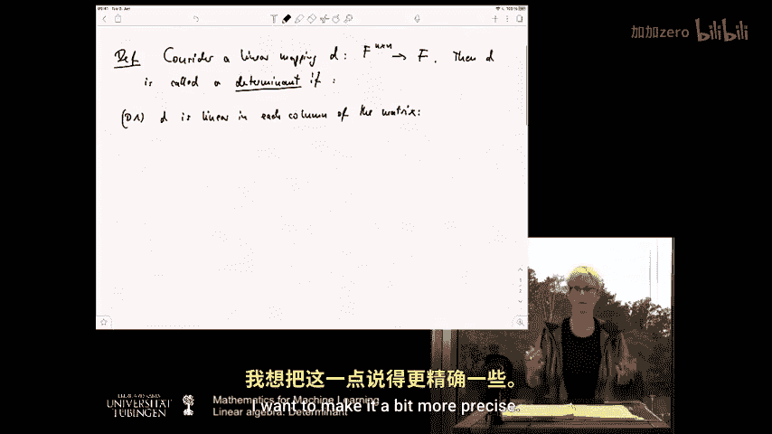

# 012：行列式 📐

在本节课中，我们将学习线性代数中的一个核心概念——行列式。行列式不仅在代数中非常重要，在分析学和优化问题（例如计算积分或运行梯度下降算法）中也扮演着关键角色。它能够揭示映射导数的许多重要性质。

## 抽象定义与性质

首先，我们从抽象定义开始。行列式是一个从 **F^(n×n)** 到 **F** 的映射，记作 **D**。这里的 **F** 代表一个固定的数域（如实数域或复数域），并且这个映射仅针对**方阵**。

接下来，我们看看一个映射 **D** 需要满足哪些性质才能被称为行列式。

以下是定义行列式的三个核心性质：

1.  **D1：列线性性**
    行列式 **D** 在其矩阵的每一列上都是线性的。这意味着，如果我们固定其他所有列，那么行列式关于任一列都是一个线性函数。

2.  **D2：交替性**
    如果矩阵 **A** 中有两列完全相同，那么其行列式 **D(A)** 等于零。

3.  **D3：规范性**
    单位矩阵 **I** 的行列式值为 1，即 **D(I) = 1**。

## 几何直观

上一节我们介绍了行列式的抽象定义和性质，本节中我们来看看它的几何意义，这有助于我们更直观地理解。

对于一个从 **R^n** 到 **R^n** 的线性映射（由一个 **n×n** 矩阵 **A** 表示），其行列式的绝对值 **|det(A)|** 描述了该映射对空间进行变换时，**体积的缩放因子**。

具体来说：
*   如果 **|det(A)| > 1**，变换会放大体积。
*   如果 **|det(A)| = 1**，变换保持体积不变（例如旋转、反射）。
*   如果 **0 < |det(A)| < 1**，变换会缩小体积。
*   如果 **det(A) = 0**，意味着矩阵 **A** 是奇异的，它将整个空间压缩到一个更低维度的子空间中（例如，将平面压缩成一条线），因此体积缩放因子为0。

行列式的**符号**则指示了该线性变换是否改变了空间的**定向**。正号表示保持定向（如旋转），负号表示反转定向（如镜像反射）。

## 计算方法与性质

理解了行列式的定义和几何意义后，本节我们来看看它的一些关键性质和基本计算方法。

以下是行列式的一些重要性质：

*   **转置不变性**：矩阵的行列式与其转置矩阵的行列式相等，即 **det(A) = det(A^T)**。
*   **乘积的行列式**：两个方阵乘积的行列式等于它们行列式的乘积，即 **det(AB) = det(A) det(B)**。
*   **逆矩阵的行列式**：如果矩阵 **A** 可逆，那么 **det(A^{-1}) = 1 / det(A)**。
*   **行列式与秩**：矩阵的行列式为零（**det(A) = 0**）是矩阵**不可逆**（即奇异）的充要条件。

对于小型矩阵，有直接的公式：
*   **2×2 矩阵**：`det([[a, b], [c, d]]) = a*d - b*c`
*   **3×3 矩阵**：可以使用萨鲁斯法则（对角线法则）计算。

对于更大的矩阵，通常通过**行化简**（高斯消元法）将其化为上三角矩阵，然后行列式的值就是主对角线上元素的乘积。需要注意的是，行交换会改变行列式的符号，而行倍加不改变行列式的值。

## 总结

本节课中，我们一起学习了行列式这一核心概念。我们从其抽象定义和三条基本性质（列线性性、交替性、规范性）出发，探讨了其几何直观——作为线性变换下体积的缩放因子和定向的改变指示器。最后，我们回顾了行列式的主要性质和基本计算方法。理解行列式对于深入学习机器学习中的优化、概率模型等主题至关重要。