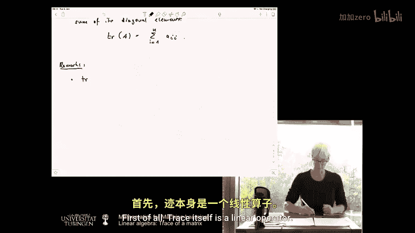

# 015：矩阵的迹 📐

在本节课中，我们将要学习一个名为“矩阵的迹”的概念。迹是一个用于总结矩阵某些性质的数字，它在机器学习的多个领域中都很有用。

## 定义

首先，让我们从定义开始。矩阵的迹定义如下：对于一个**方阵**（即行数和列数相等的矩阵），其迹是该矩阵**主对角线上所有元素的和**。

我们可以用公式来表示。设矩阵 **A** 是一个 `n x n` 的方阵，其元素为 `a_ij`，其中 `i` 表示行号，`j` 表示列号。那么矩阵 **A** 的迹 `tr(A)` 定义为：

`tr(A) = a_11 + a_22 + ... + a_nn = Σ_{i=1}^{n} a_ii`

简单来说，你只需要将矩阵从左上角到右下角对角线上的所有数字加起来。

## 性质

了解了迹的定义后，我们来看看它的一些重要性质。这些性质解释了为什么迹是一个有用的工具。

### 性质一：线性算子

迹本身是一个**线性算子**。这意味着它满足线性运算的两个基本规则：可加性和齐次性。

具体来说，对于任意两个同阶方阵 **A** 和 **B**，以及任意标量 `c`，以下等式成立：
*   `tr(A + B) = tr(A) + tr(B)`
*   `tr(cA) = c * tr(A)`

这个性质很容易理解，因为矩阵相加或数乘时，其对角线元素也相应地相加或相乘，所以它们的和（即迹）也遵循同样的规则。

### 性质二：循环置换不变性

迹有一个非常独特且有用的性质：对于矩阵的乘积，迹在**循环置换**下保持不变。

这意味着，对于矩阵 **A** 和 **B**，即使矩阵乘法的顺序通常不可交换（即 `AB ≠ BA`），但它们的迹在循环顺序下是相等的。公式表达如下：

`tr(AB) = tr(BA)`

这个性质可以推广到更多矩阵的乘积，只要保持循环顺序，迹就不变。例如：
`tr(ABC) = tr(BCA) = tr(CAB)`

这个性质在简化涉及矩阵乘积的表达式时非常强大。

## 总结

本节课中我们一起学习了矩阵的迹。我们首先给出了迹的正式定义：方阵主对角线元素之和。接着，我们探讨了它的两个核心性质：它是一个线性算子，并且对于矩阵乘积具有循环置换不变性。理解矩阵的迹是掌握更高级线性代数概念和机器学习算法的基础。