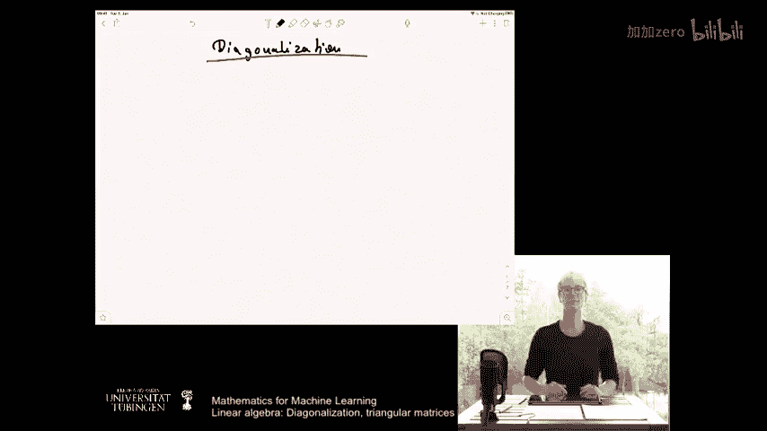
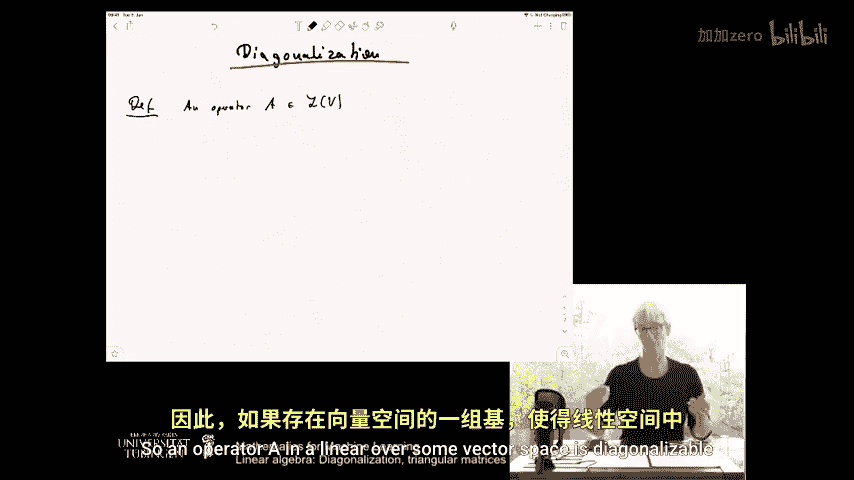
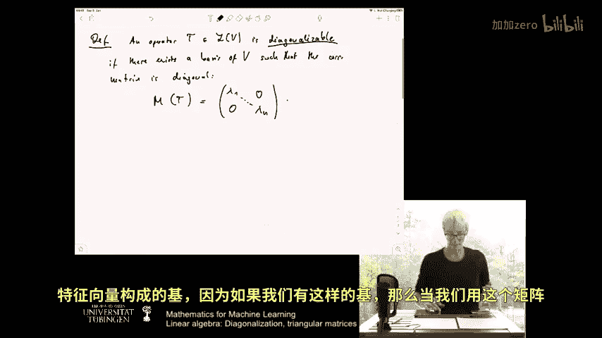
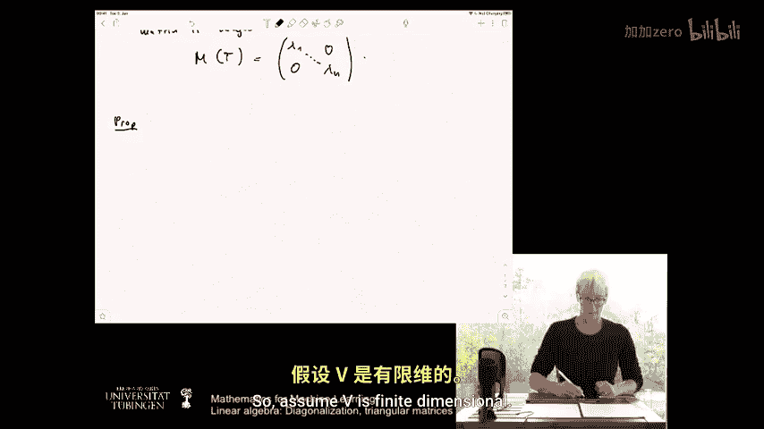
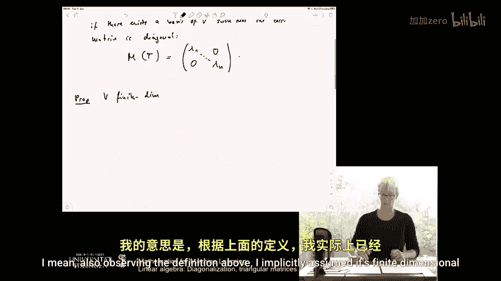
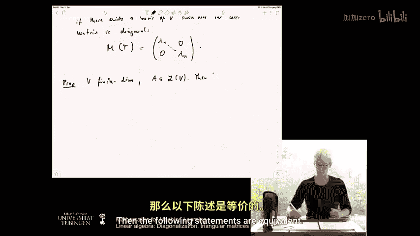

# 016：对角化与三角矩阵



在本节课中，我们将学习线性代数中一个核心概念——对角化。我们将探讨什么情况下一个线性算子可以被对角化，以及与之相关的三角矩阵的性质。

## 对角化的定义

上一节我们介绍了特征值和特征向量的概念，本节中我们来看看如何利用它们来简化线性算子的表示。

我们称一个线性算子是**可对角化**的，如果存在向量空间的一组基，使得该算子在这组基下的矩阵表示是一个对角矩阵。



具体来说，设 **T** 是定义在向量空间 **V** 上的一个线性算子。如果存在 **V** 的一组基 **B**，使得算子 **T** 在这组基下的矩阵 **A** 是一个对角矩阵，那么 **T** 就是可对角化的。

矩阵 **A** 的形式如下：
```
A = [ λ₁   0   ...   0  ]
    [  0   λ₂  ...   0  ]
    [ ...  ...  ...  ... ]
    [  0   0   ...  λₙ ]
```
其中，λ₁, λ₂, ..., λₙ 是对角线上的元素，其余位置均为零。

这意味着，构成这组基 **B** 的向量恰好是算子 **T** 的特征向量。因为当我们用矩阵 **A** 乘以第一个基向量（即第一个特征向量）时，我们得到 λ₁ 乘以该向量本身，这正是特征向量的定义。

## 可对角化的等价条件

现在，我们总结一下在有限维向量空间中，线性算子可对角化的一些等价条件。理解这些条件有助于我们判断一个算子是否可以被简化。

假设 **V** 是一个有限维向量空间，**T** 是 **V** 上的一个线性算子。那么，以下陈述是等价的：

以下是这些等价陈述的列表：
1.  **T** 是可对角化的。
2.  存在 **V** 的一组由 **T** 的特征向量构成的基。
3.  **V** 可以分解为 **T** 的特征空间的直和。即，如果 λ₁, ..., λₘ 是 **T** 的所有互异特征值，那么 **V** 等于所有特征空间 **E(λᵢ)** 的直和。
4.  **T** 的特征多项式的所有根都在标量域中，并且每个特征值的代数重数等于其几何重数。（代数重数是特征多项式根的重数，几何重数是相应特征空间的维数）。



## 三角矩阵



在探讨对角化的过程中，三角矩阵扮演着重要的角色。并非所有矩阵都能对角化，但一个非常有力的结论是，在复数域上，每个方阵都相似于一个上三角矩阵。

更精确地说，设 **T** 是有限维复向量空间 **V** 上的线性算子。那么，存在 **V** 的一组基，使得 **T** 在这组基下的矩阵是一个上三角矩阵。



这个定理的证明思路是使用数学归纳法，并巧妙地利用特征值的存在性（在复数域上保证存在）来逐步构造这组基。这个结论是证明许多重要定理（如舒尔分解、谱定理）的基础。

## 总结



本节课中我们一起学习了线性算子对角化的核心思想。我们首先定义了可对角化的概念，即存在一组特征向量基使得算子矩阵为对角形。然后，我们列出了判断可对角化的几个等价条件，这些条件将特征值、特征空间和重数联系了起来。最后，我们介绍了三角矩阵，了解到在复数域上，任何线性算子至少可以表示为一个上三角矩阵，这为处理更一般的算子提供了有力的工具。理解这些内容是学习后续更高级矩阵分解（如特征分解、奇异值分解）的关键。