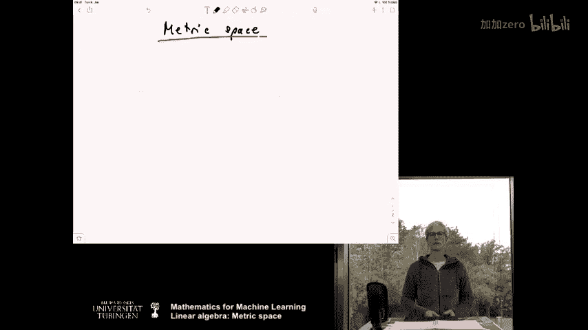
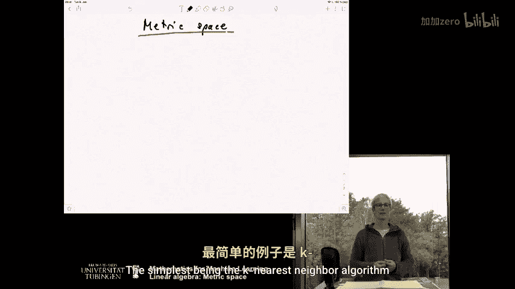

# 017：度量空间

在本节课中，我们将学习度量空间的概念。虽然我们目前处于线性代数的课程中，但理解度量空间是后续引入范数、内积乃至希尔伯特空间的基础。此外，度量在机器学习中应用广泛，例如K近邻算法等。

## 什么是度量空间？

上一节我们介绍了线性代数的基础，本节中我们来看看度量空间。度量空间的核心是定义了一种“距离”的概念。

首先，我们从一个对象的集合开始。设 **X** 为任意集合。这个集合可以包含任何东西，例如分子、文本、图像等。

接下来，我们定义一种作用于该空间上的函数，称为**度量**。一个函数 **d**，其定义域为 **X × X**（即取数据点对作为输入），并将其映射到一个实数。这样的函数被称为度量，如果它满足以下条件：

对于空间中所有的 **u, v, w**，满足以下性质：

以下是度量必须满足的三个核心性质：

1.  **非负性**：度量值总是非负的。两个不同对象之间的距离不应为负，这符合我们的直觉。
    *   **公式**：`d(x, y) ≥ 0`
    *   并且，当且仅当两点相同时，距离为零。
        *   **公式**：`d(x, y) = 0 ⇔ x = y`

2.  **对称性**：从 **x** 到 **y** 的距离等于从 **y** 到 **x** 的距离。
    *   **公式**：`d(x, y) = d(y, x)`

3.  **三角不等式**：两点之间的直接距离，总是小于或等于经过第三点的距离之和。这是“两点之间线段最短”的数学表述。
    *   **公式**：`d(x, z) ≤ d(x, y) + d(y, z)`

## 为什么需要度量空间？

度量空间为我们提供了一种严格的方式来讨论抽象元素之间的“接近”或“相似”程度。在机器学习中，许多算法（如K近邻算法）的核心就是计算数据点之间的距离，以进行分类或预测。因此，理解度量空间是理解这些算法背后数学原理的重要一步。

本节课中我们一起学习了度量空间的定义及其核心性质。我们了解到，度量是一个满足非负性、对称性和三角不等式的距离函数。它为我们在任意集合上讨论几何关系奠定了基础，是连接线性代数与更高级空间概念（如赋范空间、内积空间）的关键桥梁。