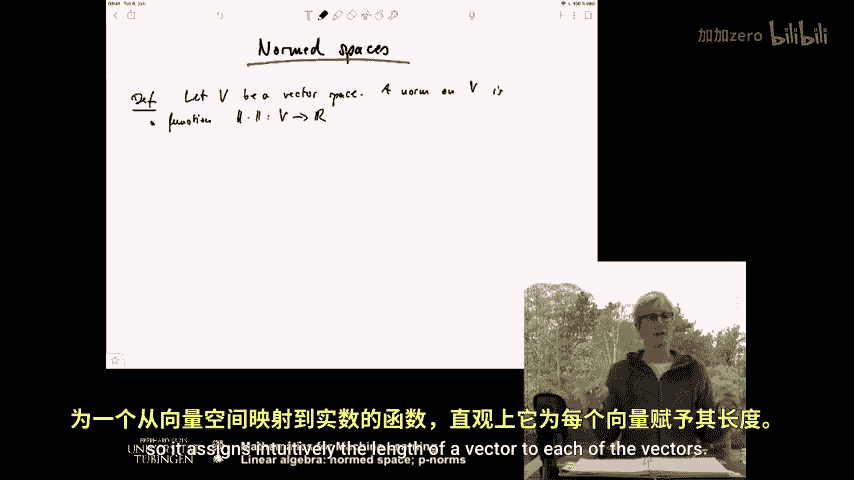

# 018：赋范空间与p-范数

在本节课中，我们将学习赋范空间的概念，并介绍一种重要的范数类型——p-范数。我们将从向量空间出发，定义范数，并探讨其基本性质。

## 从度量空间到赋范空间

在上一讲中，我们介绍了度量空间。现在，我们将引入赋范空间的概念。

这让我们回到了线性代数的领域，因为要定义一个赋范空间，我们首先需要一个向量空间。

让我们开始吧。

## 赋范空间的定义

我们定义赋范空间如下。

设 **V** 是一个向量空间。我们定义一个作用于该向量空间上的函数，这个函数称为**范数**。

一个向量空间 **V** 上的**赋范空间**，或简称 **V** 上的范数，是一个函数。我们通常用两个双竖线来表示它，即 `|| · ||`。

你可能见过这种表示法，它表示一个向量的范数。如果我们想把它定义为一个函数，有时会这样写：`|| · ||`，在中间加一个点，这意味着点是放置参数的位置。这是因为我们没有像 `f(x)` 那样的标准函数记号，所以用这种两边带竖线的特殊记号，并在中间加点来表示这是一个函数。

这个函数从向量空间映射到实数集，直观上，它为每个向量分配一个“长度”。

现在，我们需要这个函数满足一系列性质。

对于向量空间 **V** 中的所有向量 **x**、**y**，以及标量域 **F** 中的任意标量 **λ**，必须满足以下四个条件：

1.  **绝对齐次性**：`||λx|| = |λ| * ||x||`
    直观上，这意味着如果你将向量乘以5，那么新向量的长度应该是原向量长度的5倍。

2.  **三角不等式**：`||x + y|| ≤ ||x|| + ||y||`
    这个性质保证了向量加法的“长度”不会超过各自长度的和。

3.  **正定性**：`||x|| ≥ 0`
    向量的长度总是非负的。

4.  **确定性**：`||x|| = 0` 当且仅当 `x = 0`
    只有零向量的长度为零。

## 引入p-范数

在定义了范数的一般概念后，我们来看一类非常重要且常用的具体范数——**p-范数**。

对于一个n维向量 **x = (x₁, x₂, ..., xₙ)**，其p-范数定义为：

`||x||_p = (|x₁|^p + |x₂|^p + ... + |xₙ|^p)^(1/p)`

其中，**p** 是一个满足 `p ≥ 1` 的实数。

以下是几种最常见的p-范数：

*   **1-范数（曼哈顿范数）**：`||x||_1 = |x₁| + |x₂| + ... + |xₙ|`
    它计算向量各分量绝对值的和，得名于城市网格中两点间的行走距离。

*   **2-范数（欧几里得范数）**：`||x||_2 = sqrt(x₁² + x₂² + ... + xₙ²)`
    这是我们最熟悉的“长度”概念，对应于欧几里得空间中的直线距离。

*   **∞-范数（最大值范数）**：`||x||_∞ = max(|x₁|, |x₂|, ..., |xₙ|)`
    它取向量所有分量绝对值的最大值。

## 总结

本节课中，我们一起学习了赋范空间的核心概念。我们从向量空间出发，定义了满足**绝对齐次性**、**三角不等式**、**正定性**和**确定性**四个条件的范数函数。随后，我们介绍了一类具体的范数——**p-范数**，并了解了其通用公式 `||x||_p = (Σ|x_i|^p)^(1/p)`，以及当p取1、2和无穷大时所对应的特殊范数（曼哈顿范数、欧几里得范数和最大值范数）。理解这些概念是学习更高级机器学习算法中优化和正则化等内容的重要数学基础。