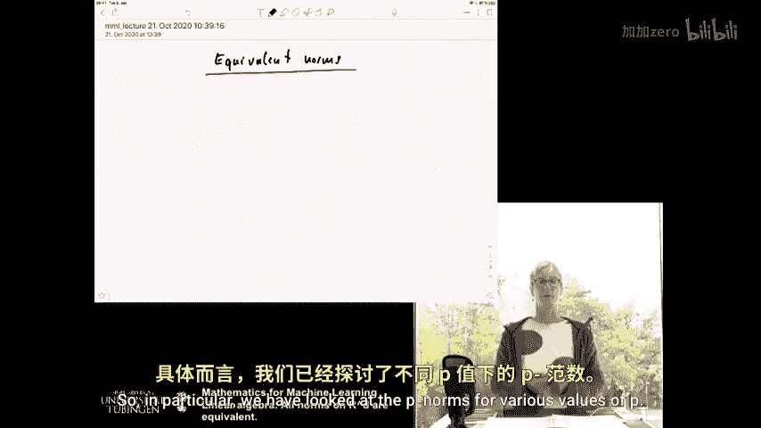
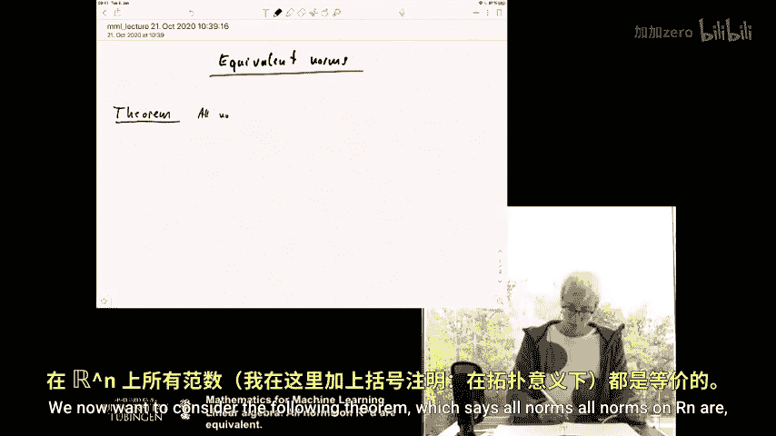

**机器学习数学：P19：R^d上的范数等价性**

在本节课中，我们将学习一个重要的数学定理：在有限维空间（如 R^d）上，所有范数在拓扑意义上是等价的。这意味着，虽然不同的范数（如L1、L2范数）在数值和几何意义上不同，但从序列收敛性等拓扑性质来看，它们的作用是“等价”的。我们将探讨这个定理的含义、证明思路及其对机器学习的启示。

---

我们之前已经了解了如何在欧几里得空间（例如 R^d）上定义各种范数。

具体来说，我们研究过不同p值下的p-范数。

从纯数学的角度看，人们可能会疑惑为何要定义这么多范数，因为数学家通常会指出：在 R^n 上，所有范数都是等价的。这个说法是正确的，这正是本节课要讨论的定理。

需要在一开始就说明一个注意事项。这里的“等价”是指范数之间可以相互转换，存在连续且有界的变换关系。然而，对于机器学习而言，这些范数并不“等价”，因为它们会给算法引入非常不同的偏差或偏好。因此，尽管从严格的数学拓扑视角看范数是等价的，但当它们被应用到实际算法中时，表现会截然不同。

不过，我们仍然要学习这个定理，因为在机器学习的理论分析中，例如在研究序列收敛性等问题时，知道所有范数在拓扑上等价意味着我们可以在证明时选择最方便操作的范数，而不影响结论的一般性。

以下是定理的正式陈述。

该定理指出：在 R^n 上，所有范数在拓扑意义上是等价的。

“拓扑等价”具体是什么意思呢？其含义是：假设我们有两个范数，分别记为 **||·||_A** 和 **||·||_B**，它们都定义在 R^n 上。那么，存在两个大于零的常数 **c** 和 **C**，使得对于 R^n 中的所有向量 **x**，以下不等式恒成立：

**c * ||x||_B ≤ ||x||_A ≤ C * ||x||_B**

---

**定理的核心思想**

这个不等式是理解“等价性”的关键。它表明，一个范数下的值可以被另一个范数的值所控制，上下都有界。因此，如果一个向量序列在一种范数下趋近于零（即收敛），那么在另一种范数下它也必然趋近于零。这就保证了收敛性等拓扑性质在所有范数下是一致的。

**证明思路简述（针对初学者）**

完整的证明涉及一些数学分析技巧，但其核心思想可以概括如下：
1.  可以证明，在 R^n 上，任何范数 **||·||** 都是其自变量的连续函数。
2.  考虑单位球面 **S = {x ∈ R^n | ||x||_2 = 1}**（在欧几里得范数下）。这是一个**紧致**的集合。
3.  在紧致集合上，连续函数既能取到最大值，也能取到最小值。
4.  因此，我们想要比较的范数 **||·||_A** 在单位球面 **S** 上存在正的最小值 **m** 和最大值 **M**。
5.  利用范数的齐次性（**||αx|| = |α| ||x||**），可以将球面上的结论扩展到整个 R^n 空间，从而得到形如 **m * ||x||_2 ≤ ||x||_A ≤ M * ||x||_2** 的不等式。
6.  通过欧几里得范数 **||·||_2** 作为“桥梁”，就可以连接任意两个范数 **||·||_A** 和 **||·||_B**，证明它们满足等价不等式。

**对机器学习的意义**

尽管范数在数学上等价，但在机器学习实践中，选择不同的范数作为正则化项（如L1正则化、L2正则化）会导致模型具有完全不同的性质：
*   **L1范数** 倾向于产生稀疏解（许多系数为零），可用于特征选择。
*   **L2范数** 倾向于让系数均匀地变小，能有效防止过拟合，但解通常不稀疏。

因此，在算法设计中，范数的选择是基于其诱导的**归纳偏差**，而不是基于它们在拓扑上的等价性。这个定理的价值在于理论分析层面，它保证了我们在分析算法收敛性等理论性质时，可以自由选择最便于数学处理的范数形式。

---

**总结**

本节课我们一起学习了 **R^d 上范数的等价性定理**。我们了解到，从拓扑学的角度看，有限维空间上的所有范数都是等价的，这意味着它们定义的收敛性等概念是一致的。该定理的关键是一个双边不等式：**c * ||x||_B ≤ ||x||_A ≤ C * ||x||_B**。我们简述了其证明思路，并重点讨论了该定理对机器学习的启示：**理论上的等价性不等于实践中的可互换性**。在构建模型时，L1、L2等不同范数正则化项的选择，是基于它们所带来的独特偏差，以实现特征选择或防止过拟合等具体目标。