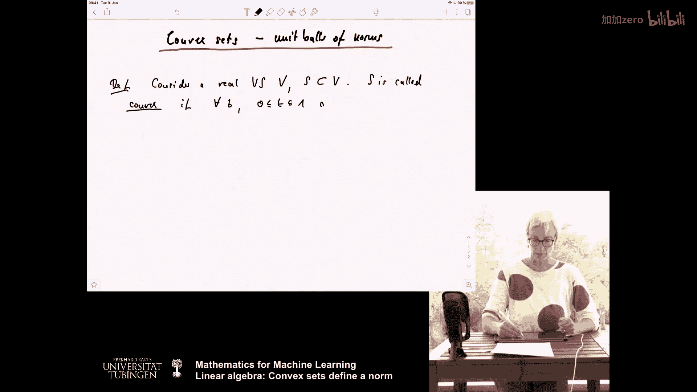

# 020：凸集诱导范数 📐

在本节课中，我们将要学习一个重要的概念：范数与凸集之间的双向关系。我们将看到，一个范数的单位球总是一个凸集。更重要的是，一个满足特定对称性的凸集，反过来可以用来定义一个范数。这个原理在机器学习中非常有用，因为它允许我们超越标准的范数，根据特定的“归纳偏好”来构造新的范数。

上一节我们介绍了范数，特别是p-范数。本节中我们来看看范数的单位球与凸集之间的深刻联系。

## 回顾：凸集的定义

在深入定理之前，我们先回顾一下凸集的定义，以确保概念清晰。

考虑一个实数向量空间 **R^D**。现在考虑一个集合 **S**，它是我们向量空间中的一个子集。

**定义**：集合 **S** 被称为**凸集**，当且仅当对于所有介于0和1之间的参数 **t**（即 **0 ≤ t ≤ 1**），以及集合中的任意两点 **x** 和 **y**，它们的凸组合仍然在集合内。

用公式表示如下：
对于任意 **x, y ∈ S** 和任意 **t ∈ [0, 1]**，都有：
**t*x + (1-t)*y ∈ S**

这个定义意味着，连接集合中任意两点的线段上的所有点，也都属于这个集合。

## 范数的单位球是凸集

当我们之前研究p-范数时，我们观察了它们的单位球。我们注意到，当 **p ≥ 1** 时，单位球通常是一个“漂亮”的凸集。而当 **0 < p < 1** 时，单位球会呈现出一种奇特的、非凸的形状。

这引出了我们的第一个关键观察：**任何范数的单位球都是一个凸集**。这是由范数的三角不等式和绝对齐次性所保证的性质。

## 从凸集诱导出范数

更有趣的是，这个过程可以反过来。如果我们有一个满足特定条件的凸集，我们可以用它来定义一个范数。

**定理**：设 **B ⊂ R^D** 是一个满足以下条件的凸集：
1.  **对称性**：如果 **x ∈ B**，那么 **-x ∈ B**。
2.  **有界性**：**B** 是有界的。
3.  **吸收性**：对于 **R^D** 中的任意非零向量 **x**，都存在某个标量 **λ > 0**，使得 **x ∈ λB**（即 **x/λ ∈ B**）。
4.  **包含原点**：**0 ∈ B**。

那么，我们可以通过以下方式定义一个函数 **||·||_B : R^D → R**：
**||x||_B = inf { λ > 0 : x ∈ λB }**

这个函数 **||·||_B** 是 **R^D** 上的一个范数，并且 **B** 恰好是这个范数的单位球（即 **{ x : ||x||_B ≤ 1 }**）。

### 如何理解这个诱导范数

这个定义可以直观地理解为：向量 **x** 的范数，是使得 **x** 刚好被“缩放”进凸集 **B** 所需的最小缩放系数 **λ**。

以下是这个构造过程的核心步骤：
1.  从一个“好”的凸集 **B**（满足上述四个条件）开始。
2.  对于空间中的任何一个向量 **x**，我们寻找所有能把它“装进”凸集 **B** 的缩放因子 **λ**。
3.  取这些缩放因子中最小的那个，定义为 **x** 的范数。

在机器学习中，这个原理非常强大。有时，直接写出一个范数的解析式很困难，但我们可以通过描述一个凸集来隐式地定义它。这个凸集就体现了算法对解空间的“归纳偏好”或先验信念。例如，我们可以设计一个非圆形的凸集，来诱导一个在不同方向上具有不同缩放特性的范数，从而在正则化中施加更复杂、更符合问题结构的约束。

## 总结

本节课中我们一起学习了范数与凸集之间的对偶关系。
*   首先，我们回顾了凸集的定义：连接集合内任意两点的线段仍包含在集合内。
*   其次，我们确认了任何范数的单位球都是一个凸集。
*   最后，也是最重要的，我们学习了一个定理：一个对称、有界、吸收且包含原点的凸集 **B**，可以用来诱导出一个范数 **||x||_B**。这个范数定义为将向量 **x** “缩放”进 **B** 所需的最小系数。

这个结果不仅优美，而且实用。它为我们提供了一种强大的工具，能够根据具体的机器学习任务需求，通过设计合适的凸集来创造定制化的范数，从而更灵活地控制模型的复杂度与性质。