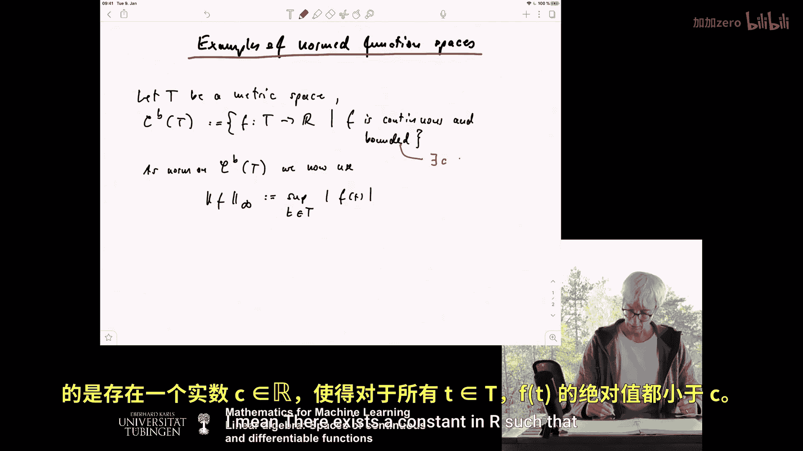

# 021：连续与可微函数空间 📚

在本节课中，我们将学习如何将函数空间，特别是连续有界函数空间，构建成一个赋范向量空间。我们将定义其上的范数，并验证其性质。

---

我们已经见过几个赋范空间的例子。

以下是另一组例子，它们由函数空间构成。

让我们从连续函数空间开始。我们已经知道连续函数空间是一个向量空间。

现在，我们想看看如何将其变成一个赋范向量空间。

考虑一个度量空间 **T**。

或者更一般地说，你也可以考虑一个拓扑空间，但在本讲座中，我们始终假设你处于一个度量空间中。

这是我们的函数定义的空间。

然后我们考虑空间 **C(T)**，它由定义在该空间上的有界函数构成。

所以，**C(T)** 是所有从 **T** 映射到 **R** 的函数的集合。

其中函数 **f** 是连续且有界的。

注意，要定义函数是否连续，我们需要一个拓扑结构，在我们的情况下是度量。

这是一个简单的函数空间，现在我们想将其变成一个赋范空间。

因此，我们需要在该空间上定义一个范数，然后检查它是否具有我们期望的性质。

所以，作为该空间上的范数。

有时我写这个空间时用花体，有时不用花体。

我们使用上确界范数。

范数定义为 **||f||∞**。

函数 **f** 的 **∞-范数** 是其绝对值的上确界。

即函数在所有定义域元素上所取值的绝对值的最大值，如果这个上确界存在的话。

在这种情况下它确实存在，因为我们处于一个有界函数空间中，所以根据定义，所有函数都是有上界的。

为了确保每个人都明白我的意思，我明确写出“有界”的含义。有界意味着存在一个常数 **C**，使得对于所有 **t ∈ T**，都有 **|f(t)| ≤ C**。

---

**总结**

本节课中，我们一起学习了如何将连续有界函数空间 **C(T)** 构建为赋范向量空间。我们定义了其上的上确界范数 **||f||∞ = sup_{t∈T} |f(t)|**，并解释了由于函数有界，该范数总是存在的。这为我们研究更复杂的函数空间和分析奠定了基础。