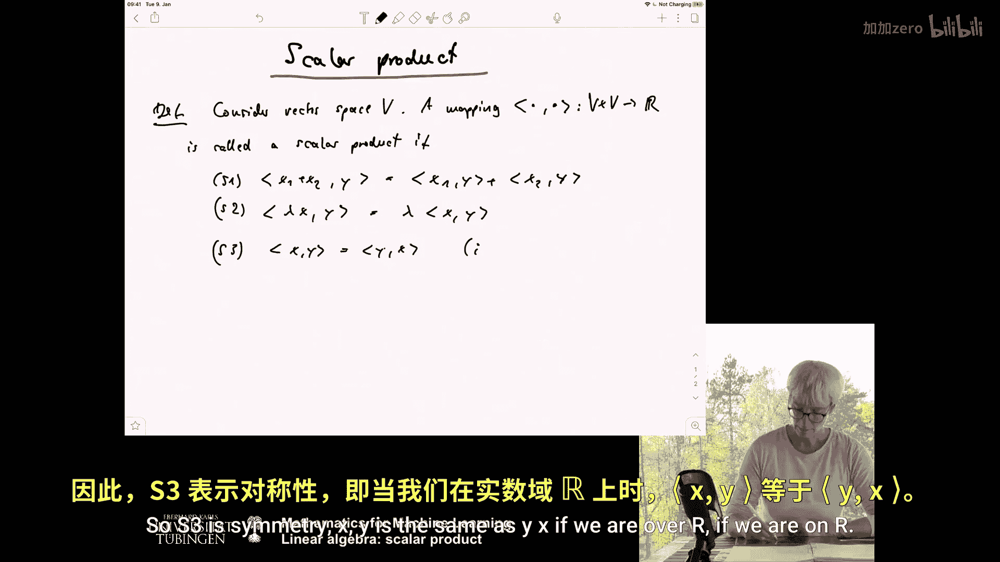

# 023：内积 ✨

在本节课中，我们将要学习向量空间中的另一个重要结构——内积。上一节我们介绍了赋范向量空间，它允许我们测量向量之间的距离。本节中，我们将更进一步，探讨一种比范数更强的结构，它不仅能测量距离，还能测量向量之间的角度。

## 从范数到内积

在之前的课程中，我们研究了赋范向量空间。这些向量空间除了向量空间的基本结构外，还拥有一个额外的结构——范数。

**范数** 是一个函数，它将每个向量映射到一个非负实数，用于衡量向量的“长度”或“大小”。其定义如下：

对于一个向量空间 \( V \)，范数是一个函数 \( \| \cdot \|: V \rightarrow \mathbb{R} \)，满足：
1.  **正定性**：对于所有 \( x \in V \)，有 \( \|x\| \geq 0 \)，且 \( \|x\| = 0 \) 当且仅当 \( x = 0 \)。
2.  **齐次性**：对于所有 \( x \in V \) 和所有标量 \( \lambda \)，有 \( \|\lambda x\| = |\lambda| \|x\| \)。
3.  **三角不等式**：对于所有 \( x, y \in V \)，有 \( \|x + y\| \leq \|x\| + \|y\| \)。

通过范数，我们可以在向量空间中测量距离，例如，两个向量 \( x \) 和 \( y \) 之间的距离可以定义为 \( \|x - y\| \)。

现在，我们希望更进一步，考虑一种被称为**内积空间**的向量空间。内积是一种比范数更强的结构。具体来说，它不仅可以用来测量距离，还可以用来测量向量空间中的角度。

## 内积的定义

让我们像往常一样，从定义开始。我们考虑一个向量空间 \( V \)。

现在，我们说我们考虑一个映射。这个映射写作：

\[
\langle \cdot, \cdot \rangle: V \times V \rightarrow \mathbb{R}
\]

所以，内积将被写成这种括号形式，例如 \( \langle x, y \rangle \) 表示向量 \( x \) 和 \( y \) 的内积。这是一个以两个向量作为输入的函数，定义在空间 \( V \times V \) 上，其值域是实数集 \( \mathbb{R} \)。

这个映射被称为**内积**，如果它满足以下几个性质。

以下是内积必须满足的性质：

1.  **对第一个参数的线性性**：
    *   **加法**：对于所有 \( x_1, x_2, y \in V \)，有 \( \langle x_1 + x_2, y \rangle = \langle x_1, y \rangle + \langle x_2, y \rangle \)。
    *   **标量乘法**：对于所有 \( x, y \in V \) 和所有标量 \( \lambda \in \mathbb{R} \)，有 \( \langle \lambda x, y \rangle = \lambda \langle x, y \rangle \)。
    这本质上是对第一个参数的线性性。由于对称性（下一条性质），这个性质也自然地扩展到第二个参数。

2.  **对称性**：对于所有 \( x, y \in V \)，有 \( \langle x, y \rangle = \langle y, x \rangle \)。

3.  **正定性**：对于所有 \( x \in V \)，有 \( \langle x, x \rangle \geq 0 \)，且 \( \langle x, x \rangle = 0 \) 当且仅当 \( x = 0 \)。

## 内积与范数的关系

一个配备了内积的向量空间自动成为一个赋范向量空间。我们可以从内积自然地诱导出一个范数：

\[
\|x\| = \sqrt{\langle x, x \rangle}
\]

这个范数满足之前提到的所有范数公理。更重要的是，通过内积，我们可以定义两个非零向量 \( x \) 和 \( y \) 之间的夹角 \( \theta \)：

\[
\cos \theta = \frac{\langle x, y \rangle}{\|x\| \|y\|}
\]

这为我们提供了在向量空间中量化“方向相似性”或“正交性”（当内积为0时）的工具。

## 总结

本节课中我们一起学习了内积的概念。我们首先回顾了赋范向量空间，然后引入了更强大的内积结构。内积是一个从向量空间 \( V \) 的笛卡尔积到实数 \( \mathbb{R} \) 的映射，它必须满足线性性（对第一个参数，并由对称性扩展到第二个参数）、对称性和正定性。内积不仅允许我们通过诱导的范数来测量长度和距离，还使我们能够定义和计算向量之间的角度，这是许多机器学习算法（如主成分分析、支持向量机等）的核心几何基础。