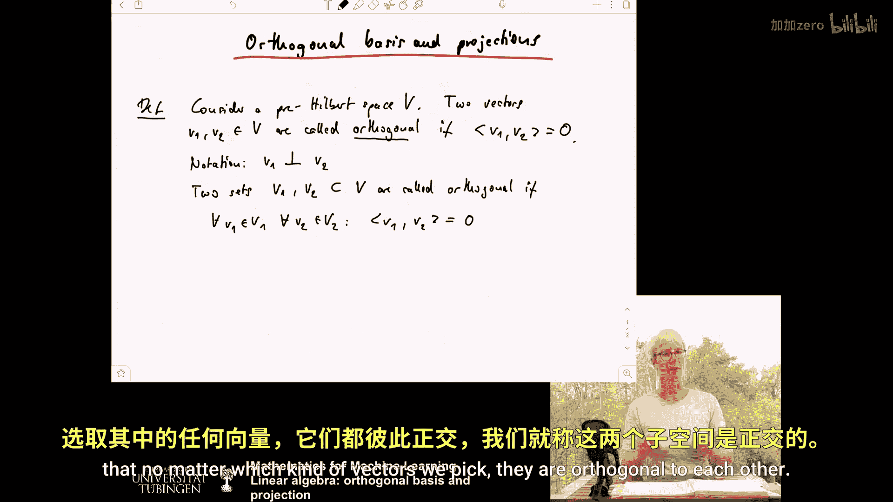

# 024：正交向量与正交基 🔍

在本节课中，我们将要学习如何使用内积来定义向量空间中的正交性。我们将从两个向量正交的定义开始，然后扩展到集合和子空间的正交性，最后介绍正交基的概念。

上一节我们介绍了内积是什么，本节中我们来看看如何使用它。

内积通常用于测量向量空间中的角度，特别是用于定义两个向量何时相互正交。

让我们开始吧。

假设我们处在一个具有内积的向量空间中，即一个预希尔伯特空间。

考虑一个预希尔伯特空间 **V**。

以下是两个向量正交的定义。

**定义**：空间 **V** 中的两个向量 **v₁** 和 **v₂** 被称为**正交**的，当且仅当它们的内积为零。

公式表示为：
**⟨v₁, v₂⟩ = 0**

这是内积的主要用途之一。当两个向量的内积为0时，我们称这两个向量正交。

有时我们使用符号 **v₁ ⟂ v₂** 来表示正交。这不是完全标准的符号，但被广泛使用。

现在我们知道了两个向量何时正交，接下来我们可以定义两个向量集合何时正交。

以下是两个集合正交的定义。

**定义**：设 **V₁** 和 **V₂** 是向量空间 **V** 的两个子集。如果对于 **V₁** 中的所有向量 **v₁** 和 **V₂** 中的所有向量 **v₂**，都有 **⟨v₁, v₂⟩ = 0**，则称这两个集合是**正交**的。

这通常应用于子空间。如果两个子空间满足上述要求，我们称这两个子空间是正交的。

接下来，我们介绍一个非常重要的概念：正交基。

在上一节中，我们讨论了基向量。现在，我们引入一个更强的条件：正交基。

**定义**：向量空间 **V** 的一个基 **B = (b₁, ..., bₙ)** 被称为**正交基**，如果基中的所有向量都是两两正交的。

这意味着对于所有 **i ≠ j**，都有：
**⟨bᵢ, bⱼ⟩ = 0**

正交基是一个非常有用的概念，因为它能极大地简化许多计算，例如坐标的求解。

最后，我们总结一下本节课的核心内容。

本节课中我们一起学习了：
1.  **正交向量**：两个向量正交当且仅当它们的内积为零。
2.  **正交集合/子空间**：两个集合（通常是子空间）正交，当且仅当其中一个集合中的任意向量与另一个集合中的任意向量的内积都为零。
3.  **正交基**：一个基被称为正交基，如果其所有基向量都是两两正交的。

理解正交性是深入学习线性代数和机器学习中许多算法（如主成分分析、傅里叶变换等）的基础。