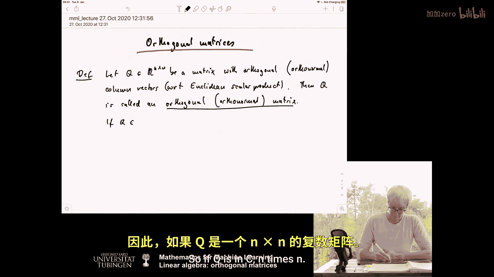

# 025：正交矩阵 🔄

在本节课中，我们将要学习一种特殊的矩阵——正交矩阵。我们已经了解了向量正交以及正交基的含义，现在来看看由这些向量构成的矩阵具有哪些美妙的性质。

## 正交矩阵的定义

上一节我们介绍了正交基的概念，本节中我们来看看如何用矩阵来描述一组正交向量。

假设我们有一个矩阵 **Q**，它属于 **R^(n×n)** 空间（即一个 n 行 n 列的实矩阵）。如果这个矩阵的所有列向量都彼此正交，那么这样的矩阵被称为**正交矩阵**。

更具体地说，对于矩阵 **Q** 的任意两个不同的列向量 **q_i** 和 **q_j**，它们满足：
**<q_i, q_j> = 0** （当 i ≠ j 时）

这里的 **<·, ·>** 表示欧几里得内积（点积）。除非特别说明，我们在 **R^n** 中讨论内积时，默认指的就是欧几里得内积。

## 标准正交矩阵

如果矩阵 **Q** 不仅所有列向量彼此正交，而且每个列向量的长度（范数）都为 1，即满足：
**<q_i, q_i> = 1** （对所有 i）
那么这样的矩阵被称为**标准正交矩阵**。

在复数域 **C** 上，我们讨论的是标准复值内积（需要取复共轭），满足上述条件的矩阵则被称为**酉矩阵**。

## 正交矩阵的性质

正交矩阵和标准正交矩阵是线性代数中性质极好的一类矩阵。以下是它们的一些核心特性：

*   **保持内积和长度**：正交矩阵的线性变换不改变向量的内积和长度。这意味着，对于任意向量 **x** 和 **y**，有 **<Qx, Qy> = <x, y>**，且 **||Qx|| = ||x||**。这在几何上表示旋转或反射变换。
*   **逆矩阵易得**：对于正交矩阵 **Q**，其逆矩阵等于其转置矩阵，即 **Q^(-1) = Q^T**。对于酉矩阵，其逆矩阵等于其共轭转置，即 **U^(-1) = U^H**。这使得求逆运算变得非常简单。
*   **行列式的值**：正交矩阵的行列式值只能是 **+1** 或 **-1**。**+1** 对应纯粹的旋转变换，**-1** 对应包含反射的变换。

## 总结

本节课中我们一起学习了正交矩阵与标准正交矩阵（在复数域称为酉矩阵）的定义。我们了解到，这类矩阵的列向量构成一组正交（或标准正交）基。由于其列向量的特殊关系，正交矩阵拥有保持向量长度和内积、逆矩阵等于转置矩阵等优良性质，在几何变换和数值计算中扮演着至关重要的角色。