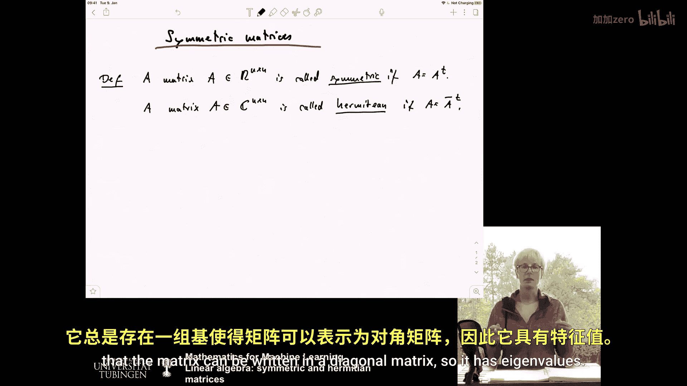

# 026：对称矩阵 🔄


在本节课中，我们将要学习一种在机器学习和线性代数中非常重要的矩阵类型——对称矩阵。我们将从定义开始，探讨其基本性质，并最终揭示其核心的谱分解定理。

我们已经了解了一类性质特别好的矩阵，即正交矩阵。现在，我们将研究其他同样性质良好的矩阵类型。第一种显而易见的“好”矩阵就是对称矩阵，仅从外观上看它就很规整。更重要的是，我们可以证明从谱（即特征值）的角度来看，它同样非常“好”，因为它拥有一个非常优美的谱分解。让我们开始吧。

## 对称矩阵的定义

首先，我们需要明确什么是对称矩阵。


一个矩阵 **A** ∈ ℝⁿˣⁿ 被称为**对称矩阵**，当且仅当 **A** 等于其转置矩阵 **Aᵀ**。


用公式表示为：
**A = Aᵀ**


这意味着矩阵的元素满足 **Aᵢⱼ = Aⱼᵢ**，即矩阵关于主对角线对称。


在复数域上，对应的概念是厄米特矩阵。一个矩阵 **A** ∈ ℂⁿˣⁿ 被称为**厄米特矩阵**，当且仅当 **A** 等于其共轭转置矩阵 **Aᴴ**。


用公式表示为：
**A = Aᴴ**


这不仅仅是关于主对角线反射，还需要对每个元素取复共轭。有时这类矩阵也被称为自伴矩阵，我们将在后续更广义的算子理论中定义它。


## 厄米特矩阵的特征值性质

关于厄米特矩阵，我们首先要提出的一个关键命题是：


**命题**：对于任意一个 ℂⁿˣⁿ 上的厄米特矩阵，其所有特征值都是实数。


这一点需要特别注意，因为在一般情况下并非如此。我们知道，在复数域 ℂ 上，矩阵总是可以通过一组基（特征向量）进行对角化。但对于厄米特矩阵，这个对角化过程会产生一个由实数构成的对角矩阵（即特征值矩阵）。


## 对称矩阵的谱定理

上一节我们介绍了对称矩阵和厄米特矩阵的基本定义及其特征值性质。本节中，我们来看看对称矩阵最核心、最强大的性质——谱定理。


谱定理是线性代数中一个非常优美且实用的结论。它指出，任何实对称矩阵都可以被一个正交矩阵对角化。这意味着对称矩阵不仅拥有实特征值，其对应的特征向量还可以构成一组标准正交基。

以下是谱定理的正式表述：


**谱定理**：设 **A** ∈ ℝⁿˣⁿ 是一个对称矩阵。那么存在一个正交矩阵 **Q** ∈ ℝⁿˣⁿ 和一个实对角矩阵 **Λ** ∈ ℝⁿˣⁿ，使得：
**A = Q Λ Qᵀ**


其中，对角矩阵 **Λ** 的对角线元素是 **A** 的特征值 λ₁, λ₂, ..., λₙ，而正交矩阵 **Q** 的列向量就是对应的单位特征向量 **q₁, q₂, ..., qₙ**。


用代码块可以更清晰地表示这个分解过程：
```python
# 假设 A 是一个对称矩阵
# 谱分解：A = Q * Lambda * Q.T
Lambda = np.diag([lambda_1, lambda_2, ..., lambda_n]) # 特征值对角矩阵
Q = np.column_stack([q_1, q_2, ..., q_n]) # 特征向量组成的正交矩阵
# 验证：A ≈ Q @ Lambda @ Q.T
```

这个定理有以下几个重要含义和应用：

1.  **完全可对角化**：对称矩阵总是可以对角化，并且是通过正交变换实现的。这比一般矩阵的相似对角化条件（需要n个线性无关的特征向量）更强。
2.  **特征向量的正交性**：属于不同特征值的特征向量自动正交。即使有重特征值，我们也能从中选取出一组正交的特征向量。
3.  **主轴定理**：在几何上，这对应着将二次型 **xᵀAx** 通过正交变换 **x = Qy** 化为标准形 **yᵀΛy**，即消除了交叉项。这在优化和多元统计中至关重要。
4.  **矩阵函数的计算**：计算对称矩阵的幂、指数函数（如 `exp(A)`）等变得非常简单，因为 **Aᵏ = Q Λᵏ Qᵀ**，而 Λᵏ 只需对每个对角元（特征值）求幂即可。


## 总结




本节课中我们一起学习了对称矩阵。我们从其定义出发，了解了实数域上的对称矩阵和复数域上的厄米特矩阵。我们证明了厄米特矩阵的特征值均为实数。最后，我们深入探讨了对称矩阵的核心——谱定理，该定理表明任何实对称矩阵都可以通过正交变换对角化，其特征向量构成一组标准正交基。这个性质使得对称矩阵在理论分析和实际计算中都极为方便和强大，是机器学习中许多算法（如主成分分析PCA、谱聚类等）的数学基础。