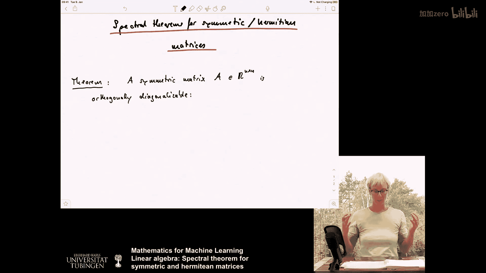

# 027：对称矩阵的谱定理 🔬

在本节课中，我们将要学习对称矩阵的谱定理。这是关于对称矩阵最重要的定理，在机器学习中至关重要。如果没有这个定理，许多方法将无法成立。

## 概述

上一节我们介绍了对称矩阵，并看到了其谱（即特征值集合）的一些初步良好性质。本节中，我们将深入探讨并证明对称矩阵的谱定理。

## 对称矩阵的已知性质

以下是关于对称矩阵我们已经了解的两个关键性质：

1.  **特征值为实数**：即使矩阵作用于复数向量空间（即**埃尔米特矩阵**），其特征值也全部是实数。用公式表示，若矩阵 **A** 满足 **A = A^T**（实数域）或 **A = A^H**（复数域，即共轭转置），则其特征值 λ 满足 **λ ∈ ℝ**。
2.  **不同特征值对应的特征向量正交**：这个性质不仅适用于复数向量空间，同样适用于实数向量空间。即，若 **λ_i ≠ λ_j**，则其对应的特征向量 **v_i** 和 **v_j** 满足 **v_i^T v_j = 0**（实数域）或 **v_i^H v_j = 0**（复数域）。

此外，我们已经知道，对称矩阵至少有一个特征值和对应的特征向量。

## 谱定理的陈述与证明

现在，我们来证明被称为对称矩阵**谱定理**的重要结论。

**定理（谱定理）**：一个在实数域上的 **n × n** 对称矩阵 **A**（即 **A ∈ ℝ^{n×n}** 且 **A = A^T**）是**正交可对角化**的。

这意味着存在一个由**正交矩阵** **Q** 和对角矩阵 **Λ** 进行的分解：
**A = Q Λ Q^T**
其中：
*   **Q** 的列由 **A** 的**标准正交特征向量**组成，即 **Q^T Q = I**。
*   **Λ** 是一个对角矩阵，其对角线元素是 **A** 的**实特征值**。

这个定理的核心在于，我们总能找到一组**完整的、相互正交的**特征向量作为 **ℝ^n** 空间的一组标准正交基，从而将矩阵 **A** 简洁地表示为在上述基下的伸缩变换。

## 总结

本节课中，我们一起学习了对称矩阵的谱定理。我们首先回顾了对称矩阵的特征值均为实数，且不同特征值对应的特征向量相互正交的性质。随后，我们正式陈述并解释了谱定理：任何实对称矩阵都可以被一个正交矩阵对角化。这个定理是理解许多机器学习算法（如主成分分析PCA）中矩阵分解的基石。