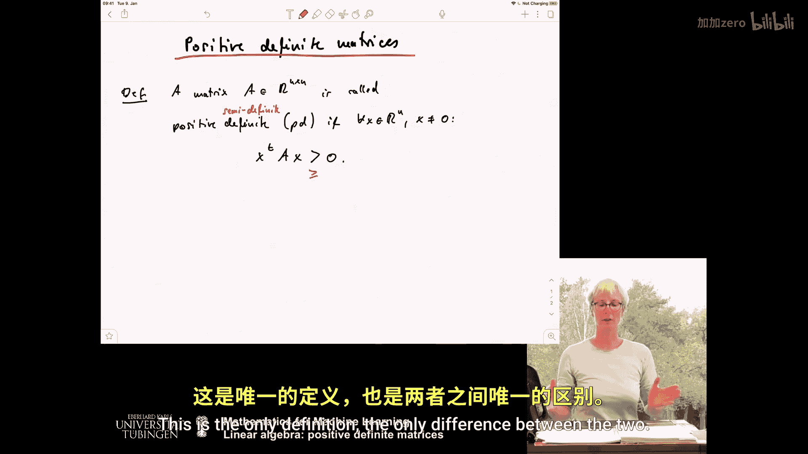
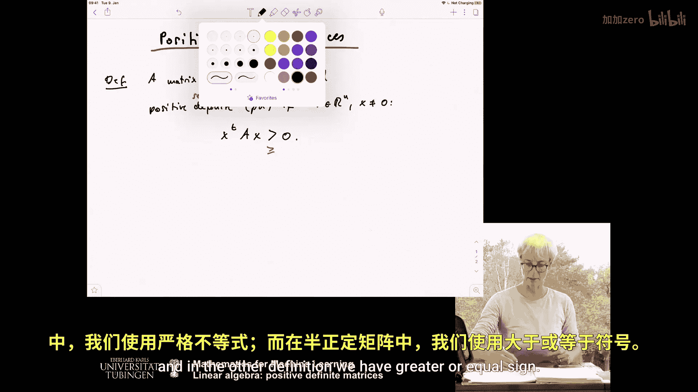
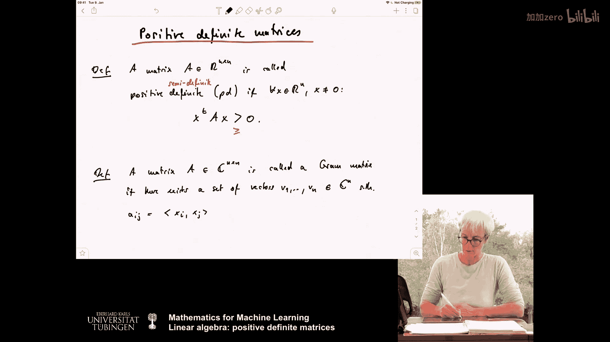

机器学习数学：A27：正定矩阵 📈

在本节课中，我们将要学习机器学习中另一类非常重要的矩阵：正定矩阵与半正定矩阵。我们已经了解了正交矩阵和对称矩阵，现在来看看这类在机器学习（例如核方法与协方差矩阵）中扮演核心角色的矩阵。

### 定义

我们从定义开始。一个 **n × n** 的矩阵 **A** 被称为**正定矩阵**（有时缩写为 PD），如果对于所有非零向量 **x ∈ ℝⁿ**，都有以下性质成立：

**xᵀ A x > 0**

一个矩阵 **A** 被称为**半正定矩阵**，如果对于所有非零向量 **x ∈ ℝⁿ**，满足：

**xᵀ A x ≥ 0**

正定与半正定的唯一区别就在于这个不等式是严格的（>）还是非严格的（≥）。

### 格拉姆矩阵

最重要的一类正定矩阵与格拉姆矩阵有关，它在机器学习中也与协方差矩阵紧密相连。我们首先定义格拉姆矩阵。

一个 **n × n** 的矩阵 **A** 被称为**格拉姆矩阵**，如果存在一组向量 **v₁, …, vₙ ∈ ℝᵐ**，使得矩阵的每个元素 **Aᵢⱼ** 由这些向量的内积给出：

**Aᵢⱼ = vᵢᵀ vⱼ**

换句话说，格拉姆矩阵记录了给定向量集中所有向量对之间的内积。

### 总结

本节课我们一起学习了正定矩阵与半正定矩阵的核心定义，并介绍了与之密切相关的格拉姆矩阵。理解这些矩阵的性质对于掌握后续的优化算法、核方法等机器学习核心概念至关重要。