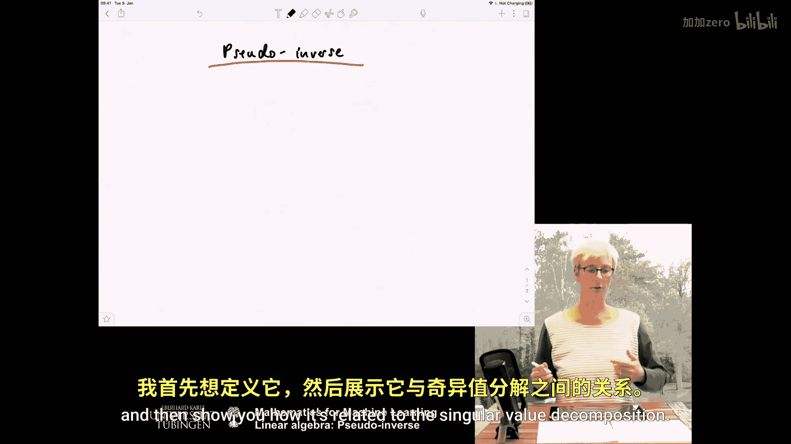
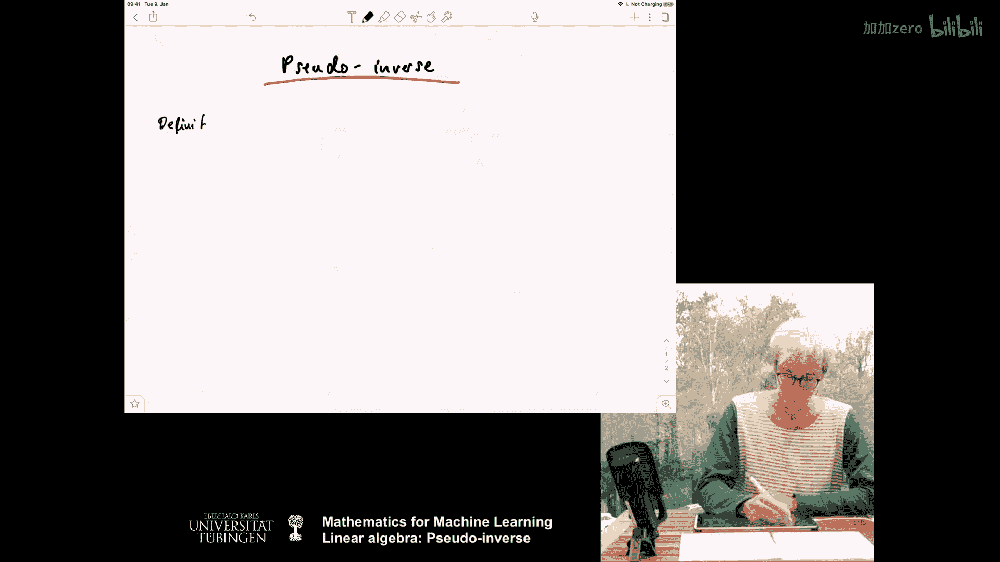
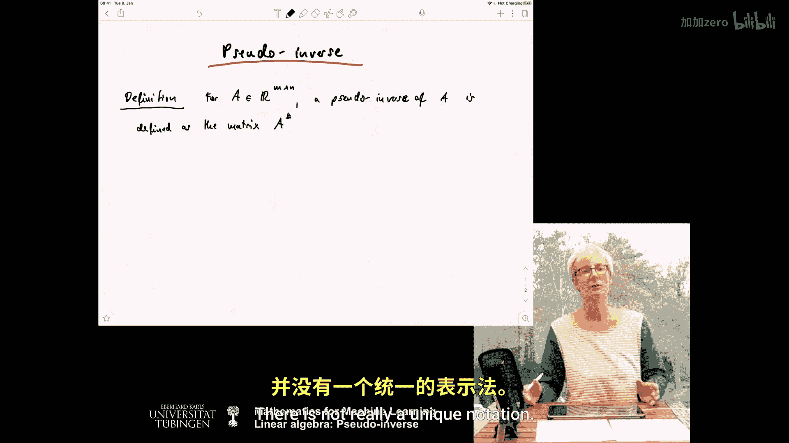

# 032：矩阵的伪逆 🔢


在本节课中，我们将要学习矩阵的伪逆。这是一种在矩阵不可逆或非方阵时，依然能提供类似逆矩阵功能的强大工具。我们将从定义开始，然后探讨它与奇异值分解的关系，并了解其在机器学习（如线性回归）中的应用。

---


上一节我们介绍了如何使用奇异值分解来近似一个大矩阵。本节中，我们来看看奇异值分解的一个完全不同的用途。

假设你有一个矩阵，你希望求它的逆，但可能无法做到。这可能是因为它是一个矩形矩阵，其逆矩阵本身就没有定义；也可能是因为该矩阵根本不可逆。许多矩阵都是不可逆的。


但在许多应用中，要求一个逆矩阵可能过于严格。有时，我们满足于一个稍弱的概念。在机器学习和统计学中，最典型的例子就是线性最小二乘回归。


如果你想解决一个最小二乘回归问题，并且你的设计矩阵（所有系数的矩阵）是可逆的，那么一切都很顺利。你可以解析地写出解，其中就涉及矩阵的逆。

现在，如果那个矩阵不可逆，这确实很麻烦。但在这种情况下，你并不需要真正的逆矩阵，你可以使用一个更简单的构造。它不像逆矩阵那样“强大”，但具有足以保证我们所需结果的特性。

这样的工具被称为**伪逆**。在本节课中，我将定义什么是伪逆。伪逆有很多不同的构造方法，但这是我们通常使用的一种，至少我在机器学习中经常使用它——**摩尔-彭罗斯伪逆**。


我将首先定义它，然后向你展示它与奇异值分解的关系。


---

### 伪逆的定义

我们从定义开始。这是一个有点抽象的定义，就像我们定义行列式时，说“存在一个具有以下性质的线性映射”。这里我们说，“存在一个具有以下性质的矩阵”。

对于一个矩阵 **A**（它甚至可能不是方阵，即大小为 \( m \times n \)），其伪逆，记作 **A⁺**，被定义为满足以下四个条件的矩阵：


以下是伪逆必须满足的四个彭罗斯条件：


1.  **A A⁺ A = A**
2.  **A⁺ A A⁺ = A⁺**
3.  **(A A⁺)^T = A A⁺** （即 **A A⁺** 是对称矩阵）
4.  **(A⁺ A)^T = A⁺ A** （即 **A⁺ A** 是对称矩阵）


对于任意矩阵 **A**，满足这些条件的矩阵 **A⁺** 是**存在且唯一**的。如果 **A** 本身是可逆的方阵，那么它的伪逆 **A⁺** 就等于其常规的逆矩阵 **A⁻¹**。

---


### 通过奇异值分解计算伪逆


上一节我们定义了伪逆，本节中我们来看看如何实际计算它。奇异值分解为此提供了一种优雅的方法。

假设矩阵 **A** 的奇异值分解为：
**A = U Σ V^T**

其中：
*   **U** 是 \( m \times m \) 的正交矩阵。
*   **Σ** 是 \( m \times n \) 的对角矩阵（更准确地说，是矩形对角矩阵），其对角线上的元素是奇异值 \( σ_1, σ_2, ..., σ_r \)（r 是矩阵的秩），其余元素为零。
*   **V** 是 \( n \times n \) 的正交矩阵。

那么，矩阵 **A** 的伪逆 **A⁺** 可以通过以下公式计算：
**A⁺ = V Σ⁺ U^T**


这里，**Σ⁺** 是 **Σ** 的伪逆。它是一个 \( n \times m \) 的矩阵，通过以下方式得到：取 **Σ**，将其非零的奇异值 \( σ_i \) 替换为它们的倒数 \( 1/σ_i \)，然后进行转置。


用代码可以更清晰地描述这个过程：


```python
import numpy as np

def compute_pseudoinverse_svd(A):
    """
    使用SVD计算矩阵A的伪逆。
    """
    # 1. 计算SVD
    U, S, Vt = np.linalg.svd(A, full_matrices=False)
    # S是一维数组，包含奇异值

    # 2. 构建Sigma的伪逆Sigma_plus
    # 将非零奇异值替换为其倒数，零奇异值保持为零
    S_plus = np.zeros(S.shape)
    # 避免除以零
    threshold = 1e-10
    S_plus[S > threshold] = 1 / S[S > threshold]

    # 3. Sigma_plus 需要是一个对角矩阵，用于计算
    # 因为SVD返回的是向量，我们这里直接使用向量乘法
    # A_plus = V * diag(S_plus) * U^T
    A_plus = Vt.T @ np.diag(S_plus) @ U.T

    return A_plus

# 示例
A = np.array([[1, 2], [3, 4], [5, 6]])
A_plus = compute_pseudoinverse_svd(A)
print("矩阵 A:")
print(A)
print("\n伪逆 A⁺:")
print(A_plus)
# 验证第一个彭罗斯条件：A A⁺ A ≈ A
print("\n验证 A A⁺ A ≈ A:")
print(A @ A_plus @ A)
```


---


### 伪逆在线性回归中的应用


现在我们已经知道如何计算伪逆，本节中我们来看看它在机器学习中的一个核心应用：求解线性最小二乘问题。



在线性回归中，我们试图找到参数向量 **θ**，使得 \( \| y - Xθ \|^2 \) 最小化，其中 **X** 是设计矩阵，**y** 是目标向量。



当 **X^T X** 可逆时，最优解为：
**θ* = (X^T X)^{-1} X^T y**

然而，当 **X^T X** 奇异（不可逆）时，例如在特征共线或样本数少于特征数的情况下，这个公式失效。此时，我们可以使用伪逆来得到**最小范数最小二乘解**。

最优解可以统一地写为：
**θ* = X⁺ y**


其中 **X⁺** 是设计矩阵 **X** 的伪逆。这个解具有两个重要性质：
1.  它使残差平方和 \( \| y - Xθ \|^2 \) 最小化。
2.  在所有能最小化残差平方和的解中，**θ*** 的欧几里得范数 \( \| θ \| \) 是最小的。


---


### 总结


本节课中我们一起学习了矩阵的伪逆。


*   我们首先了解了伪逆的概念，它是在矩阵不可逆或为非方阵时，对标准逆矩阵的一种推广，由四个彭罗斯条件唯一定义。
*   接着，我们探讨了伪逆与奇异值分解的紧密联系：通过 SVD 可以优雅而稳定地计算出任何矩阵的伪逆。
*   最后，我们看到了伪逆在机器学习中的关键应用，即求解线性最小二乘问题。当正规方程中的矩阵不可逆时，使用设计矩阵的伪逆 **X⁺** 可以直接给出最小范数最小二乘解 **θ* = X⁺ y**。



伪逆是一个强大的数学工具，它帮助我们在面对病态或非方阵系统时，依然能找到有意义的、数值稳定的解。