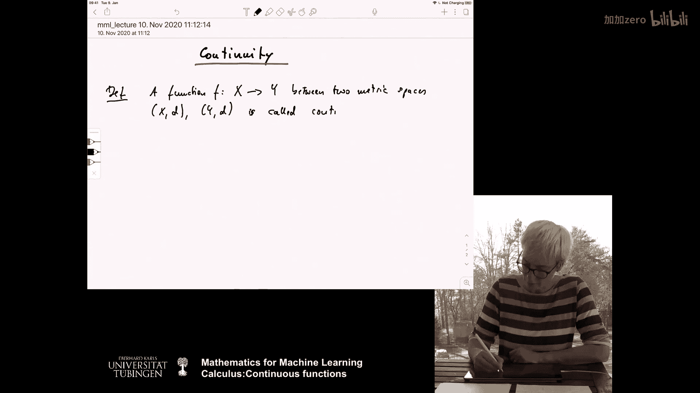
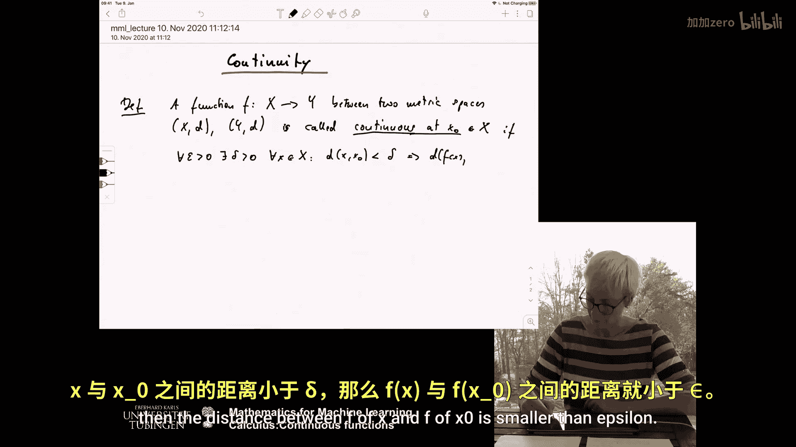
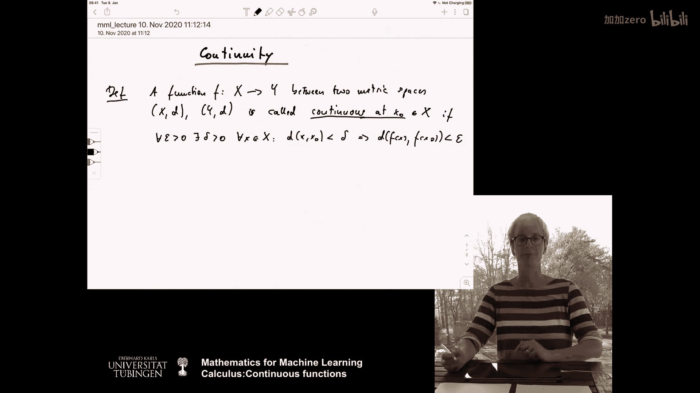
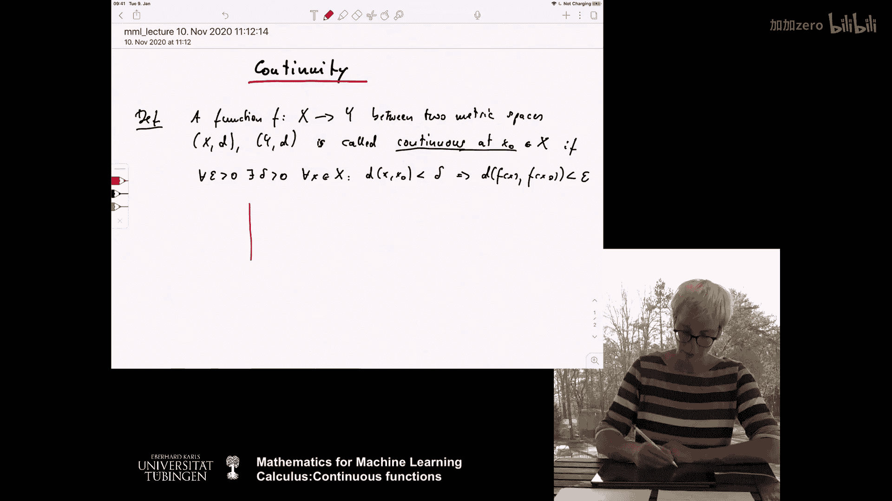
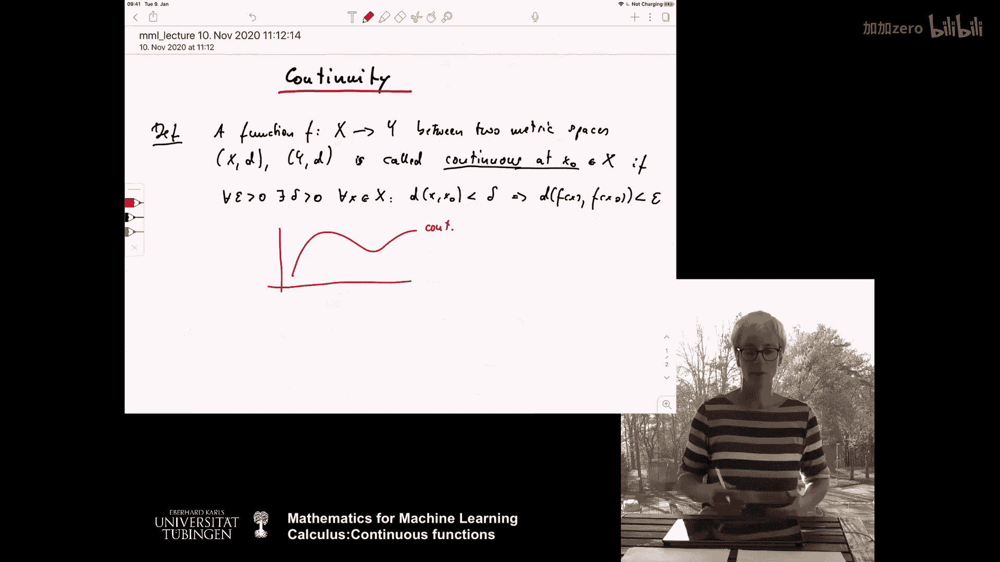

# 036：连续函数 📈

在本节课中，我们将要学习连续函数的概念。连续性在微积分和机器学习中都是一个核心概念，它描述了函数行为的“平滑性”，即函数图像没有突然的跳跃或断裂。

## 连续函数的直观理解

上一节我们介绍了函数的基本概念，本节中我们来看看如何定义函数的连续性。

首先，大多数人对函数连续性的直观理解是：函数图像没有跳跃。换句话说，如果你把函数画成一条曲线，这条曲线上没有缺口或断点。

## 连续性的两种形式化定义

当然，我们需要一个更严谨的数学定义。事实上，存在多种方式来形式化地定义连续性，我将向你展示两种不同的方法。这两种定义是等价的，但根据你的目的（例如，证明某个定理），其中一种可能比另一种更方便。

### 定义的前提：度量空间

让我们开始吧。我们考虑一个函数 **f**，它从一个集合 **X** 映射到另一个集合 **Y**。目前，我们将 **X** 和 **Y** 视为度量空间。这意味着这两个集合都定义了距离的概念。

我们称 **X** 和 **Y** 为度量空间，并分别用 **d_X** 和 **d_Y** 表示它们的距离函数。我们不需要为这两个距离函数引入不同的符号，只需注意：当点来自 **X** 时，我们使用 **d_X**；当点来自 **Y** 时，我们使用 **d_Y**。

### 第一种定义：ε-δ 定义

现在，我们写出第一种定义，即著名的 **ε-δ 定义**。

我们说函数 **f** 在点 **x₀ ∈ X** 处是连续的，如果满足以下条件：

对于任意 **ε > 0**，都存在一个 **δ > 0**，使得对于所有 **x ∈ X**，如果 **d_X(x, x₀) < δ**，那么就有 **d_Y(f(x), f(x₀)) < ε**。

用公式表示如下：
> **∀ ε > 0, ∃ δ > 0, s.t. ∀ x ∈ X: d_X(x, x₀) < δ ⇒ d_Y(f(x), f(x₀)) < ε**

### 通过示例理解定义

让我们看两个例子来说明这个定义的含义。

以下是一个连续函数的例子，因为它没有跳跃。

---

本节课中我们一起学习了连续函数的概念。我们从直观理解入手，介绍了函数在度量空间上的形式化定义，并重点讲解了使用 **ε-δ** 语言来精确定义函数在某一点连续性的方法。理解这个定义是学习后续微积分概念的重要基础。