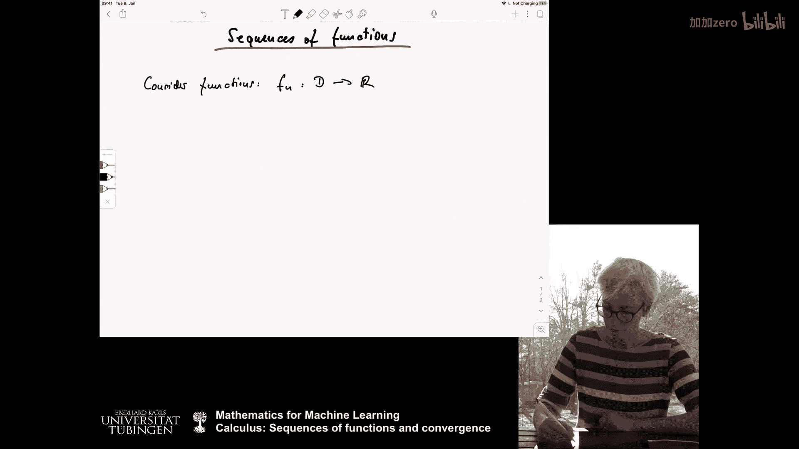
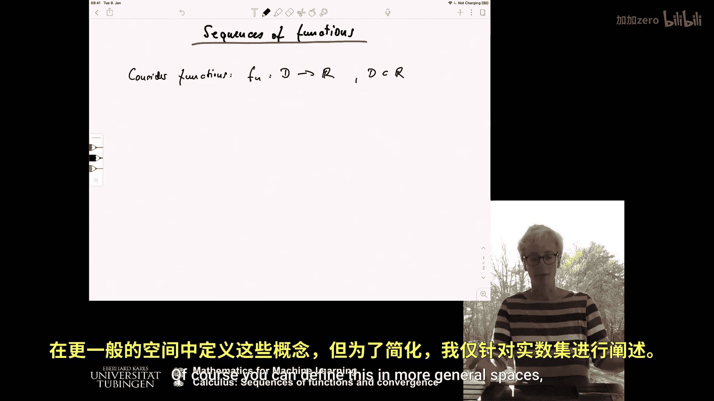
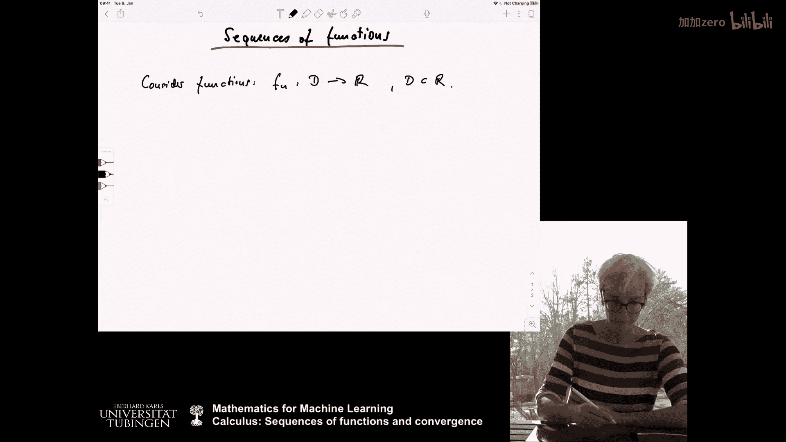
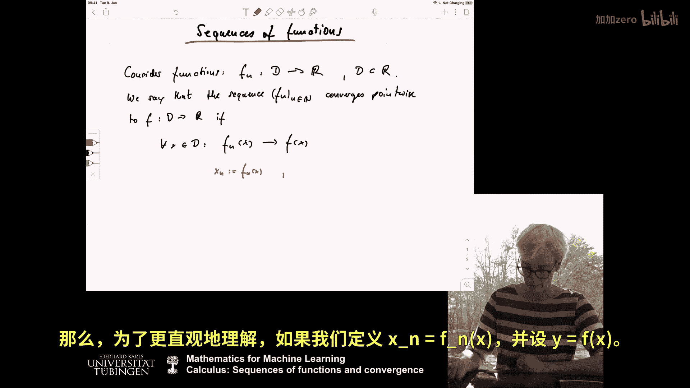

# 037：函数序列的点态收敛与一致收敛 📈

在本节课中，我们将要学习函数序列的收敛性。我们将结合之前学过的数列收敛与函数连续性的概念，探讨函数序列如何收敛，并重点介绍两种核心的收敛方式：点态收敛与一致收敛。

---

上一节我们介绍了数列的收敛和函数的连续性。本节中，我们来看看如何将这两个概念结合起来，研究**函数序列**的收敛性。

函数序列的收敛有两种基本且重要的方式，在整个数学中，尤其是在微积分里至关重要。一种是**点态收敛**，这是一种相对较弱的收敛形式；另一种是**一致收敛**，这是一种强得多的收敛形式，并且能带来许多良好的性质。

让我们开始具体分析。

首先，我们考虑一系列函数。这些函数从一个定义域 **D**（**D** 是实数集 **R** 的一个子集）映射到实数 **R**。为了简化，我们仅在实数范围内讨论，当然这个概念可以推广到更一般的空间。

现在，我们定义什么是**点态收敛**。

我们说，函数序列 **{f_n}** 点态收敛于函数 **f**（**f** 也是一个从定义域 **D** 到 **R** 的函数），如果对于定义域 **D** 内的**所有**点 **x**，当 **n** 趋于无穷大时，函数值序列 **f_n(x)** 都收敛于 **f(x)**。

用公式描述如下：
> 对于所有 **x ∈ D**，有 **lim_{n→∞} f_n(x) = f(x)**。

为了更直观地理解，我们可以这样想：对于每一个固定的点 **x**，我们得到一个数列 **x_n = f_n(x)**。点态收敛要求，对于每一个这样的 **x**，数列 **{x_n}** 都收敛于极限值 **y = f(x)**。

---

本节课中我们一起学习了函数序列收敛的基本概念。我们定义了**点态收敛**，即函数序列在每个单独的输入点上都收敛到极限函数对应的函数值。这是一种逐点定义的收敛方式。在接下来的课程中，我们将探讨更强的一致性收敛及其重要性质。