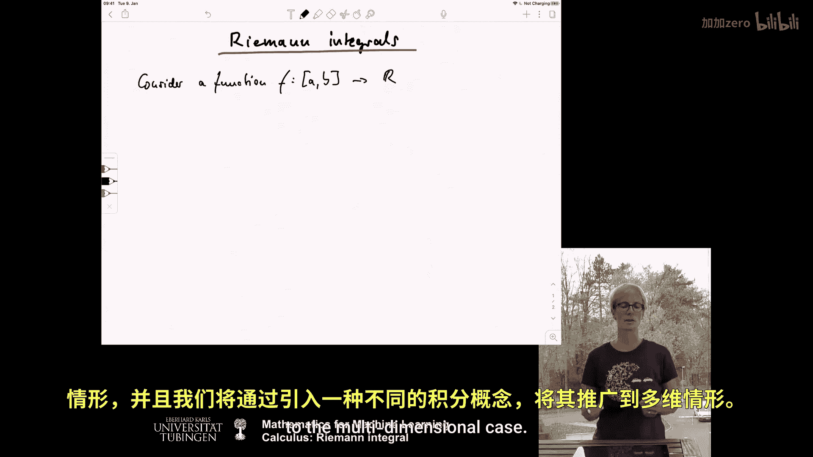
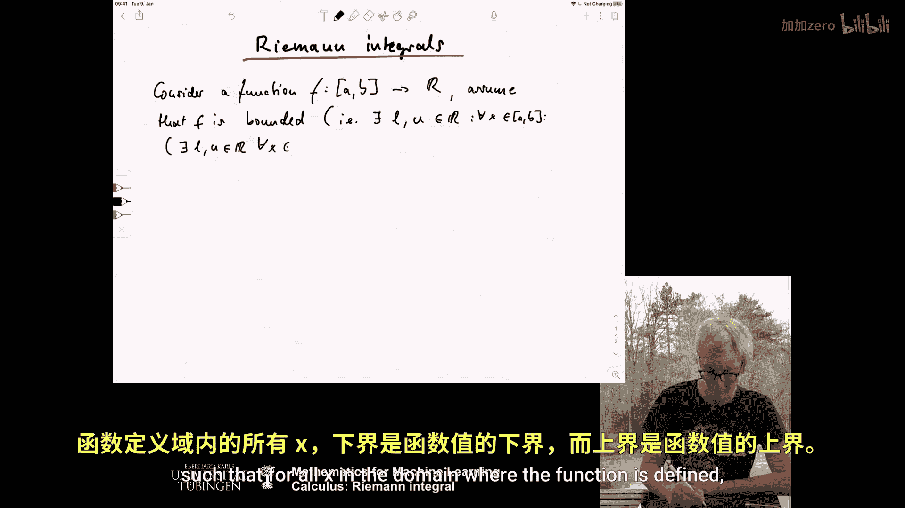

# 039：实数上的黎曼积分

在本节课中，我们将学习积分的基本概念，特别是黎曼积分。这是一种非常直观的积分定义方式，虽然它可能不是最完善的，但它是理解积分思想的重要基础。我们将从定义在有界闭区间上的有界函数开始，逐步构建黎曼积分的概念。

## 黎曼积分的背景与动机

数学家们为了形式化地定义积分，曾进行过许多不同的尝试。黎曼积分是这些尝试中的重要一步，它提供了一个非常直观的理解方式。即使你已经在学校或大学本科教育中接触过积分，我们仍将在此回顾其基本思想，以便为后续更深入的学习打下基础。

## 定义域与函数

我们首先考虑一个定义在实数集上有界闭区间上的函数。为了简化讨论，我们目前只处理一维情况，但原则上这种方法也可以推广到多维空间。

具体来说，我们考虑一个函数 **f**，其定义域是一个有界闭区间 **[a, b]**，其中 **a** 和 **b** 是实数。

我们假设这个函数 **f** 是有界的。这意味着存在实数 **L** 和 **U**，使得对于定义域 **[a, b]** 内的所有 **x**，函数值都满足以下不等式：

**L ≤ f(x) ≤ U**

换句话说，函数 **f** 的图像被限制在两条水平线 **y = L** 和 **y = U** 之间。