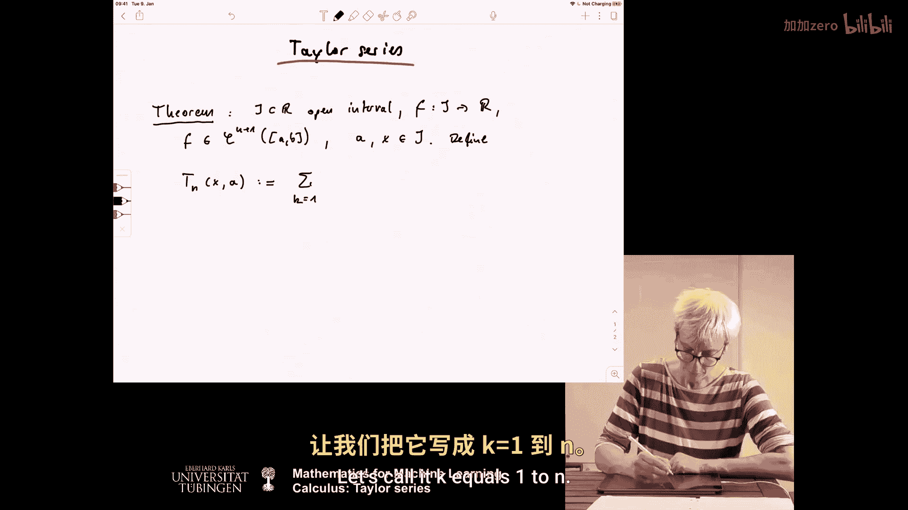

# 042：泰勒级数

在本节课中，我们将要学习泰勒级数。我们将探讨如何将一个函数表示为无穷级数的形式，并理解其背后的数学原理和适用条件。

上一节我们介绍了幂级数及其收敛性。本节中我们来看看如何从一个给定的函数出发，构造其对应的幂级数，即泰勒级数。

## 泰勒级数的核心思想

我们已知，如果一个函数可以表示为一个幂级数，那么该级数的系数可以通过该函数的各阶导数来表达。具体公式如下：

对于一个在点 `a` 处解析的函数 `f(x)`，其幂级数展开为：
`f(x) = Σ_{k=0}^{∞} [f^{(k)}(a) / k!] * (x - a)^k`

其中，`f^{(k)}(a)` 表示函数 `f` 在点 `a` 处的 `k` 阶导数。

一个自然的问题是：这个过程是否可以反过来？对于任意一个函数，我们能否通过计算其在某点的各阶导数来构造一个幂级数，并期望这个级数收敛到原函数本身？

答案是：在一定条件下可以。这引出了泰勒定理。

## 泰勒定理（带余项形式）

以下是泰勒定理的一种表述。

设 `I` 是 `R` 中的一个开区间，`f: I → R` 是一个函数。特别地，假设 `f` 是 `n+1` 次连续可微的，即 `f ∈ C^{n+1}(I)`。

假设 `a` 和 `x` 是区间 `I` 内的两个数。我们定义函数 `f` 在点 `a` 处的 `n` 阶泰勒多项式为：

`T_{n, a}(x) = Σ_{k=0}^{n} [f^{(k)}(a) / k!] * (x - a)^k`

那么，函数 `f(x)` 与其泰勒多项式 `T_{n, a}(x)` 之间的误差，即余项 `R_n(x)`，可以精确表示为：

`f(x) = T_{n, a}(x) + R_n(x)`

并且余项 `R_n(x)` 存在一个积分形式的表达式（例如拉格朗日余项或积分余项），它量化了近似误差。

这个定理的关键在于，它不要求无穷级数收敛，而是给出了一个有限项多项式逼近原函数，并明确指出了逼近的误差。当 `n` 趋向于无穷大时，如果余项 `R_n(x)` 趋向于零，那么泰勒多项式序列就收敛到原函数，此时泰勒级数成立。

## 泰勒级数的不同版本

泰勒定理存在多种形式，主要区别在于余项的表达式。以下是几种常见的余项形式：

*   **积分余项**：`R_n(x) = (1/n!) ∫_{a}^{x} f^{(n+1)}(t) * (x - t)^n dt`
*   **拉格朗日余项**：存在某个 `ξ` 介于 `a` 和 `x` 之间，使得 `R_n(x) = [f^{(n+1)}(ξ) / (n+1)!] * (x - a)^{n+1}`
*   **柯西余项**：存在某个 `ξ` 介于 `a` 和 `x` 之间，使得 `R_n(x) = [f^{(n+1)}(ξ) / n!] * (x - ξ)^n * (x - a)`

选择不同的余项形式有助于在不同情况下分析和估计逼近误差。

## 从泰勒多项式到泰勒级数

当函数 `f` 在点 `a` 的某个邻域内是**无穷次可微**的，并且对于该邻域内的所有 `x`，泰勒多项式的余项 `R_n(x)` 随着 `n → ∞` 而趋于零时，我们得到泰勒级数：

`f(x) = Σ_{k=0}^{∞} [f^{(k)}(a) / k!] * (x - a)^k`

此时，我们说函数 `f` 在点 `a` 处是**解析**的。泰勒级数的收敛半径由函数本身的性质决定。

本节课中我们一起学习了泰勒级数的概念。我们从幂级数系数与导数的关系出发，引出了通过函数导数构造其幂级数表示的核心问题。通过泰勒定理，我们理解了如何用有限项的多项式（泰勒多项式）逼近函数，并分析了余项。最后，我们探讨了使泰勒多项式序列收敛为泰勒级数的条件，即函数需要在某点处解析。泰勒级数是连接离散多项式逼近与连续函数分析的重要桥梁，在机器学习的函数逼近和优化理论中有着广泛应用。