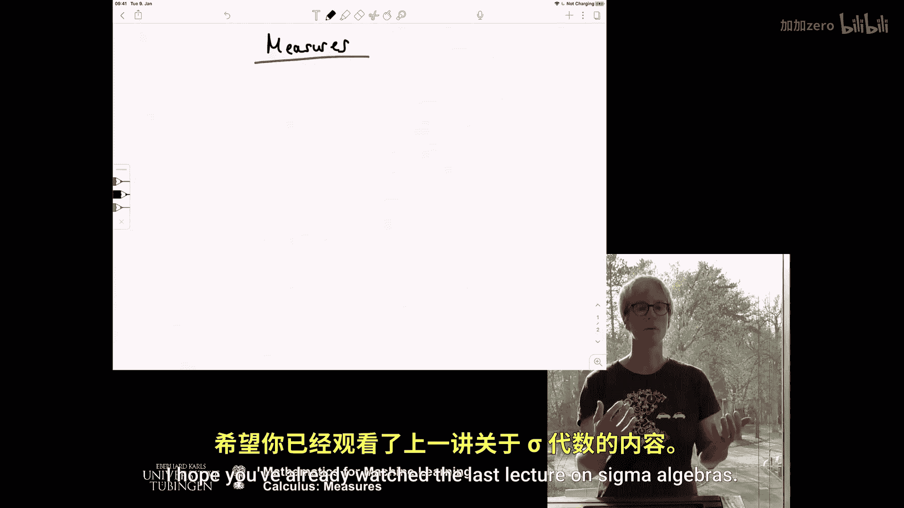
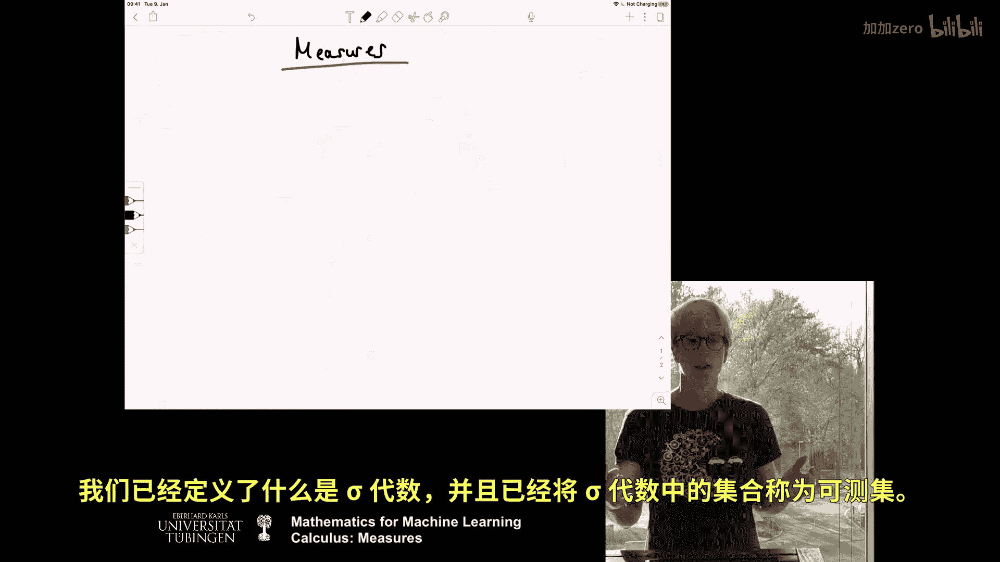
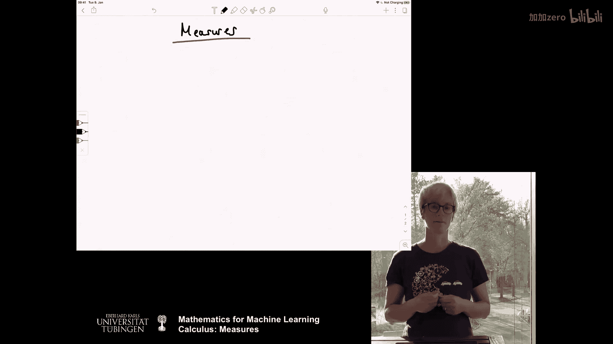
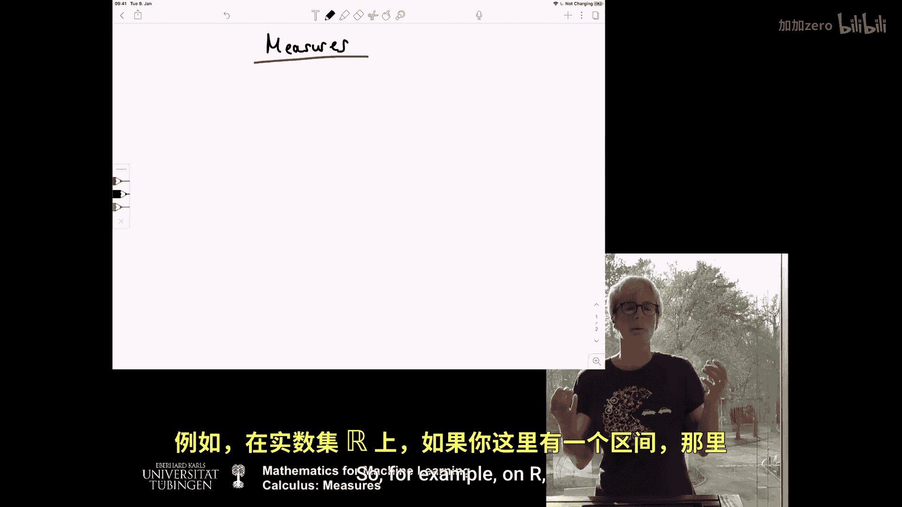
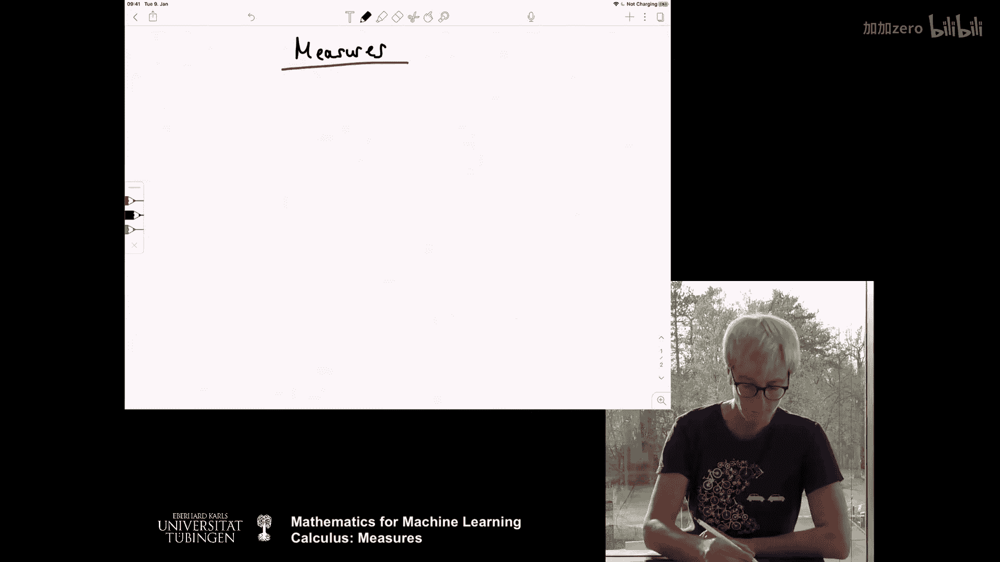
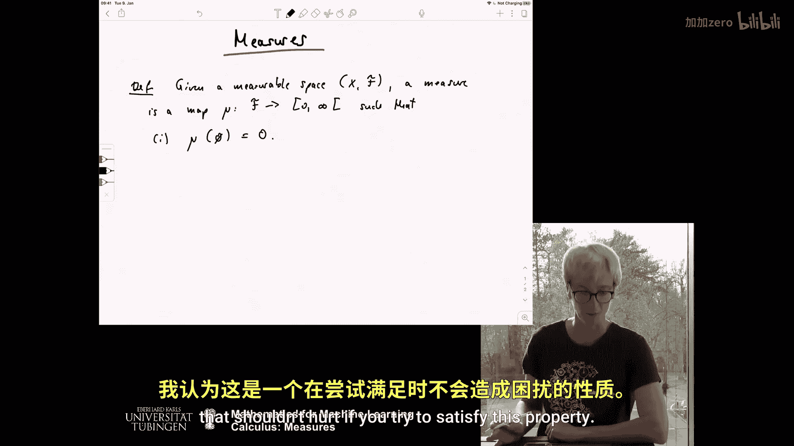

# 044：测度定义 📏

在本节课中，我们将学习测度的正式定义。测度是数学中一个核心概念，它为我们提供了一种系统化的方式来度量集合的“大小”或“体积”，这对于理解概率论和机器学习中的积分至关重要。

上一节我们介绍了σ-代数，它定义了哪些集合是“可测的”。本节中，我们将看看如何为这些可测集合分配一个数值，即测度。

## 从直观到定义

在关于σ-代数的课程中，我们已经给出了直观的解释。我们现在要做的是定义一个“体积”的自然概念。这个概念应该满足比仅基于有限个区间发展出的通用体积概念更一般的性质。

我们已经定义了什么是σ-代数，并且已经将σ-代数中的集合称为可测集。现在，我们想为所有这些集合分配一个测度。

## 测度的构成要素

现在的情况是，我们有一个空间，以及一个σ-代数，它包含了所有我们希望赋予“体积”概念的集合的全体。

当然，和往常一样，这个测度需要满足某些性质。例如，在实数集 **R** 上，如果你有一个区间和另一个区间，并且它们不相交，那么这两个区间的体积应该相加。

我们现在有一系列这样的性质。

## 测度的正式定义

现在，让我们直接给出定义。

我们从一个给定的可测空间开始。一个可测空间 **(X, F)**，其中 **F** 是一个σ-代数。

给定这样一个空间，一个**测度**是一个映射。这个映射通常用希腊字母表示，如 λ, μ 等，这里我们称之为 μ。

这个映射从σ-代数 **F** 映射到非负实数（包括无穷大）。

它需要满足以下性质：

以下是测度必须满足的三个核心性质：

1.  **空集的测度为零**：`μ(∅) = 0`。这是一个合理且不应被违反的性质。
2.  **非负性**：对于任何可测集 **A ∈ F**，其测度非负：`μ(A) ≥ 0`。
3.  **可列可加性**：这是测度最核心的性质。如果有一系列**两两不相交**的可测集 **A₁, A₂, A₃, ...**，那么它们的并集的测度等于它们各自测度之和。用公式表示为：
    `μ(⋃_{i=1}^{∞} A_i) = Σ_{i=1}^{∞} μ(A_i)`

这个性质确保了测度在可数无限操作下仍然保持“体积”相加的直觉。

## 总结

本节课中，我们一起学习了测度的正式定义。我们从需要度量集合“体积”的动机出发，基于之前建立的σ-代数框架，定义了一个从可测集到非负实数的映射 μ。这个映射必须满足三个关键性质：空集测度为零、非负性以及最重要的可列可加性。测度为我们在更复杂的空间（如概率空间）上定义积分和概率奠定了严格的数学基础。