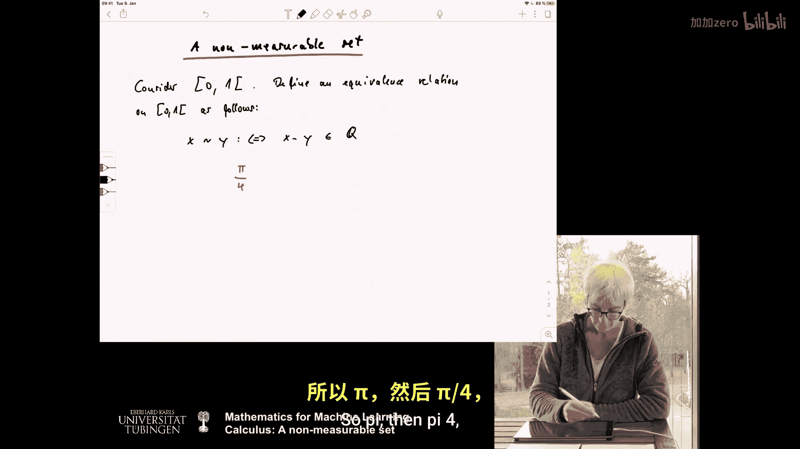

# 046：不可测集的构造 🧩

在本节课中，我们将学习一个重要的概念：**勒贝格不可测集**。上一节我们介绍了勒贝格测度的构造，并提到可能存在一些集合，它们无法用勒贝格测度来度量。本节中，我们将具体构造这样一个集合，并理解其背后的原理。

## 概述

我们将在一个简单的区间上，通过定义一个等价关系，并借助**选择公理**，来构造一个无法被赋予勒贝格测度的集合。这个构造过程本身也展示了数学中一些深刻而有趣的思想。

## 构造不可测集

### 1. 定义等价关系

首先，我们在实数集 **R** 的开区间 **(0, 1)** 上工作。为了简化，我们也可以在整个 **R** 上进行，但这里选择单位区间。

我们在这个区间上定义一个**等价关系**。具体定义如下：

我们说两个数 **x** 和 **y** 是等价的，当且仅当它们的差是一个**有理数**。

用公式表示这个关系：
\[
x \sim y \quad \text{当且仅当} \quad x - y \in \mathbb{Q}
\]

这意味着，如果你能找到任意一个有理数 **q**，使得 **x = y + q**，那么 **x** 和 **y** 就属于同一个等价类。

例如，**π/4** 和 **π/4 + 1/2** 就属于同一个等价类，因为它们的差 1/2 是一个有理数。

### 2. 应用选择公理

这个等价关系将区间 **(0, 1)** 划分成了无数个互不相交的等价类。每个等价类都由彼此相差有理数的所有数组成。

现在，我们从**每一个**等价类中，**恰好选取一个元素**，组成一个新的集合 **V**。

这个“从每个等价类中选一个代表”的操作，无法通过明确的规则（例如“选最小的那个数”）来完成，因为等价类在实数中是稠密的。我们必须依赖一个强大的数学工具——**选择公理**。

选择公理是集合论中的一条基本公理，它允许我们从一族非空集合的每一个集合中选出一个元素，而无需指定具体的选取规则。虽然有些数学家对它的使用存在争议，但在构造此类“怪异”集合时，它是必不可少的。

### 3. 集合 V 的性质与矛盾

我们构造出的集合 **V** 具有以下关键性质：

*   **V** 中的任意两个元素都不等价（即它们的差不是有理数）。
*   对于区间 **(0, 1)** 中的任何一个数 **x**，都存在 **V** 中唯一的一个元素 **v** 和一个有理数 **q**，使得 **x = v + q**。换句话说，整个区间 **(0, 1)** 可以被表示为 **V** 与所有有理数平移后的集合的并集。

现在，假设 **V** 是**勒贝格可测**的。让我们看看会发生什么。

考虑所有绝对值小于1的有理数集合 **Q₁**。这是一个可数集。对于每个有理数 **q ∈ Q₁**，我们构造集合 **V_q = {v + q | v ∈ V}**，即将 **V** 平移 **q** 个单位。

以下是这些集合的性质：
1.  所有这些平移集合 **{V_q}** 是两两不相交的。
2.  它们的并集覆盖了整个区间 **(0, 1)**，并且被包含在更大的区间 **(-1, 2)** 中。

由于勒贝格测度具有**平移不变性**（平移一个集合不改变其测度），如果 **V** 可测，那么每个 **V_q** 也可测，并且它们的测度都等于 **V** 的测度，记作 **λ(V)**。

根据测度的**可数可加性**（互不相交的可数多个可测集的并集的测度，等于它们各自测度的和），区间 **(0, 1)** 的测度（等于1）应该等于所有 **V_q** 的测度之和。

这导致了一个关于 **λ(V)** 的方程：
\[
1 = \lambda((0,1)) = \sum_{q \in Q_1} \lambda(V_q) = \sum_{q \in Q_1} \lambda(V)
\]
由于 **Q₁** 是可数无穷集，这个求和意味着：
*   如果 **λ(V) = 0**，那么无穷个0相加还是0，不等于1。
*   如果 **λ(V) > 0**，那么无穷个正数相加会趋于无穷大，也不可能等于1。

我们得出了一个矛盾。因此，我们最初的假设——“**V** 是勒贝格可测的”——是**错误**的。

所以，我们成功构造了一个集合 **V**，它**不是勒贝格可测的**。

## 总结

本节课中，我们一起学习了如何构造一个勒贝格不可测集。我们首先在单位区间上定义了一个基于有理数差的等价关系，然后借助**选择公理**从每个等价类中选取一个代表元，构成了集合 **V**。通过分析 **V** 的平移集合的性质，并利用勒贝格测度的**平移不变性**和**可数可加性**，我们推导出了矛盾，从而证明了 **V** 不可能是可测的。这个构造揭示了勒贝格测度理论的边界，也展示了选择公理在构建“病态”数学对象中的关键作用。