# 048：R^n上的微分与偏导数 🧮


在本节课中，我们将要学习如何对定义在多维空间（维度大于一）上的函数进行求导。在机器学习中，求导几乎是最重要的主题，因为几乎所有机器学习算法都涉及求解优化问题，而解决这些问题通常需要计算函数的梯度，并执行梯度下降、随机梯度下降或其他更巧妙的近似方法。因此，我们需要定义如何在定义于R^n空间上的函数进行求导。


由于在R^n空间中存在多个方向需要考虑，相关概念会比在一维实数空间R中更为复杂。本节我们将从**偏导数**这一核心概念开始。

## 偏导数的定义 📝


上一节我们介绍了高维空间求导的必要性，本节中我们来看看偏导数的具体定义。


我们考虑一个函数 **f**，其映射关系为 **f: R^n → R**。这里我们经常需要处理两个空间的维度：输入空间和输出空间。我们通常用 **N** 表示输入空间的维度，用 **M** 表示输出空间的维度。在本例中，输出维度 **M = 1**，而输入维度 **N** 是一个大于1的数。

偏导数的直观理解是：考虑一个具有多个变量的函数，但**固定除一个变量外的所有其他变量**，然后对这个单一变量进行求导。


以下是偏导数的正式定义：


函数 **f** 在点 **p** 处关于变量 **x_i** 被称为**可偏导**的，如果以下极限存在：

$$
\frac{\partial f}{\partial x_i}(p) = \lim_{h \to 0} \frac{f(p_1, ..., p_i + h, ..., p_n) - f(p_1, ..., p_i, ..., p_n)}{h}
$$

这个极限值就被称为 **f** 在点 **p** 处关于 **x_i** 的**偏导数**。


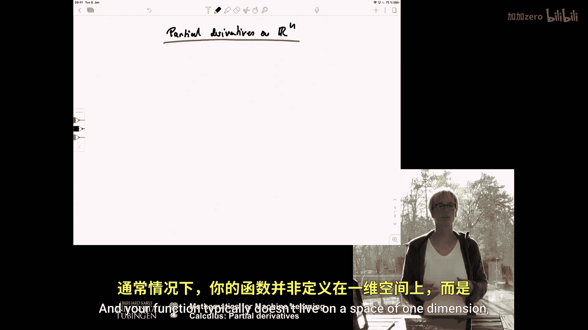


## 核心概念解析 🔍


为了更清晰地理解，我们可以将偏导数的计算分解为以下步骤：

1.  **选择变量**：从函数的 **n** 个输入变量中，选择一个变量 **x_i** 作为我们要求导的对象。
2.  **固定其他变量**：将所有其他变量 **(x_1, ..., x_{i-1}, x_{i+1}, ..., x_n)** 视为常数。
3.  **视为一元函数**：此时，函数 **f** 可以被看作仅仅是关于变量 **x_i** 的一元函数。
4.  **应用一元导数定义**：对这个新的一元函数在点 **p_i** 处应用标准的一元导数定义，即计算函数值变化量与自变量变化量比值的极限。

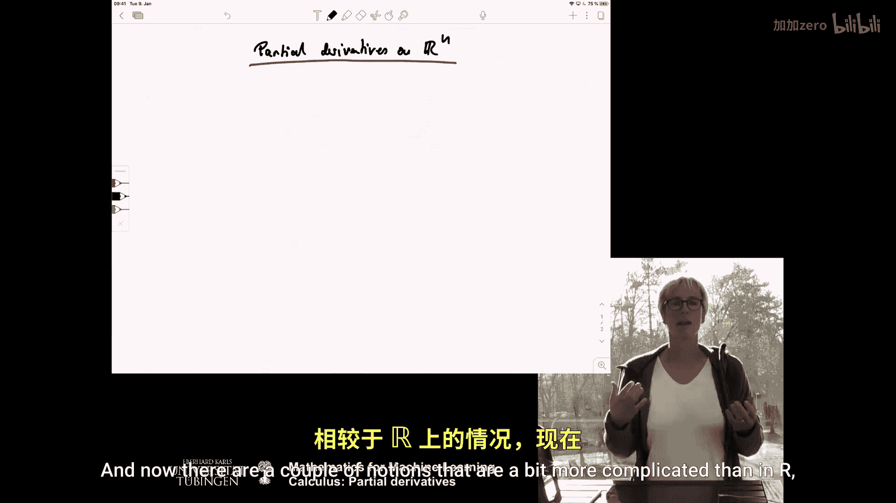


## 计算示例 💻


让我们通过一个简单的例子来巩固理解。假设有一个函数：

$$
f(x, y) = x^2 + 3xy + y^3
$$

我们要计算在点 **(1, 2)** 处关于 **x** 的偏导数 **∂f/∂x**。

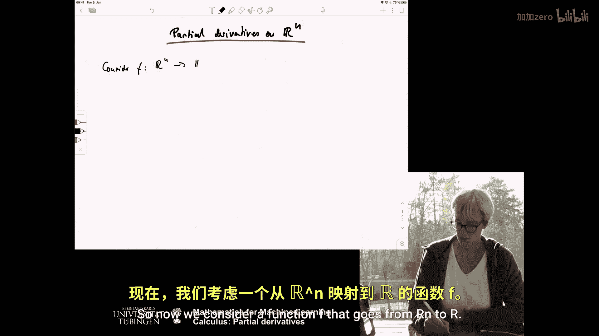

根据定义和步骤：
1.  选择变量 **x**。
2.  将另一个变量 **y** 视为常数（此时 `y = 2`）。
3.  函数变为关于 **x** 的一元函数：`f(x) = x^2 + 3*x*2 + 2^3 = x^2 + 6x + 8`。
4.  对该一元函数求导：`df/dx = 2x + 6`。
5.  在 `x = 1` 处计算：`∂f/∂x (1,2) = 2*1 + 6 = 8`。

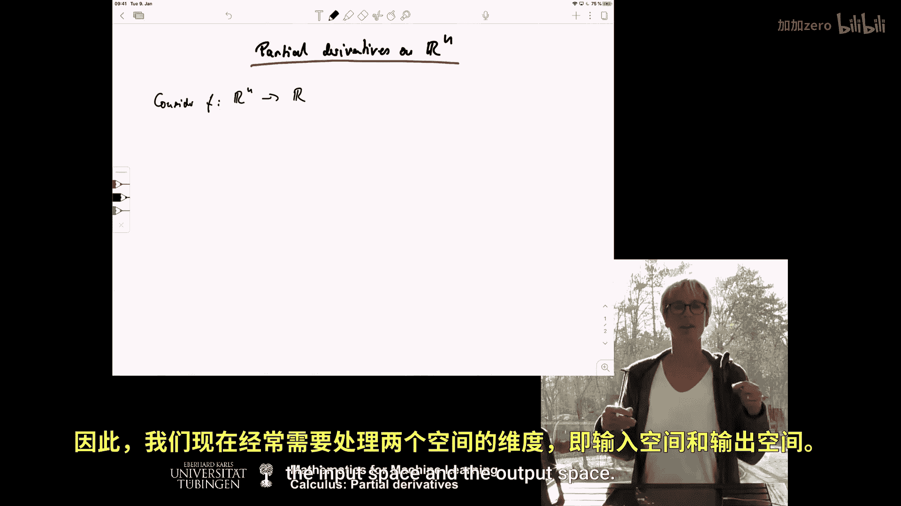

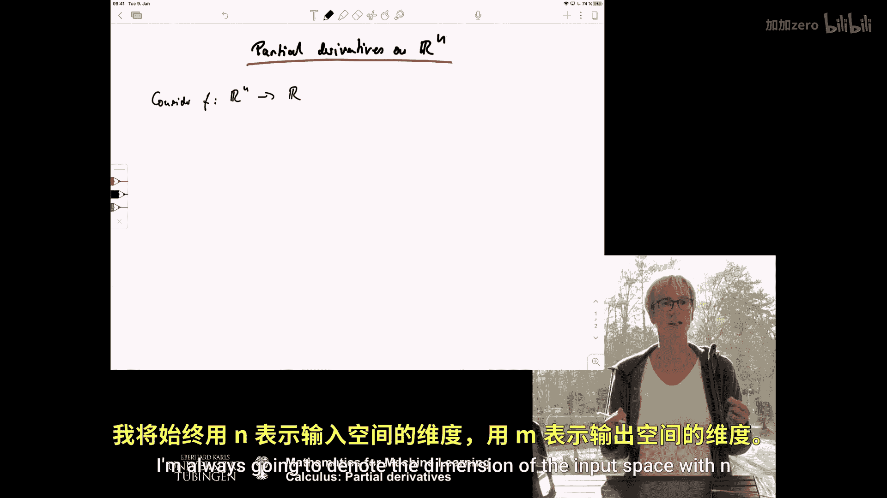

用代码表示其计算逻辑如下：
```python
def partial_derivative_x(f, x, y):
    # 将y视为常数，对x求导
    h = 1e-5 # 一个极小的数，用于数值近似
    return (f(x + h, y) - f(x, y)) / h

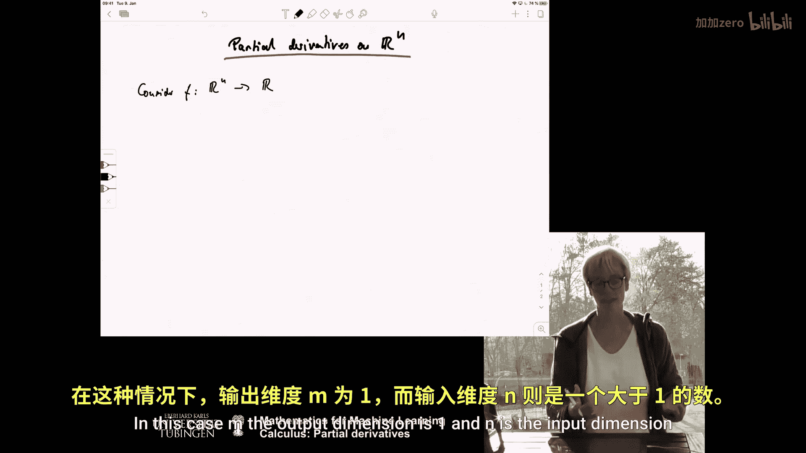

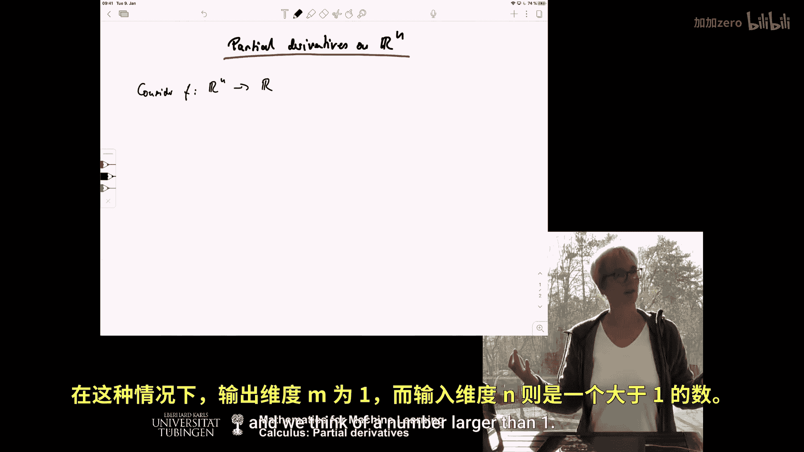

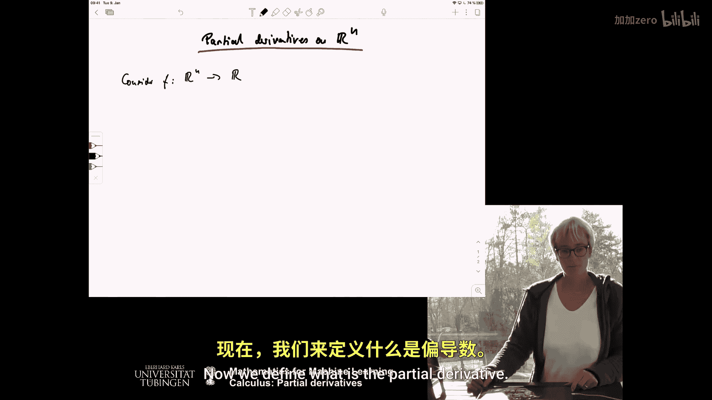

def f(x, y):
    return x**2 + 3*x*y + y**3

# 计算在点(1,2)处关于x的偏导数
result = partial_derivative_x(f, 1, 2)
print(f"∂f/∂x at (1,2) ≈ {result}")
```

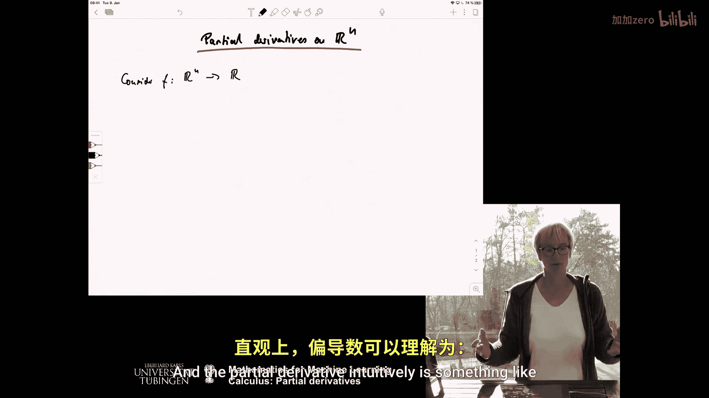

## 几何意义 📐

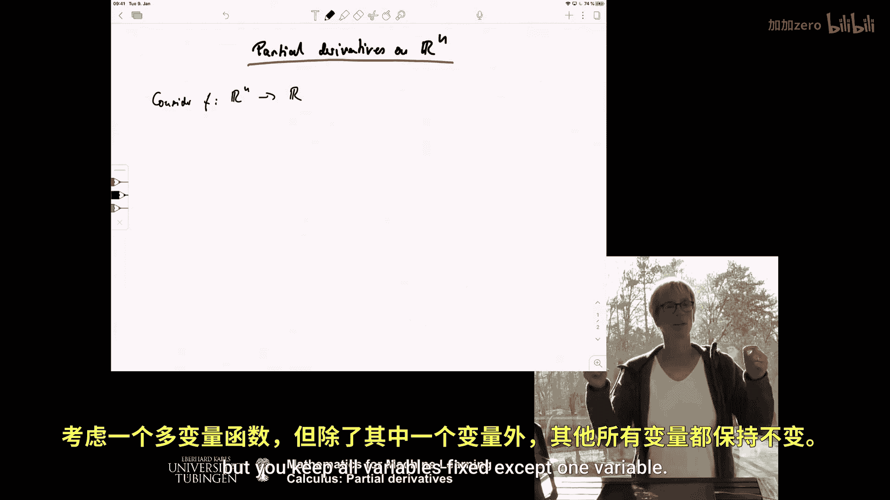

从几何角度看，函数 **z = f(x, y)** 可以表示三维空间中的一个曲面。偏导数 **∂f/∂x (p)** 表示的是：在点 **p** 处，曲面与平行于 **xOz** 平面（即固定 **y** 值）的垂直平面相交所得到的曲线的切线斜率。它刻画了函数沿 **x** 轴方向的变化率。

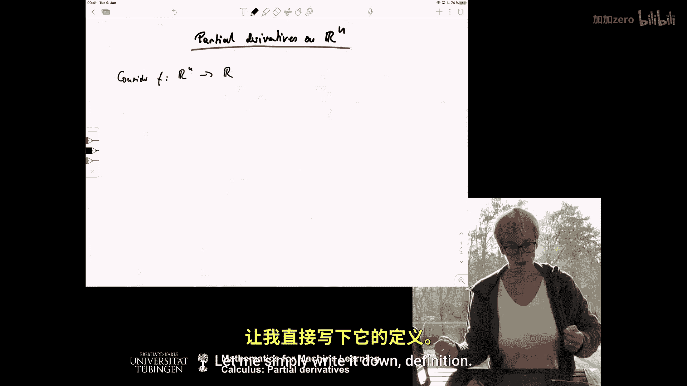

## 总结 🎯

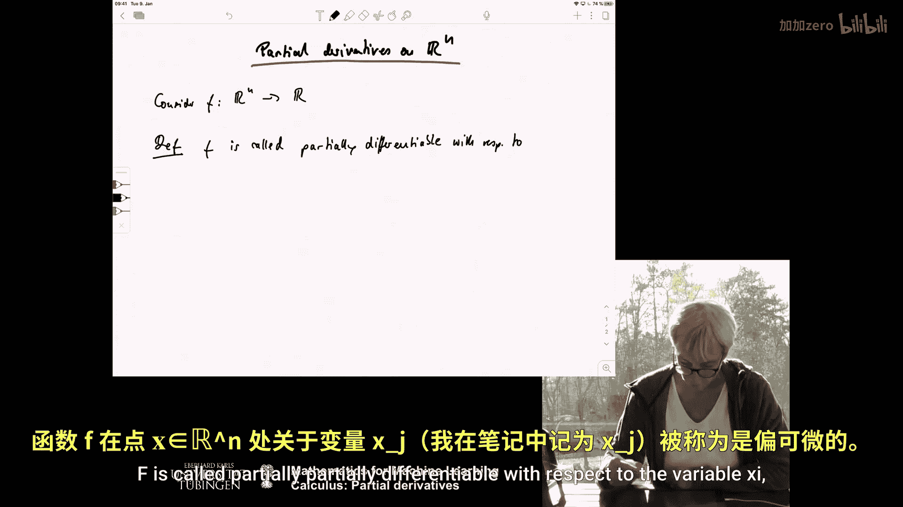

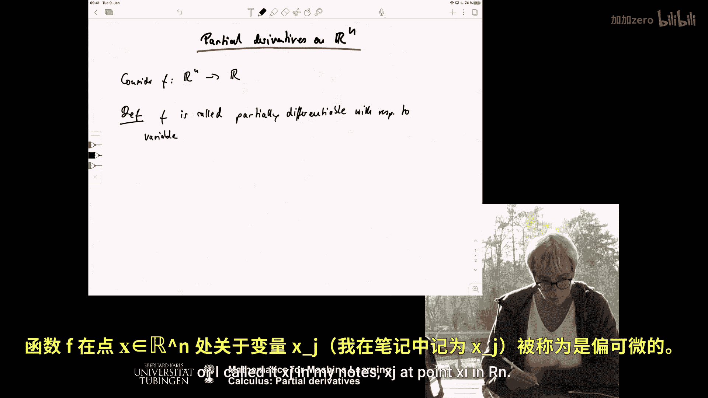

本节课中我们一起学习了高维函数微分的基础——**偏导数**。我们明确了其定义，即固定其他变量，仅对某一特定变量求导。我们分析了其计算步骤，并通过具体例子和代码进行了演示，最后探讨了其几何意义。理解偏导数是理解后续更复杂的梯度、方向导数等概念的关键基石。在下一节中，我们将基于偏导数，构建出机器学习优化中的核心工具——**梯度**。