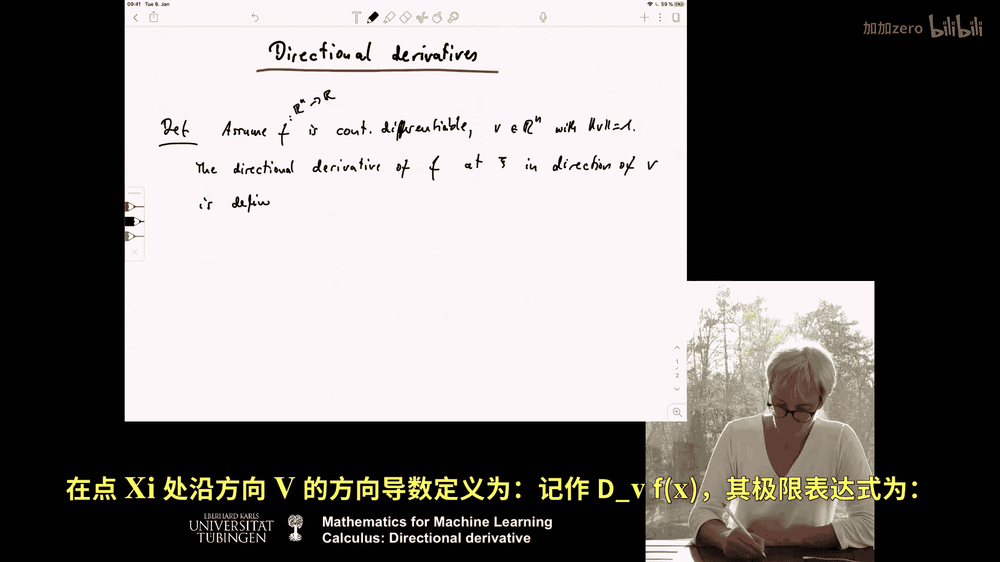

# 050：方向导数 🧭

在本节课中，我们将要学习方向导数的概念。方向导数是偏导数的推广，它描述了函数在任意指定方向上的变化率，而不仅仅是沿着坐标轴方向的变化。

## 从偏导数到方向导数

上一节我们介绍了偏导数，它描述了函数在多维空间中沿着某个坐标轴方向的变化情况。

偏导数的直观理解是：对于一个定义在多维空间上的函数，当我们固定其他所有坐标值，只让其中一个坐标（例如第一个坐标）变化时，观察函数值如何变化。

现在，我们可以将这一原理推广到任意方向。我们可能想知道，如果沿着一个并非坐标轴的方向（例如图中所示的斜向箭头）移动，函数值会如何变化。

## 方向导数的定义

以下是方向导数的正式定义。

假设函数 **F** 是可微的（为简化起见，至少是连续的）。我们想要定义函数 **F** 在方向 **V** 上的方向导数。

设 **F** 是一个从 **R^n** 映射到 **R** 的函数。**V** 是 **R^n** 中的一个向量，并且其范数为1（即单位向量）。

方向导数定义如下：

**方向导数公式**：
`D_v F(x) = lim_{h -> 0} [ F(x + h*v) - F(x) ] / h`

其中：
*   `D_v F(x)` 表示函数 **F** 在点 **x** 处沿方向 **V** 的方向导数。
*   `v` 是单位方向向量（`||v|| = 1`）。
*   `h` 是一个趋近于0的标量。

## 总结

本节课中我们一起学习了方向导数。方向导数扩展了偏导数的概念，使我们能够计算函数在任意指定方向上的瞬时变化率。其核心是考虑函数值在点 **x** 处沿着单位向量 **v** 的微小位移 `h*v` 时的变化，并通过极限来定义该方向上的导数。