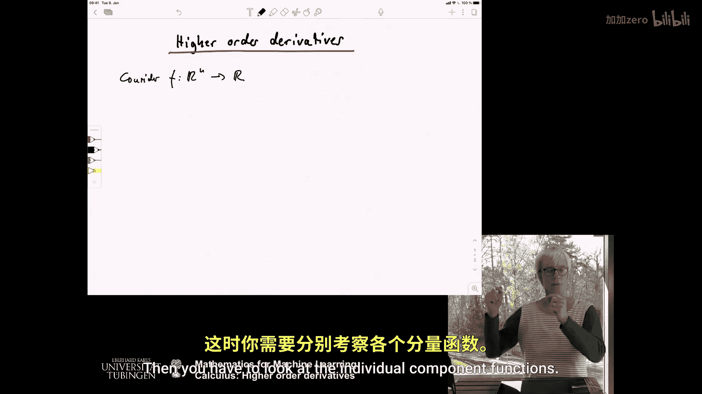
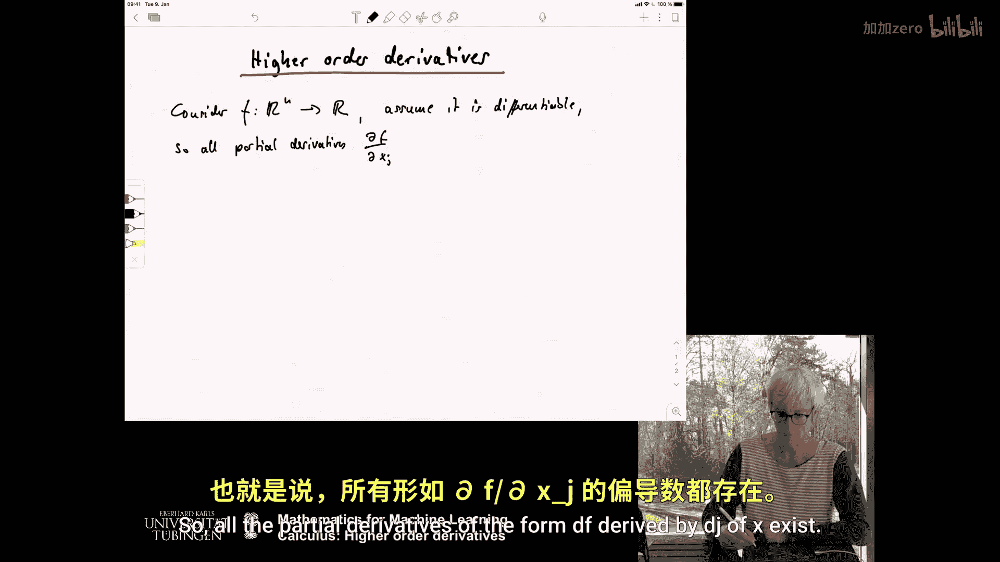
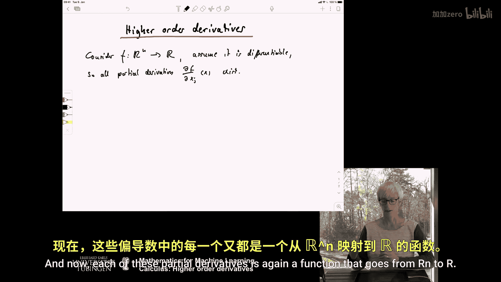
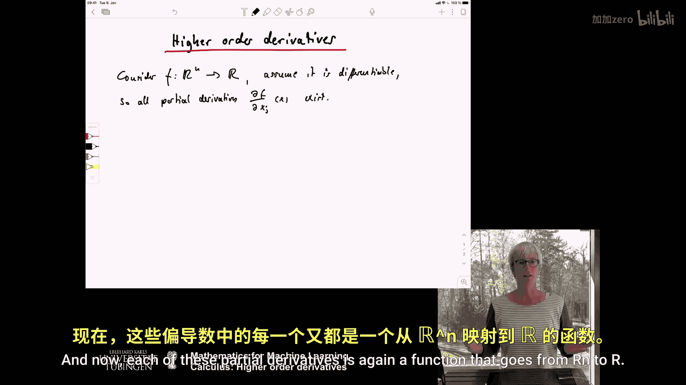
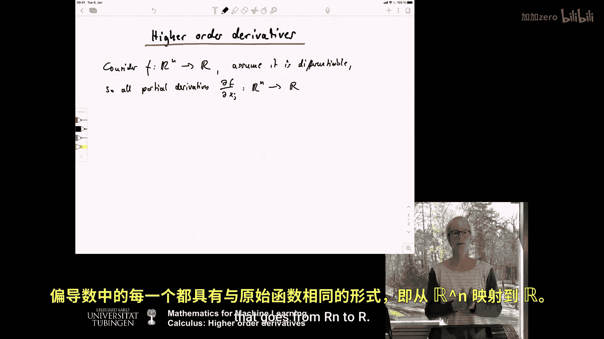
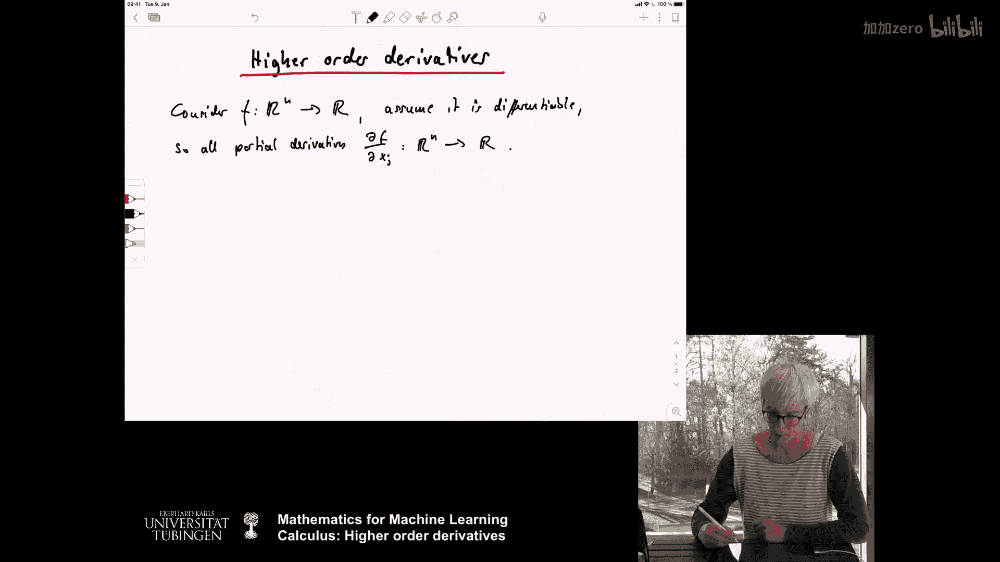
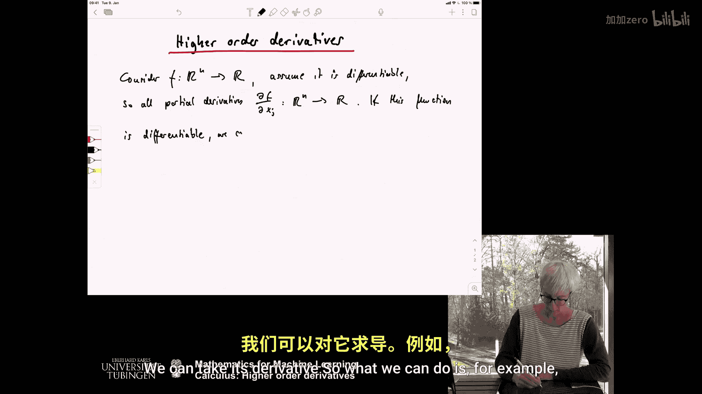
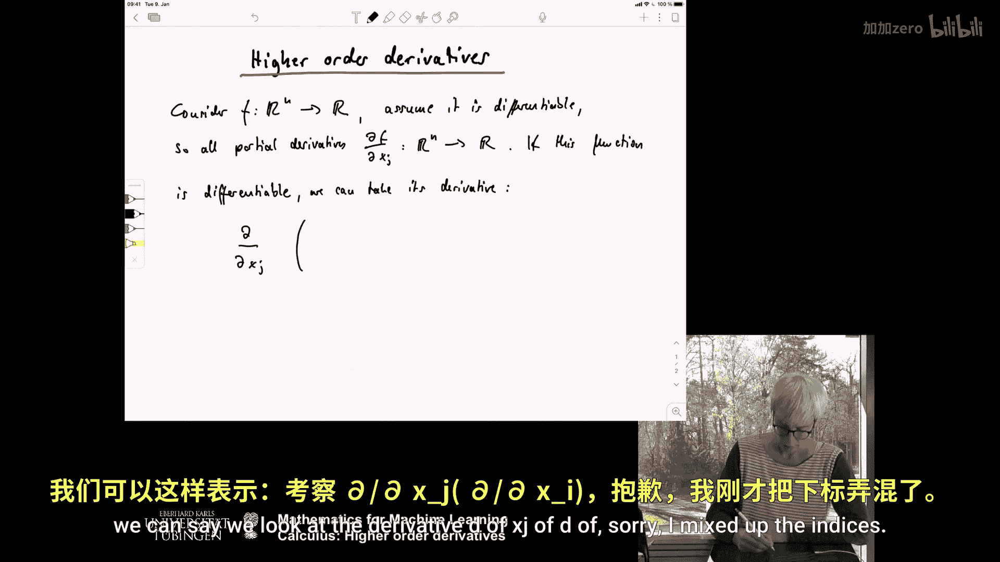

# 051：R^n上的高阶导数 📈


在本节课中，我们将要学习高维空间中的高阶导数概念。上一节我们介绍了偏导数、全导数和方向导数，本节中我们来看看如何定义和计算二阶及更高阶的导数。


我们考虑一个函数 **F**，其定义域为 **R^n**，值域为 **R**。为简化起见，我们选择目标空间为一维。当然，如果目标空间是多维的，此概念同样适用，只需分别考察其各个分量函数。


我们假设函数 **F** 是可微的。这意味着所有形式为 **∂F/∂x_j (x)** 的偏导数都存在。





每个偏导数本身也是一个从 **R^n** 映射到 **R** 的函数。因此，如果这个偏导数函数也是可微的，我们就可以再次对它求导。




以下是高阶导数的定义过程：






1.  首先，对原函数 **F** 求关于变量 **x_j** 的偏导数，得到一阶偏导数函数 **∂F/∂x_j**。
2.  接着，如果 **∂F/∂x_j** 可微，我们可以对其再求关于变量 **x_k** 的偏导数。
3.  这个过程得到的结果称为二阶偏导数，记作 **∂²F/(∂x_k ∂x_j)** 或 **D_{kj}F**。


用公式表示，二阶偏导数为：
```
∂²F/(∂x_k ∂x_j) (x) = ∂/∂x_k ( ∂F/∂x_j (x) )
```







我们可以继续这个过程，对二阶偏导数再求导，得到三阶或更高阶的偏导数。这些高阶导数在优化、物理建模和机器学习中（例如在牛顿法或理解损失函数的曲率时）至关重要。






本节课中我们一起学习了高维函数高阶导数的概念。我们了解到，高阶导数是通过对低阶导数函数连续求偏导得到的，它们提供了函数在一点附近更精细的变化信息。