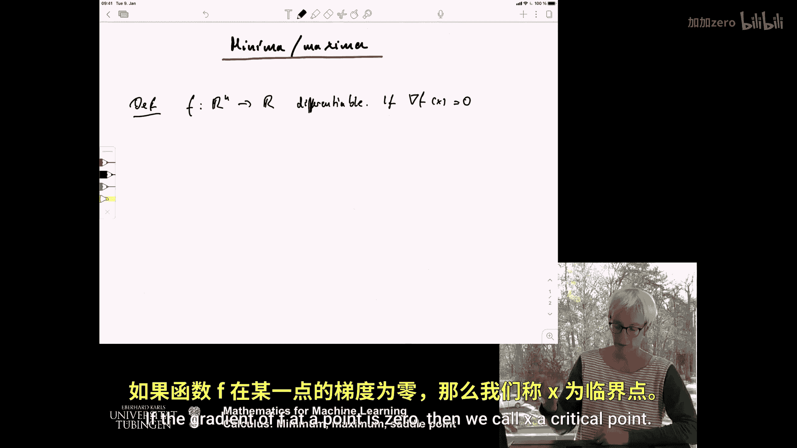

# 052：极值点与鞍点 🔍

在本节课中，我们将要学习如何利用导数来寻找函数的最小值、最大值和鞍点。这些概念是几乎所有机器学习优化算法的核心，因为机器学习本质上就是通过最小化损失函数来找到最佳模型。

上一节我们介绍了导数和梯度的概念，本节中我们来看看如何利用梯度来寻找函数的极值点。

## 为什么梯度如此重要？🎯

我们在这门课程中如此关注求导的原因是，几乎所有的机器学习算法最终都归结为解决一个优化问题。

在机器学习中，你有一个损失函数和一个函数空间。你的目标是从这个庞大的函数类中挑选出最能描述你手头数据的最佳函数。通常，你会指定一个损失函数，可能还有一个正则化项，然后希望找到最佳函数。这通常意味着你需要最小化损失函数。因此，最终我们需要解决一个最小化问题。

为了找到一个函数的最小值，我们通常会观察其梯度。

一旦我们了解了梯度，我们还需要判断找到的点是最小值、最大值还是鞍点。这正是本节课要简要概述的内容。

## 定义与背景 📖

考虑一个函数 **f: ℝⁿ → ℝ**。在机器学习背景下，ℝⁿ 中的点可能是你的输入点，例如描述你感兴趣对象的特征向量。这些对象可能是你想要分类的分子、客户等等。

因此，这些对象由 ℝⁿ 中的向量描述，而函数的输出最终将是一个实数，例如损失函数的值。我们假设这个函数是可微的。

在机器学习中，你最初可能想到的“自然”损失函数往往并不可微。例如，在分类问题中，自然的损失函数是判断分类正确与否，这是一个0-1函数，一个离散函数，非常难以优化。因此，我们通常的做法是：

以下是我们的替代方案：
*   我们选择替代的损失函数，这些函数可能具有相似的性质，但至少是连续的，理想情况下也是可微的。
*   否则，我们无法真正推导或写出优化算法。
*   然后，我们优化这个替代损失函数，并希望（有时也能证明）通过优化替代损失函数，我们也能优化我们真正感兴趣的那个损失函数。

这就是为什么我一开始就说，假设这个函数是可微的。

## 关键概念：临界点 ⚠️

那么，什么是临界点？

如果函数 **f** 在某一点的梯度为 **0**，即：

**∇f(x) = 0**

那么我们就称点 **x** 为函数 **f** 的一个**临界点**。

在临界点处，函数的变化率为零，它可能是局部最小值、局部最大值，也可能是鞍点。区分这三种情况是优化过程中的关键步骤。

本节课中我们一起学习了如何通过梯度为零的条件来寻找函数的临界点，并了解了在机器学习中，我们通常需要构造可微的替代损失函数来进行有效的优化。理解临界点的类型（最小值、最大值、鞍点）对于后续学习具体的优化算法至关重要。