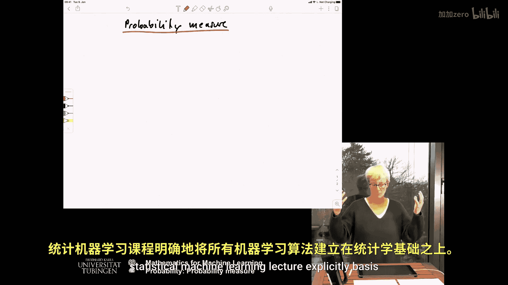

# 054：概率测度的定义 📊

在本节课中，我们将开始学习概率论。概率论是理解机器学习的核心领域之一。

## 概述

机器学习的一个标准流程是：我们接收一些训练数据，希望从中学习，并得出适用于整个潜在总体的结论。我们通常使用概率论来建模训练数据的获取方式。例如，我们可以假设数据点是从某个地方“采样”得到的。这种从有限样本的结论推广到更大样本空间的方法，本质上是统计学的内容。而实现统计学所需的工具，正是概率论，因为它定义了“从空间采样”、“概率测度”和“概率分布”的含义。在机器学习中，概率论无处不在，无论是统计机器学习、概率机器学习，还是对学习现象本身的建模，都离不开它。

上一节我们介绍了概率论在机器学习中的重要性，本节中我们来看看概率论的基础——概率测度的定义。

## 概率测度的定义

要讨论概率论，我们首先需要引入概率测度的概念。我们已经在前面的微积分课程中学习过测度、σ-代数（Sigma代数）和可测空间。如果你还没有看过这些课程，建议你先学习关于σ-代数和测度的内容，因为这是我们今天所有讨论的基础。

以下是对测度和σ-代数的快速回顾：

*   **σ-代数**：在一个样本空间 Ω 上，一个σ-代数 A 是 Ω 子集的集合，满足：
    1.  Ω ∈ A。
    2.  如果 A ∈ A，那么它的补集 A^c ∈ A。
    3.  对于可数个集合 A₁, A₂, ... ∈ A，它们的并集 ∪_{i=1}^{∞} A_i ∈ A。
*   **测度**：在一个可测空间 (Ω, A) 上，一个测度 μ 是一个函数 μ: A → [0, ∞]，满足：
    1.  μ(∅) = 0。
    2.  σ可加性：对于A中任意两两不相交的可数集合序列 {A_i}，有 μ(∪_{i} A_i) = Σ_{i} μ(A_i)。

**概率测度** 是一种特殊的测度。在一个可测空间 (Ω, A) 上，一个概率测度 P 是一个函数 P: A → [0, 1]，它满足测度的所有性质，并且额外满足：
*   **归一化条件**：P(Ω) = 1。

用公式表示，概率测度 P 满足：
1.  **非负性**：对于所有 A ∈ A，P(A) ≥ 0。
2.  **空集为零**：P(∅) = 0。
3.  **可数可加性**：对于A中任意两两不相交的可数集合序列 {A_i}，有 P(∪_{i} A_i) = Σ_{i} P(A_i)。
4.  **归一性**：P(Ω) = 1。

三元组 (Ω, A, P) 被称为一个**概率空间**。其中，Ω 是样本空间（所有可能结果的集合），A 是事件域（我们能够谈论概率的事件的集合），P 是概率测度（为每个事件分配一个概率值的规则）。

## 总结

本节课中我们一起学习了概率论的基础——概率测度的定义。我们了解到，概率测度是一种特殊的测度，它为可测空间中的事件分配一个介于0和1之间的概率值，并且所有可能结果的概率总和为1。由样本空间、事件域和概率测度构成的三元组称为概率空间，它是所有概率论讨论的严格数学基础。理解这个概念，是后续学习概率分布、随机变量和统计推断的关键第一步。