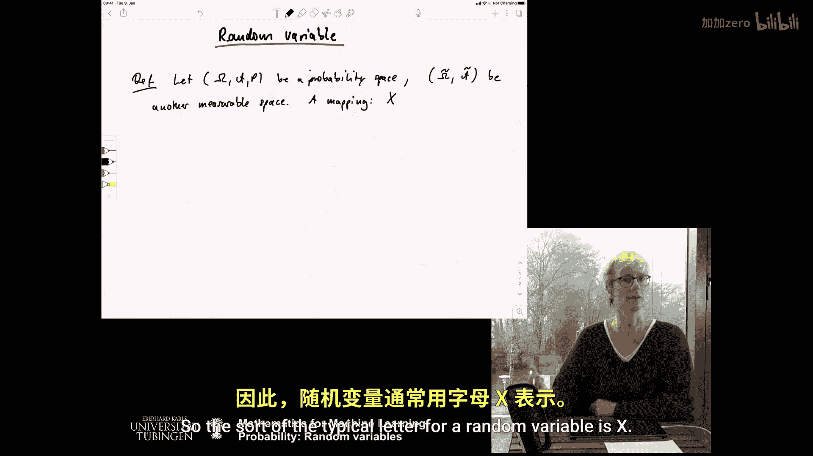

机器学习数学：5：随机变量

在本节课中，我们将介绍随机变量的概念。随机变量是概率论的核心概念之一，它允许我们对样本的特定属性进行建模和测量。

---

### 随机变量的直观理解

直观上，随机变量是可以在样本上测量的任何属性。

例如，考虑世界人口。你的概率度量定义在世界上所有人的空间上，它描述了抽样到特定个人的概率。但我们真正感兴趣的属性可能是这个特定个人的身高，或者这个人的收入。在机器学习中，我们甚至可能对其他类型的属性感兴趣。

因此，评估概率空间中基本事件（即基本对象）的属性，通常就是通过随机变量来建模的。

另一个例子是掷两次骰子。你的概率空间由可能得到的基本事件（如(1,2)、(3,4)等）组成。但我们实际感兴趣的是两次结果的总和。这个“总和”就是一个随机变量。

接下来，我们将正式引入这个概念。在概率论中，几乎所有内容都建立在随机变量的基础上。除了概率度量本身，这可以说是最重要的定义之一。

---

### 随机变量的形式化定义

我们考虑一个概率空间。设 **(Ω, A, P)** 为一个概率空间。这里，Ω 是样本空间，A 是σ-代数，P 是概率度量。这个空间包含了我们可以抽样的对象。

然而，我们通常对样本的某些测量结果感兴趣，这些结果往往位于另一个不同的空间中。因此，我们需要第二个空间。我们将其表示为 **(Ω̃, Ã)**，这是另一个可测空间，它将作为目标空间。

现在，我们考虑一个映射，通常用 **X** 表示（这是随机变量的典型字母）。这个映射的形式是：
**X: Ω → Ω̃**

这个映射 **X** 需要满足一个关键条件：它必须是**可测的**。这意味着对于目标空间 **(Ω̃, Ã)** 中的任何可测集合 **B ∈ Ã**，其在 **X** 下的原像 **X⁻¹(B)** 必须属于原始概率空间的σ-代数 **A**。用公式表示就是：
**∀ B ∈ Ã: X⁻¹(B) ∈ A**

满足这个条件的映射 **X** 就被称为一个**随机变量**。它正式地将我们从一个抽象的概率空间，连接到了我们实际关心的、包含测量值（如身高、总和等）的具体空间。

---

### 总结

本节课我们一起学习了随机变量的概念。我们从直观的例子入手，理解了随机变量是样本属性的数学抽象。然后，我们形式化地定义了随机变量：它是一个从一个概率空间 **(Ω, A, P)** 到另一个可测空间 **(Ω̃, Ã)** 的可测映射 **X**。这个定义是概率论和统计学后续所有工作的基石，它允许我们将现实世界中的不确定性测量转化为严谨的数学对象进行处理。