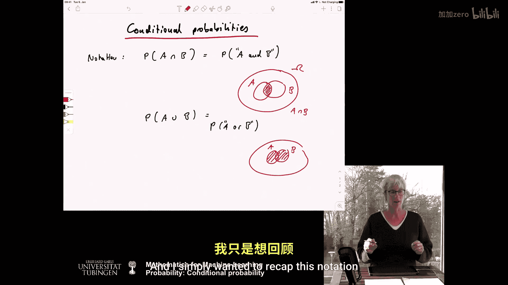

# 059：条件概率

在本节课中，我们将要学习概率论中的一个核心概念——条件概率。条件概率用于描述在已知某个事件已经发生的前提下，另一个事件发生的概率。我们将通过掷骰子的例子来直观理解这个概念，并学习其数学定义和符号表示。

## 条件概率的直观理解

上一节我们介绍了概率的基本概念。本节中我们来看看条件概率。条件概率是概率论中的关键概念之一，它用于描述在已知另一个事件已经发生的条件下，某个事件发生的概率。

例如，考虑掷两个骰子求点数之和。如果你已经知道第一个骰子的点数是1，那么最终的点数之和就不可能达到12。因为第二个骰子的点数范围是1到6，所以总和最多只能达到7。

如果第一个骰子显示的是6，那么结果就会不同。因此，根据我对第一个骰子已知信息的不同，对于两个骰子点数之和这一事件，我会得到不同的概率分布。这正是条件概率分布想要建模的情况。

## 事件运算符号

在正式开始之前，我想再介绍一个之前未提及的符号，因为后续会频繁使用。

我们经常会讨论两个事件的概率。设A和B是σ-代数中的两个元素（即两个事件）。我们想讨论它们的交集 `A ∩ B` 的概率。

`P(A ∩ B)` 直观上表示事件A和事件B同时发生的概率。假设这是我们的样本空间Ω，这是事件A，这是事件B。它们的交集就是中间重叠的部分。一个样本点属于交集，当且仅当它既属于A也属于B。

理解这个符号非常重要。交集符号 `∩` 表示逻辑“与”（and）。

当然，我们还有并集 `A ∪ B`，其概率 `P(A ∪ B)` 表示事件A或事件B发生的概率。用图形表示，第一个是A与B的交集，而A或B的并集则是包含A和B在内的整个区域。它可以是A或B中的任何一个，甚至可以同时包含交集中的部分，但整体上代表A或B发生。

## 条件概率的定义

现在，我们正式引入条件概率的定义。

设 `(Ω, A, P)` 是一个概率空间，`B ∈ A` 是一个事件，且 `P(B) > 0`。那么，在给定事件B发生的条件下，事件A发生的**条件概率**定义为：

`P(A | B) = P(A ∩ B) / P(B)`

这个公式可以理解为：在事件B发生的“新世界”里，事件A发生的概率，等于A和B同时发生的概率（`P(A ∩ B)`）占事件B发生的概率（`P(B)`）的比例。

## 总结

本节课中我们一起学习了条件概率。我们首先通过掷骰子的例子直观理解了条件概率的含义：已知部分信息会如何改变我们对事件发生可能性的判断。接着，我们回顾了事件交集 `∩`（与）和并集 `∪`（或）的符号及其概率含义。最后，我们给出了条件概率的正式数学定义 `P(A | B) = P(A ∩ B) / P(B)`，这是概率论和机器学习中后续学习贝叶斯定理等概念的基础。